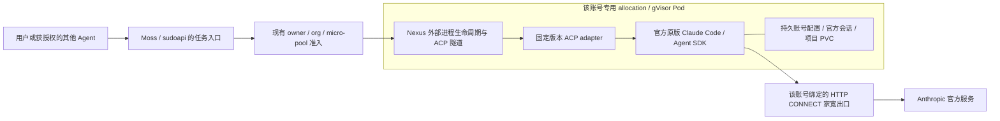

# 官方 Claude Code 作为 Cloud Agent 运行时

日期：2026-11-04。这是新增运行时的接入设计与准备制品。现有生产 cohost/scode
保持原来的版本、契约与验收状态；CC 尚未作为生产 A2A worker 注册。

## 任务链路与模型链路

ACP 传送任务、工具事件、审批、取消与续接。官方 CC 拥有自己的系统 prompt、工具
循环、上下文和 provider 请求。不能把任意 `/v1/messages` 请求无损塞进 ACP 后
继续宣称 API 的 system/tools/stop/cache/token 语义不变。sudoapi 可提供账号与
出口登记、任务准入和状态 API；普通 LLM API 转发保留自己的显式路由。

原生 cohost 的 `SpawnTask<Kernel>` 当前运行 scode；新增 CC 使用独立的外部 ACP
进程路径，不把闭源 CC 链进 Rust，也不要求修改官方二进制。Nexus 已有的
`spawn_spec` 与 fd 隧道可作为候选接缝；当前 Moss 的 `CohostBackend` 则要求
`acp-mailbox/1`、持久原生会话和 scode hostContext，因此不能仅改 command 就使用。
必须核验所选发行版真实支持的隧道，并在 Moss 做独立适配，不能伪造 mailbox endpoint
或 durable_session_id。跨仓 Task variant 变化仍从 Moss 语义来源产生并精确生成。

准备制品在 `tools/deploy/claude-runtime/`：固定 upstream adapter 0.100.0、官方
SDK 0.3.316，lockfile 固定完整依赖与平台二进制完整性。镜像层保留既有 cohost
入口；启动器不改官方 prompt、header 或模型请求。真实 ACP initialize/EOF 与
官方 CLI `--version` 是启动证据，不能当作生产任务验收。

## 身份、Pod 与出口

绑定为 `owner + org + micro-pool + provider account → allocation/PVC + assigned exit`。
owner 身份和池权限复用现有权威；账号及出口绑定来自 FujiToken inventory。
共享家宽是 inventory 中显式声明的例外，不允许混用账号状态或跨池调度。
首个生产实例的 owner/组织、本人订阅及真实 repo/issue 尚待选择。

gVisor 适合隔离工具执行，但不是网络防火墙、匿名身份、凭据保险箱或风控保证。
非 root、独立 PVC、无 host home/Docker socket/云管理凭据、关闭 SA 自动挂载，
复用现有网络策略和短期 owner 委派。API 流量只到固定 HTTP CONNECT 代理，拒绝
直接云出口回退；官方 CC 不支持 SOCKS，现有混合监听器应使用其 HTTP 入口。

每个账号保留 `/data/claude/<accountId>`，包括官方配置、凭据、官方 session、
workspace 路径与需要的身份状态，不能只持久化某个 OAuth 字段。Pod 单 writer
租约跨控制器生效。空闲后可以释放 Pod，任务结束后无需立即回收整个 allocation。
取消先通过 ACP，中断结果与状态落盘后再退休；强杀和失联归为 unknown，不重发
已经 accepted 的任务。重启恢复同一官方 session，不换新身份继续原调用。

## KV cache 与隐私基线

provider KV cache 在 Anthropic 侧；PVC 不能保存它，也不能保证 Pod 重建后命中。
保持同一账号/模型、稳定 system/tool 前缀和官方 session，记录官方返回的 cache
read/create 用量。避免无目的重建进程、切换 provider 与 prompt 顺序；TTL 到期
按真实 miss 处理。不能为了提高命中伪造官方 header、设备或 session。

CLI 用官方 `CLAUDE_CODE_DISABLE_NONESSENTIAL_TRAFFIC=1` 关闭可选流量；关闭
官方 marketplace 自动安装，固定发布版本并禁自动更新。镜像 managed policy
与 launcher 共用这些值；不禁 WebFetch 安全检查或必须的 auth/inference 请求。

网页基线在本人专用、固定出口 profile 上核对账号，然后关闭 Location metadata
与 Help improve our AI models，刷新后复核保存。Ladder `claude_privacy.py` 是共用
实现，授权前及手工 callback 恢复时均执行；缺项、新增未知开关、错号或保存失败
均停在待验收。它不删除历史、关安全功能或声称隐藏服务方必要的 IP 安全记录。

## 真任务验收与 A2A

一次有实际用途的小型公开 repo 工作可以作为账号上线验收：记录固定源码、任务
目标、权限和预算，由其他已授权 Agent 通过现有任务入口分配；CC 实际读代码、
修改文件、运行相关检查并交付 diff/commit 或 PR。验收保存客户端来源与可执行
摘要、账号/出口、官方 session、工具事件、结果和用量；日志不保存 Authorization
头或完整凭据。不为验收刷 token，也不自动生成重复任务。

还需分别验：跨 owner/池拒绝；工具允许/拒绝/超时；流式输出与取消；同官方
session 冷恢复；接收已成功但响应丢失时查询旧任务而不重复提交；退出不可用时
fail closed；账号撤权立即停止准入。一次真实任务只证明该次运行，不能证明不会
被风控、额度无限或所有 API 兼容。Agent-task 验收不会自动启用原来的 raw API 号池。

Anthropic 支持程序化 CC、Agent SDK、subagents 与 agent teams；A2A 本身不是
全面禁止的行为。现行订阅 SDK / `claude -p` 说明仍允许本人订阅登录消耗本人额度，
不能由此推导订阅账号转售、跨用户凭据池或托管中介都被许可。生产按实际授权
使用者的账号与计划执行；组织共享/对外服务应选适用的官方授权形式。

## 官方依据（本次核对）

- [程序化 CC、bare 的 API-key 限制与中断语义](https://code.claude.com/docs/en/headless)
- [订阅、Agent SDK 与 claude -p 的现行额度说明](https://support.claude.com/en/articles/15036540-use-the-claude-agent-sdk-with-your-claude-plan)
- [身份凭据与托管使用边界](https://code.claude.com/docs/en/legal-and-compliance#authentication-and-credential-use)
- [Agent teams](https://code.claude.com/docs/en/agent-teams)
- [实际 ACP adapter 源码](https://github.com/agentclientprotocol/claude-agent-acp)
- [CLI 遥测与可选流量](https://code.claude.com/docs/en/data-usage#telemetry-services)
- [HTTP 代理配置](https://code.claude.com/docs/en/network-config)
- [容器配置与持久目录](https://code.claude.com/docs/en/devcontainer)
- [可选位置元数据与必要 IP 安全处理](https://privacy.claude.com/en/articles/11186740-does-claude-use-my-location)
- [gVisor Kubernetes 部署](https://gvisor.dev/docs/user_guide/quick_start/kubernetes/)
