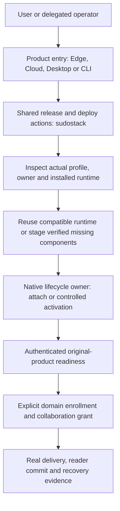

# Shared deploy and cross-domain Agent collaboration

Status: the shared checkpoint/configuration/version-selection actions have
deployed the real existing DGX SudoWork/Moss/cohost product. Original Agent,
owner, durable SID and projected history were preserved; three real local-model
turns and reattach/recall passed. Cross-domain join and seven-party delivery are
still unfinished. Existing Cloud Agents are the next consumer of the same
contracts.

## Ownership and target

Cloud and Edge consume one deployment spine. They retain different placement
adapters: Kubernetes and owner allocations on Cloud, existing user services,
local models and appliance networking on Edge. Neither adapter owns another
authentication protocol, mailbox implementation or credential issuer.

| Concern | Owner |
| --- | --- |
| CA verification, current peer classification, revocation, authorization, durable A2A objects | nexus-vfs |
| Resolved managed Agent, session execution, send/list/receiver, ACP | sudocode |
| Shared release composition, deploy/join sequencing and evidence | sudostack |
| Appliance service/GPU/network selection and deployment record | sudoedge |
| Cloud tenant/allocation/Kubernetes selection | sudocloud / existing Moss adapter |

The DGX acceptance runtime is `SudoWork -> Moss -> local ManagedAgentService ->
in-process scode -> local Nexus`. Its collaboration writes must pass that
local Kernel's authorization and configured content gate. Directly connecting
an unrelated CLI to the remote broker would qualify a different path.

Runtime placement and process ownership are defined in
[deployment profiles](../deployment-profiles.md). Moss orchestrates the managed
product's owner, Agent and Session; Nexus ManagedAgentService and the scode
adapter create its execution. Standalone scode owns its own process and Session.
SudoCloud is a placement/control option rather than a prerequisite for local
execution or authenticated Agent collaboration.

`deploy` assembles, inspects, stages, activates and verifies a runtime and its
connections. `spawn` creates an execution under a resolved Agent and owner.
`move` transfers durable state with writer fencing. Deploy does not implicitly
spawn another identity or implement move by copying a directory.

## Runtime preparation

These are shared assembly decisions. A complete device bootstrap/join entry
and bounded device-delegation executor remain implementation work
(`enforced_by: none`). Existing native service bootstrap, placement, checksum
and original-product tests qualify their own actions separately.

The delivery unit is a source/digest-pinned release composition plus a private
device profile. It selects the actual platform, runtime form, native component
compatibility, persistent roots and lifecycle owner. Online download and an
offline package provide the same verified component bytes and action entry;
the artifact's trusted digest comes from the approved composition. A deployment
receipt binds that composition to the observed running executable and product
readiness.

Sudocode's existing `service-host` owns local Nexus artifact verification,
installation, authenticated local discovery and service lifetime. SudoWork's
desktop `ScodeRuntimeService` and `ScodeServiceClient` invoke `scode service
stdio`; the old Desktop Nexus installer has been removed. Standalone CLI runtime
selection consumes this same owner. The native contract and acceptance live in
[sudocode shared services](https://github.com/sudoprivacy/sudocode/blob/main/docs/shared-services.md).
SudoWork owns application progress and Electron integration. Nexus owns the
credential format and Kernel; no application duplicates its issuer or service
installer.

Stack owns product release composition and deployment sequencing. Its existing
`tools/deploy/artifacts.py` verifies deployment assets before atomic publication;
the Nexus component installer remains in sudocode. Linux executable placement
and existing-product transitions already have their own actions. A common entry
composes these source-owned actions with native identity/readiness operations.

For standalone scode, ordinary local execution uses the already linked
in-process Kernel. Selecting persistent or network collaboration can prepare
a compatible local service or attach to an existing one. For cohost, the
selected executable already contains Nexus and the scode engine; starting an
Agent creates a session task in that daemon. A browser profile additionally
prepares the existing Moss/WebUI application services. GPU/model provisioning
is an Edge placement concern, independent from obtaining an Agent identity.

The lifecycle owner records the runtime and state roots it controls. An
existing listener is inspected and authenticated before reuse. A conflicting
listener or incompatible state produces an actionable refusal; killing an
unknown process by port is not the shared adoption procedure. The DGX's current
Node/cohost, original Agent and model state remain the deployment target.

### First installation and updates

First-run runtime preparation, manual update and scheduled update use the same
source-owned artifact selection, verification and staging operations. The
frontend presents the choice; the lifecycle owner applies it. A local CLI
profile retains daemon-free execution, while shared services are an explicit
installation choice. Protocol/headless clients retain noninteractive startup.

The scode release updater already shares installation between startup prompts
and `scode update`. The product's next integration binds that CLI package to
the shared-service composition and controlled maintenance step
(`enforced_by: none`). SudoWork's Electron updater continues to update the
desktop application; it delegates runtime operations to sudocode. Pinned
enterprise profiles retain their approved release selection. Installing a new
frontend or a cached latest release does not authorize replacing another
client's active daemon, identity or state.

## Authority at each operation

These assembly boundaries guide the product entry. A single machine-enforced
deploy delegation is still pending (`enforced_by: none`); today's SSH account
permissions remain the actual host authorization boundary.

| Operation | Authenticated principal and enforcement owner |
| --- | --- |
| Prepare or switch a device runtime | Device owner's OS account or explicitly delegated installer; device-side executor checks the approved release/plan and allowed effects |
| Start or resume a managed Session | Moss-authenticated human/owner, delegated session credential, and native ManagedAgentService owner binding |
| Run standalone scode | Invoking OS user and the CLI's actual local Session; network admission additionally requires the selected native Agent credential |
| Join a collaboration space or send/receive | Actual Agent mTLS principal, current domain trust/revocation and explicit participant grant, enforced by Nexus |

SSH can carry the initial package and invoke the same product entry. Once
enrolled, an authenticated device-control channel can request that entry too.
Both transports need the same local authorization decision. Receiving an A2A
message proves its sender; executing a deploy requires separate delegation.
The planned delegation binds the operator, device, deployment profile, approved
release/plan, bounded actions/state roots, expiry and revocation. Its effective
OS permissions must match that scope; a checked plan inside a broadly
privileged SSH account alone does not establish confinement. Reuse the native
authority and credential machinery rather than minting another installer CA.

Cross-domain Agent authentication uses native Nexus mTLS under the actual
scode Agent's principal in either host form. The receiving Kernel authorizes
that principal; a shared Node credential cannot stand in for it. Moss can
authenticate a human, obtain native delegated credentials and request enrollment
under that owner's authority.
Two Moss servers do not have to trust one another for their Agents to speak,
and a standalone CLI can use the same native Agent identity and grant. Account
SSO, model-provider access and machine-administration permission retain their
own scopes.

Moss also owns the enterprise's Agent inventory, management level, delegation,
lifecycle and audit view. Joining a chat establishes the admitted principal and
participant permissions; it does not establish complete containment of an
external Agent's execution. The product's gateway-managed and hosted-execution
levels retain their different enforcement scopes. The DGX development/office
collaboration profile can admit scoped bidirectional messages; core-business
domain policies retain their separate controlled artifact-publication boundary.

## Existing source, separately from the proposal

The source cut for the Nexus findings is `v0.8.23`; the composed scode cut is
`f6cb2593bcb7cc51ab00c2f801d6f327d4c6e822`. Review these exact owner sources:

- Nexus `proto/nexus/raft/transport.proto`: node-authorized live
  `RegisterForeignCa`, `ListForeignCas`, `UnregisterForeignCa` already exist.
- `rust/transport/src/peer_identity.rs`: classification verifies signatures
  against local and registered foreign anchors. A foreign CA can attest an
  Agent, and cannot turn its certificate into a local cluster Node.
- `rust/transport/src/auth.rs`: `resolved_agent_id` qualifies a foreign Agent;
  `display_id` is presentation and is not a canonical input constructor.
- `rust/a2a/src/foreign_containment.rs`: current foreign access is primarily a
  path-shape boundary. Transcript admission does not bind the caller to that
  conversation's participants. Every foreign reader-register write is denied.
- `rust/a2a/src/addresses.rs`: conversation IDs derive from participant strings;
  chat-list paths assume a single Agent segment. Qualified foreign names need
  an explicit address encoding and common participant identity on both sides.
- scode `engine-host/src/managed_agent.rs`: the managed task builds its mailbox
  over the same `KernelFsBackend` as file tools. A remote client injected in
  place of that backend would bypass the required local path.
- scode `runtime/src/mailbox.rs`: discovery, index creation, stream provision,
  seat acquisition and the Agent's own reader commits are part of operation.
  A handshake and one remote append do not prove this lifecycle works.

Consequently CA registration alone is not a completed domain join. The
existing local six-peer network is not evidence for cross-domain isolation.
Do not widen generic VFS foreign access just to make its receiver work.

## Join, authentication and authorization

The following are selected design constraints, not claims about deployed code.

1. **Domain enrollment** binds the full SHA256 of the registered anchor's DER
   SubjectPublicKeyInfo (SPKI), plus its public certificate, to an operator
   approved domain and endpoint. Exchange public anchors only. Keep private
   CA keys on their existing authority. Validate the remote server under an
   explicitly trusted anchor and expected service identity; do not disable TLS
   or enroll a foreign domain as a Raft voter to obtain mailbox access.
   The existing foreign-CA registration API separately pins complete-certificate
   DER; do not pass the new address's SPKI authority as that registry key.
2. **Agent authentication** comes from the actual mTLS peer and the current
   installed verifier. A typed principal binds issuer fingerprint, subject
   kind and the signed Agent identity. A profile, body field, PID, display
   label or broker host is not that principal. The local cohost must bind an
   outbound leaf to its authenticated resolved Agent/owner; a shared Node or
   controller credential cannot impersonate all hosted Agents.
3. **Collaboration authorization** is distinct from anchor trust. An explicit,
   scoped grant authorizes the participating principals and collaboration
   space. It confers no owner adoption, local filesystem, secret, model,
   administrative or cluster membership permission. Reuse the existing
   authoritative control store and immutable conversation metadata. Do not
   introduce a second directory/identity database or a relay daemon.
4. **Current authority** is rechecked on every admission, query and receipt
   recovery, including a long-lived TLS connection after expiry or revocation.
   Local issuer continuity, foreign-anchor removal and the applicable current
   CRL must govern access. Cached directory entries are not authorization.
   A control-store admission ordered after revocation must refuse. An already
   admitted operation may finish: this does not promise atomic revocation
   through an append in another zone. A drained/quiescent result additionally
   requires the actual worker fence. Cross-process/offline CRL writers remain
   part of native integration; a process-local mutex does not establish that.
5. **Canonical addressing** must be owned once by Nexus A2A and consumed by
   scode. Both domains must derive the same global participant identity and
   conversation ID. Presentation aliases and path-safe leaf encodings are
   separate. Preserve existing local conversations; negotiate a new capability
   for a new cross-domain shape, and explicitly refuse unsupported peers.
   No slash replacement, ambiguous concatenation or unannounced ID migration.

The concrete principal encoding, grant fields, participant binding and native
operation capability must be reviewed in nexus-vfs before producing generated
cross-repo contracts. This document deliberately does not freeze another JSON
schema alongside that semantic owner.

## Data and recovery boundary

Use the existing cohost and Kernel. Its local collaboration mount/backend
must carry the verified Agent's identity to the remote authority and apply
the local content policy before any outbound write. Local session transcripts,
model mounts and collaboration logs stay distinct; mounting over the existing
`/agents` or `/conversations` roots must not replace current product state.

The remote authority must bind an immutable participant set before accepting
operations. It may expose only the authorized transcript/index and the
caller's own reader/receipt operations. Reading or advancing another Agent's
reader is a separate, explicit authorization decision. Do not remove the
current denial for every reader just to repair delivery.

Choose one authoritative transcript per conversation. Local forwarding state,
if required, is delivery/reconciliation evidence, not a second authoritative
transcript. An admission refusal proves no append only at the native pre-write
boundary. A lost response after submission remains **Unknown**; retain the
original operation and reconcile. Do not automatically resend a possibly
committed append or claim exactly-once execution from a successful RPC.

Directory visibility does not prove online status. An outer controller's
active/idle callback acceptance is also distinct from scode consuming a frame.
Existing ownership, approval, pause/worker fences and one-receiver semantics
continue to apply to managed and standalone consumers.

## Shared deploy sequence

1. Inspect actual product adapters, running executable hashes, public issuer
   fingerprints, source/ABI/protocol versions, service ownership and durable
   paths. Do not derive live versions from repository HEAD or filenames.
2. Plan against a pinned release composition. Keep an existing runtime, Agent,
   owner, Session, volume, CA, model configuration and policy unless an explicit
   reviewed transition changes that specific item. Report unsupported native
   capabilities before making trust or runtime changes.
3. Stage source/digest verified, immutable artifacts. `tools/deploy/cohost.py`
   supplies the shared Linux user-service placement step. `inspect` is read
   only, `stage` changes no service, and `install` starts only a fresh unit.
   An existing different unit/runtime requires its native owner-controlled
   drain/adoption path; this installer does not interrupt it or overwrite it.
4. Apply the product's controlled maintenance/admission procedure. Preserve
   unit drop-ins, state and identity. For an existing Linux product, Edge's
   native preparation feeds Stack's shared `checkpoint`, `configuration` and
   `selection` actions. Selection waits for empty process groups, verifies a
   fresh cold copy, installs exact prepared unit bytes, reloads the manager,
   and checks actual executable/application-entry hashes. Executable activation
   is separate from authenticated product readiness and domain joining.
5. Establish the explicit join and scoped grant through supported native APIs;
   reuse an identical existing enrollment and reject conflicting bindings.
   Ambiguous mutation responses are reconciled, not interpreted as absence.
6. Verify authenticated readiness and actual collaboration, then write a
   source-bound deployment/acceptance receipt. A pre-selection failure restores
   original services. After possible selection/migration, stop the declared
   services and preserve new data plus the cold backup for native inspection;
   do not automatically restore an old database over newer writes.

The cohost command's `authenticatedReady:false` and `domainJoinAccepted:false`
are intentional boundaries. A placement receipt cannot become full deploy
acceptance merely because systemd reports active.

## DGX and seven-party qualification

The observed DGX has an existing vault/login service at `22140`, and a distinct
Moss execution cohost with model/content-policy drop-ins at `22141`. These are
existing product state, not disposable fixtures. Keep host locations and secret
paths in the private deployment record and sudoedge device documentation.

Before activation, qualify the actual old data/identity/configuration with the
selected cohost and preserve a tested application rollback. Do not replace the
whole appliance stack, its model or its trust roots as an installer side effect.

Seven-party acceptance requires the six existing participants and a real Agent
in the DGX product runtime. The matrix must include each directed pair and
actual durable append/receive/commit evidence. Explicit one-time acknowledgments
are correlated to cases and are never themselves acknowledged automatically.
Also qualify same-name/different-domain isolation, forged identity, unrelated
conversation access, wrong reader writes, expiry/revocation on a live connection,
content deny/redaction/outage, lost response without resend, restart/reentry,
and preservation of existing local Moss history/model behavior.

Cloud is the next consumer of the same native contracts and common deploy/join
sequence. Its existing Agents and allocation bindings participate in their own
real runtime; another demonstration Agent or a cloud deployment change is not
implicitly authorized by this Edge qualification. Kubernetes placement and
user-owned volumes remain the responsibility of the existing Cloud adapter.
