# Sudo Cloud 架构与设计

每位有 Moss 权限的企业成员拥有一个专属 Moss Agent；个人 Agent 可有多个。它们共用 compute VM → gVisor Pod → cohost/scode，以实际 owner 的权限、独立 Key 与账本执行。

**阅读顺序：** 先看总图，再按主题查正文。当前验收只在「交付与验收」集中说明；带日期的旧状态和完整技术记录保留在折叠附录。设计已确认、代码合入、正式发布、生产部署和真实验收分别记录。

<nav class="topic-nav" aria-label="文档目录">
<a href="#architecture">总图</a><a href="#identity">身份与权限</a><a href="#runtime">运行与会话</a><a href="#deployment">版本与升级</a><a href="#channels">客户端、IM与计费</a><a href="#edge">跨域与盒子</a><a href="#ontology">业务本体</a><a href="#delivery">交付与验收</a><a href="#history">历史证据</a>
</nav>

<a id="architecture"></a>
## 1 · 系统架构

第一图保留 Cloud/Edge 的全部原节点与连线，并补入飞书按人绑定、专属 Moss Agent 及持久 Session。节点分别标明合入、发布、部署与验收状态；Ethan 本人按成员路由、连续对话、共享 WebUI 历史与实际 Key 扣费已验，两人隔离等剩余项见 §9。旧版本、失败与详细验收均保留在正文/附录，不由控制器版本推断计算 Pod 已升级。

<!-- cloud-plan:first-diagram -->
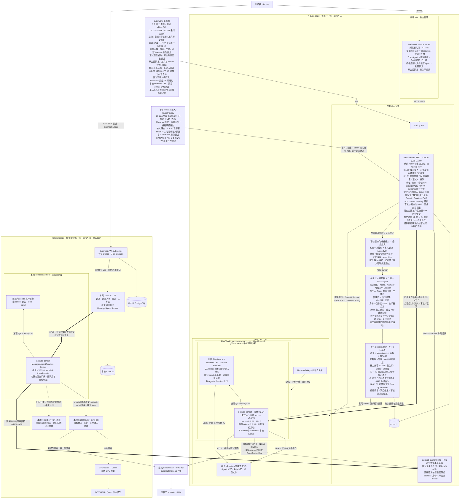

<!-- /cloud-plan:first-diagram -->

<details>
<summary>总图补充：客户端、计算与控制链路</summary>

**盒子部署约定：** WebUI + 本地 Moss + cohost + new-api + GPUStack；无需 Electron，也不为本地会话额外部署 nexusd-cluster。Moss 提供离线可用的登录、历史、工作区与会话 API；ManagedAgentService 在已有 cohost daemon 内创建 scode 会话任务。`sudoedge` 统一负责设备运维，默认 online；`sudo sudoedge connectivity local` 关闭公网出口，`online` 恢复。`/model` 由 sudoedge 在 Nexus 启动后通过 mTLS 配置，Router 重建凭据后同步刷新。

**云与盒子共用 cohost 运行机制。** 云端按 owner 隔离运行环境，盒子按组织的信任边界部署 daemon；同一 daemon 内承载多个 scode 会话。放置与启动职责统一见 [共享部署决策](https://github.com/sudoprivacy/sudostack/blob/main/docs/deployment-profiles.md)，本页记录 Cloud 接入与验收。二进制已发布、机器已有产物、真实会话由它承载分别核验；当前状态统一见 §9。

**云端会话控制直达用户 cohost。** 当前链路为 `Moss → 用户 allocation Pod 的 nexusd-cohost（ManagedAgentService）→ 进程内 scode 会话任务`。Moss 认证调用者，解析持久的 Agent／allocation 绑定并编排 k3s 资源；控制面 nexusd-cluster 提供短期身份签发、secrets 与跨域服务。控制与事件流由 Moss 使用 owner 委托身份直接连接对应 Pod，cluster 不充当这条会话链路的中转。

**会话契约必须完整。** 逐跳接入保留消息发送、流式回复、工具事件、权限审批、取消和恢复，明确 cluster 与 cohost 的 PCB 归属和会话定位。信箱消息与浏览器会话事件通过协议适配；外部 spawn 兼容路径保留 fd 隧道契约。Cloud 的当前 cohost 入口与真实验收见 §3、§9，旧外部 scode 部署记录见附录。

**模型调用经过 Nexus。** 会话由上述控制链路建立；推理路径为 `cohost 内的 scode → 本地 Nexus 模型驱动 → SudoRouter → LLM`；模型请求和返回进入同一治理接缝。盒子本地推理已使用 `nexus:///model`、本地 new-api 与 GPUStack。Cloud 已在真实用户 Pod 验证本地 Nexus `/model`、实际 owner 的独立 SudoRouter 凭据和工作台账单；新按人飞书路由已验证 Ethan 本人的两轮群回复与 Key 420 的真实用量；第二成员及其他生产边界仍见 §9。收到回复与费用记入正确 owner 分别取证，计费规则集中见 §5.1。盒子记录见 G2。

**两种客户端，同一套接口。** 桌面端（企业模式）直连 moss 的客户端接口；浏览器走前端 VM 上的 webui server，它再打同一套接口。差别只在客户端形态，不在协议。

**moss 是控制平面。** 它做认证、组织与 RBAC、会话编排、agent/skill 目录，并把浏览器的 WS 桥接到 scode 的 ACP。它自己不跑用户代码。

**计算与控制分离。** 会话运行在独立计算节点的 k3s 上。每个用户可有一个或多个 allocation；每个 allocation 使用独立 Pod、PVC、Service 和凭据交付，每个 Pod 内由一个 daemon 承载多个 Agent／Session 执行上下文。Moss 与公共 AgentRuntimeHomes 策略选择并保存 Agent 的唯一存储归属，K3s 把已创建的 Pod 放到计算节点上；同一 Agent 的所有会话使用同一归属。真实用户 C 的 17 个 Agent、两个 Pod／PVC 及两侧物理路径隔离已验收；按 CPU 自动扩缩容与 Agent Move 另行设计。`runtimeClassName: gvisor` 用 runsc 做应用内核隔离。完整 cohost/scode 运行时随镜像交付；镜像版本和 daemon 启动方式由部署清单明确，节点不通过 hostPath 注入另一份运行时。

**模型出口统一走 SudoRouter**，按模型和 provider 使用 Anthropic 或 OpenAI 兼容协议；盒子的 Qwen 本地通道使用 OpenAI 兼容协议。当前原生 scode 与 Router 之间已通过 Pod 本地 Nexus 模型驱动接通，协议由引擎按所选模型决定。

**公网入口是 Caddy**，`publicBaseUrl = https://agent.sudoprivacy.com`，moss 据此吐出 `wss://` 的 ws_url。两个入口都是公网 HTTPS，客户端接入不需要任何 overlay 网络。

---

</details>

<a id="identity"></a>
## 2 · 租户与身份

### 2.1 企业组织与 Nexus Zone

Org 是 Moss 管理的成员、角色、计费和审批对象；Zone 是 Nexus 的持久数据、安全与复制边界，关联命名空间根、Raft/federation 归属及 zone_perms。两者的跨仓语义来源为 [ADR-002](https://github.com/sudoprivacy/sudostack/blob/main/docs/adr/ADR-002-zone-and-tenancy-model.md)。该 ADR 的多对多 ZoneGrant 仍有未实现项，不能据设计认定当前生产已完成；新组织的默认 Zone 绑定也不等于二者恒等。

跨组织数据共享与挂载需要明确授权。以下是保留的零复制目标方案；生产在线 share/mount 的实际接口、停机与独占锁限制见附录 R4，不能把 syscall 设计能力写成当前产品可在线完成：

| 动作 | 做法 | 代价 |
|---|---|---|
| 两个组织合并 | 把 B 的 zone mount 进 A 的命名空间 | 零数据移动 |
| 组织拆分 | share 把子树切出去成新 zone | 零数据移动 |
| FDE 进客户项目 | 限时 mount，到期卸载 | 无需加入对方组织 |

**唯一要守的纪律：zone 名进路径，所以 zone id 不可变。** 会变的属性（显示名、计费主体、成员关系）挂在 zone id 上的元数据或 tuple 里，永不靠改 zone 名表达。

### 2.2 人、copilot、worker

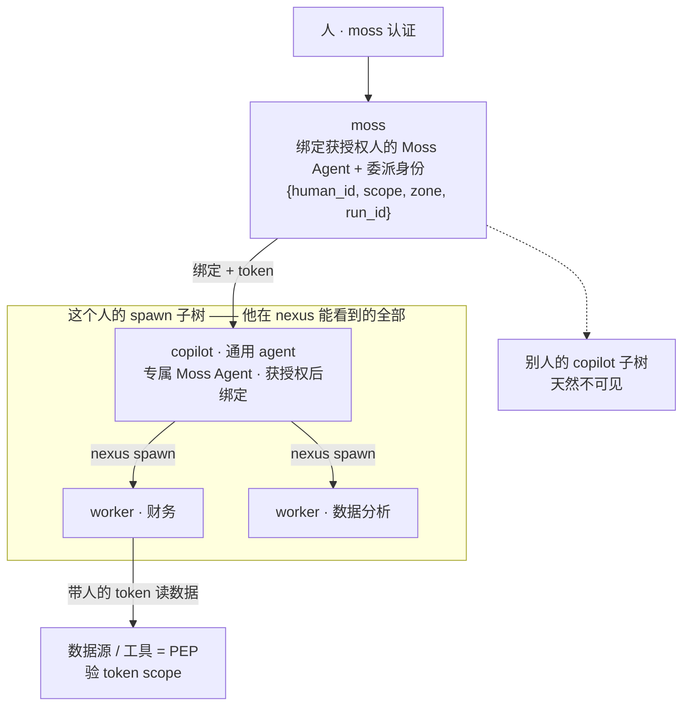

**核心不变式：Agent 有自己的可寻址身份；代表人执行时，不能获得超出该人的授权。** 每次特权动作记录实际人类 owner、Agent principal 与本次委派范围；数据源和工具在执行时再次校验。Agent 自身身份、人的授权和本次运行 scope 分开保存。

- **企业成员 ↔ Moss Agent**：每个企业中，每位具有 Moss 使用权限的人恰好一个专属 Moss Agent。获得权限后按需幂等创建；普通个人 Agent 仍可创建多个，见 §2.4。
- **copilot spawn worker**，走 nexus 的 spawn 路径，落在自己的子树里。
- **可见性按企业和实际权限计算**：个人默认看到自己的 Agent；管理员可浏览当前企业授权范围内的 `/agents/`。spawn 子树记录委派来源，不授予对整个企业的隐式读取权。人的认证由 Moss 承担，统一身份见 §2.3。
- **创建、恢复与执行分别授权**：Moss 在入口校验可启动的目标，Nexus 和工具在执行点校验委派 scope；没有财务 scope 的人不能借启动财务 worker 获得财务数据。

**moss 是 PDP，数据源与工具是 PEP。** moss 认证人并签发委派 token；执行点在数据源那一刻校验。有效数据访问 = 说话人权限 ∩ run scope。

### 2.3 一套身份，不是两套

nexus 的 auth 子系统 mint `SubjectType{User, Agent, Service}`——**人和 agent 在同一套身份里**，各自带 zone_perms 与不可伪造的 `from`。

心智模型：**moss 是人的认证前门，nexus auth 是人+agent 统一的身份与权限底座。** 目标态是 moss 认证人之后换发 nexus User subject，人和他的 copilot 归到同一个身份面。

---

### 2.4 每位获授权用户的专属 Moss Agent

**2026-10-25 已确认设计，身份与使用权代码已提交，交付状态统一见 §9。** 唯一归属键为 `(企业 ID, 人类用户 ID, purpose=moss)`；显示名和飞书昵称不参与身份。并发首次访问只能创建一个绑定。个人 Agent 与 Moss Agent 共用身份、存储、运行和工作台组件；用途、授权范围与长期记忆分别保存。

| 对象 | 数量与归属 | 权限和记忆 |
|---|---|---|
| 个人 Agent | 同一人可有默认 Agent 及多个具名 Agent | 各自持久身份、配置与长期记忆 |
| 专属 Moss Agent | 每个企业内，每位有 Moss 权限的人一个 | 代表该人使用已授权的企业管理能力；独立记忆，不混用个人 Agent home |
| 任务模板 | 可复用的任务指令 | 会话选择，不承担 owner 或记忆桶身份 |
| Session | 一个 Agent 可有多条持久会话 | 历史、冻结上下文、运行绑定与工作区分别记录 |
| cohost/scode | 共用的执行引擎 | compute VM → gVisor Pod → cohost 内 scode；不另建 Moss 专用引擎 |

**Moss 使用权显式授予，普通 SudoWork 登录和飞书配对不自动授予企业管理权。** 每次入口和恢复重新检查成员状态、企业归属及 Moss 权限；撤销后拒绝新输入与启动，保留历史和审计，不删除身份或把会话移交给别人。产品的使用权与数据源的执行权限分别校验。

**默认范围已确认：企业管理员＋管理员指定的成员。** 管理员可在 Moss Web 的“用户管理 → 成员操作 → Moss 使用权”或同一 API 中查看、授予、撤销。Web 和 API 共用后端授权；普通 SudoWork 账户不自动获得。明确撤销也覆盖管理员的默认使用权，停用账户不会因授予使用权而被启用。该界面与 API 已随 #441 纳入 0.1.80 并部署，交付状态以 §9 为准。

**管理员能管理许多 Agent，专属 Moss Agent 仍只有一个。** 管理列表展示当前企业、当前权限允许的 `/agents/`，支持详情及共享对话工作台。启动其他 owner 的 Agent 必须有明确授权；保留目标 owner、计费归属与实际操作者审计。专属 Moss Agent 调用其他 Agent 属于受控委派，不把自己的身份、会话或记忆切换成目标 Agent。

### 2.5 飞书人类身份绑定

新应用 **Moss**（`cli_aa574ee4baf85cf0`，SudoPrivacy 企业）作为 IM 入口。机器人应用和连接负责收发；真正执行者从消息发送人的已验证企业身份解析。旧 `openclaw` 连接保留历史与回退记录，不作为新产品名称或执行引擎。

**实现检查点：** [Moss #443](https://github.com/sudoprivacy/moss/pull/443) 已通过全部适用 CI 并正常合并，随 0.1.80 部署。Ethan 本人绑定、群回复与共享 WebUI 历史已验，其他生产边界见 §9。以下链路已实现。管理员显式启用按成员模式，固定企业、应用、连接及配置修订；旧连接保持原模式。普通成员从“Agent → 我的 Moss Agent”进入共用详情/工作台，在本人详情中完成飞书绑定或解除。

管理员的连接配置保存在独立表中，普通连接 owner 修改渠道选项不能降级为旧模式或替换身份边界。相同配置的重复/并发提交保留原修订和绑定；更换企业、应用或 tenant 会使旧证明及绑定失效。飞书身份优先采用固定应用内稳定的 `open_id`，避免员工 ID 可见范围变化导致同一个人被误认成新身份。

1. 校验消息来源、应用/连接及企业，读取飞书稳定发送人 ID；以企业及连接命名空间保存映射，不按昵称匹配。
2. 通过已登录 Moss/SudoWork 用户的显式账户绑定或已验证的企业账号映射，解析实际人类用户。当前实现只把十分钟有效的一次性码私聊给已核验的发送人，数据库只保存摘要；本人登录后兑换，API Key/内部令牌不能代领。私聊失败不向群里回退发码。管理员批准“允许这个人使用机器人”不能替代“这个人是谁”的绑定证明。
3. 检查该人仍为当前企业有效成员、具有 Moss 使用权，再解析其唯一 Moss Agent。未绑定或无权限时只返回绑定/拒绝说明，不启动模型、不借用连接 owner 的 Key。
4. 进入 §3.4 的会话定位，再由 §5.1 解析实际 owner 的 Key 与组织账本。连接管理员、说话人、Agent owner 三种身份保留在审计中。

**迁移边界：** 原 QA 连接 `lark_4uozxhe7` 的配对固定委派给旧 owner `test_2`（SudoRouter 账户 9920）；10/26 切换时仅停止这个同应用接收端，原 owner 与历史保留。新的 `lark_default` 连接固定到 Ethan 的日常组织，已用本人短信登录及本人飞书用户 token 读取私聊证明完成绑定。旧 `openclaw` 应用的同名连接属于另一个 owner，未改动。旧配对和连接级授权不推定人类身份或 Moss 管理权限。


<a id="runtime"></a>
## 3 · 会话运行时

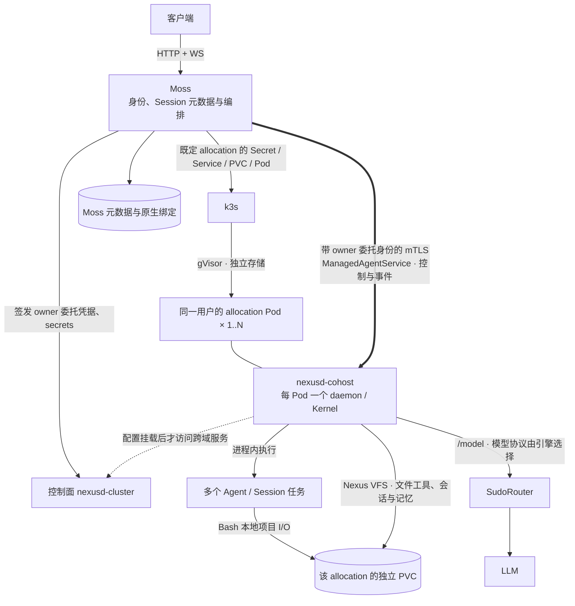


**保管权与放置是两件事。** nexus 管保管权——pid、PCB、`/proc/{pid}`、mailbox、身份、生命周期；k8s 管放置——跑在哪台机、资源、沙箱。`spawn_spec` 冻结契约把这条分工写死在**外部 spawn** 那条接缝上：调用方拥有全部启动逻辑，nexus 只负责执行、监管、并把子进程的 stdio 泵进 `/proc/{pid}/fd/{0,1,2}` 的字节隧道。co-host 那条接缝上分工不变，只是被监管的东西从子进程变成了同进程里的一个任务。

| | 归谁 | 具体 |
|---|---|---|
| 保管权 | nexus | pid · PCB · `/proc/{pid}` · mailbox · 身份 · 生命周期 |
| 放置 | k8s | 跑在哪台机 · 资源 · 沙箱 |

**会话不是子进程，是 daemon 里的一个任务。** co-host 把 agent 循环编进 nexusd 同一个二进制，所以 PCB 描述的就是这个会话本身，不是任何代理进程；取消就是取消这个会话。这也意味着 stdio 不必经 `/proc/{pid}/fd` 的字节隧道往外泵——调用方与 agent 在同一个内核里。

**daemon 与 agent 在同一 Pod、同一进程交付。** 这是当前 cohost 的运行边界：`SpawnTask<Kernel>` 使用同一个 Kernel，文件工具和 Bash 解析到同一份本地项目存储，gVisor 在 Pod 外包住整个用户运行环境。当前生产没有挂载 Nexus FUSE。gVisor 的普通 PVC 文件与匿名 mmap 已实测成功；独立 FUSE 试验中的 ENOSYS 不应写成 gVisor 普遍不支持 mmap，也不构成这项部署选择的唯一理由。

**托管 agent 的 pod 跑的是 `nexusd-cohost`，不是 `nexusd-cluster`。** 两者是两个产物，不是一个的两种构建：`nexusd-cluster` 是纯守护进程，`nexusd-cohost` 多链进了 agent 运行时，所以体积也各有各的预算（linux-x64 压缩包的测量记录见任务 R3，差异来自所携带的运行时）。`nexus-vfs` 链不进 sudocode——那会是依赖环——所以 cluster 那份的体积不会因为 agent 侧的工作而变化。

**一个 cohost 产物里，守护进程与 agent 运行时的 kernel rev 在构建期就被钉死成同一个**（cohost 的版本号就是它携带的 sudocode 版本；换 sudocode 就换一个 cohost 版本）。两者不一致会让一个进程里出现两个 Kernel 类型——这不是部署时要记得遵守的纪律，而是构建期已经不可能发生的事。

**pod 内的 daemon 只是叶子。** 它手上没有业务库连接，只有一张证书；需要外部数据时经 federation 出去，由对端按那张证书评估（§8 的两条前提）。所以把 agent 和 kernel 放进同一个进程，并没有让 agent 够到任何它本来够不到的东西。

### 3.0 会话是怎么起来的

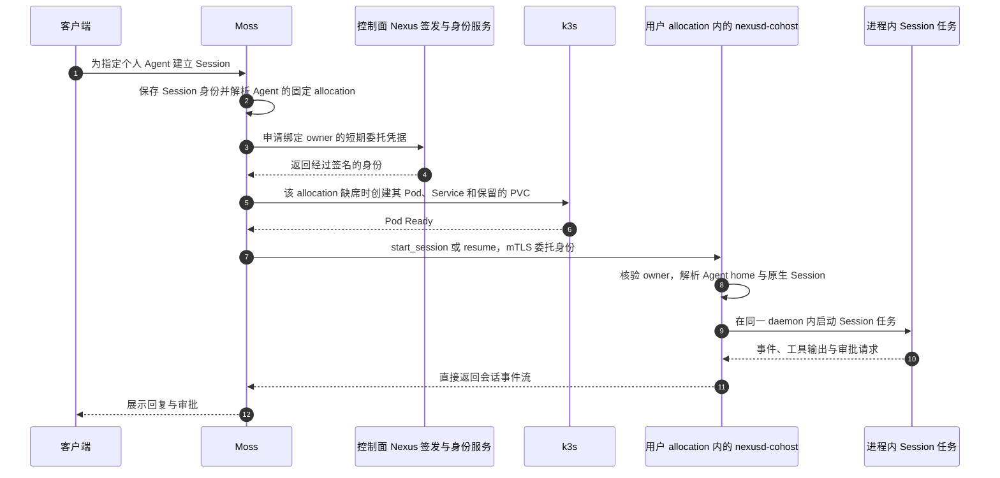


**先解析 Agent 的存储归属，再决定是否建 Pod。** 同一个 Agent 的所有 Session 固定在同一 allocation；其 Pod 已存在时，新 Session 只是该 daemon 内的另一个任务。新 Agent 超过当前 allocation 的容量后，Moss 分配下一份独立 Pod／PVC，K3s 决定 Pod 跑在哪台计算节点。已有 Session 不因重连被重新分配到另一份状态。

**用户 Pod 的 owner 由经过验证的委托身份与受限启动配置共同决定。** `serve-user --owner` 将运行环境固定到该用户；客户端任意填写的 owner 不能扩大权限。Moss 的会话访问检查是前置检查，底层 Nexus 的文件、会话读取与取消仍须自己核验身份。真实 B 身份在自身运行环境有效，但对 A 的上述三项操作均被拒绝。控制面 Nexus 负责签发、secrets 和跨域服务，当前 Cloud 的 Session 控制与事件由 Moss 直接连接 Pod 内 cohost，不经签发服务中转。

**两条 spawn 接缝，不是两种部署。** 外部 spawn（`spawn_spec`）起的是子进程，stdio 经 `/proc/{pid}/fd/{0,1,2}` 的字节隧道被**长轮询读出来**；co-host（`SpawnTask<Kernel>`）起的是同进程里的任务，没有这条隧道。云上与盒子走后者；前者留给 agent 本来就是独立进程的场景。

**走外部 spawn 时有一条本机管道不存在的约束：客户端的 RPC 截止时间必须长于它自己请求的轮询预算。**两者相等时，客户端先到期、读调用被拒，而如果跟随循环把这种拒绝当成「写者已消失」，一条健康会话就会在固定时长后被拆掉——现象是握手正常、随后准点死亡、退出码为 0 且无错误文本。所以这条接缝有两个必须同时成立的前提：**阻塞读要有独立于连接超时的截止时间**，以及**跟随循环要把传输层拒绝与真正的流关闭分开**。判断一次断开属于哪一类，看错误本身：传输层拒绝带 gRPC 状态名，真正的流关闭带服务端的错误负载。

**原生会话日志是历史的持久来源。** `/sessions/<native-session-id>/transcript.jsonl` 由原生 Session store 写入，Agent 下的 sessions 目录通过 DT_LINK 提供枚举。Moss 保存应用 Session 身份、Agent／allocation 归属、原生绑定及需要的投递记录；上层历史读取与 UI 映射遵循原生日志，不另设第二个权威 transcript 写入方。Agent 记忆由新 Session 形成快照，普通 resume／compact 保持该快照；工作区、Bash 本地 I/O 与文件工具的治理边界见本轮核验。

### 3.1 搬 agent，搬的是状态不是进程

agent 的 `ppid`、`owner_id` 与 `zone_id` 在 spawn 时确定；迁移通过持久状态交接和新运行恢复表达。已有接口与执行约束见任务 R4 的核验记录。

正确的形态是搬状态。每个 agent 在 nexus 里有一个持久、被复制的家目录 `/agents/{name}`，里面是 `chat-with-me` 收件箱与 `state` 流；它由 `start_session` 在选择 spawn 策略之前无条件 provision，并且**活得比进程久**——注释写的是 outlives the pid，永不随进程拆除。把这棵子树 share 成一个新 zone、再 mount 到目标位置，agent 的身份与信箱就跟着过去了，进程在哪起无关紧要：进程是可抛弃的，状态不是。这与组织合并拆分用 mount 表达、零数据移动是同一个机制。

**前置条件是 spawn 走 nexus，而 co-host 让它自动成立。** 只有经由 `managed_agent.start_session_v1` 起来的会话才会留下 `/agents/{name}`；绕过 nexus 自己拉起 agent 的做法，在 nexus 里不会留下任何东西，也就没有可搬之物。co-host 之下会话本来就是那个 daemon 里的任务，绕不过去。

**以下是待实现的 Agent Move 方案，不是当前 Cloud 的运行路径。** 现有生产只恢复原 allocation 的保留状态，没有跨 Pod 迁移 Agent。share／mount 的接口约束见 R4；真正上线迁移前，还需明确唯一写者、租约续期、旧写者隔离、失败回退及状态交接。下图保留锁与 Watch 的设计讨论。

**同城演示：一棵 `/agents/{name}`，两个 pod 轮流持有。**

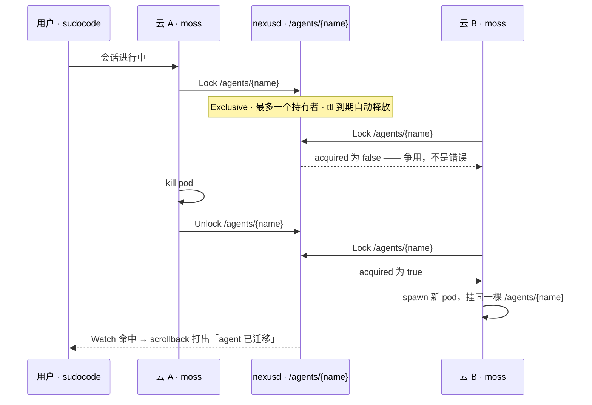

**锁必须由同一个权威状态源仲裁。** 现有 typed advisory lock 支持 Exclusive、`max_holders=1` 与 TTL；这些局部接口不足以保证两个独立 Pod 的本地 Kernel 之间互斥，也不能阻止旧写者在租约失效后继续写。Agent Move 必须满足所用 Nexus／Raft 的实际租约契约，并把旧写者隔离落实到写入端。普通 PVC 文件锁或一次 `acquired=true` 都不能替代这项保证；当前固定 allocation 避免了同 Agent 跨 Pod 并发写。

**对面怎么知道搬完了。** `Watch` 是阻塞的、inotify 形状的长轮询：给一个路径与超时，命中返回事件路径与类型，`matched=false` 表示超时无事件，再从同一路径续等。写入侧不需要额外广播——每次变更都经 `dispatch_observers` 唤醒模式匹配的 watcher。这与会话 stdio 走的 `streamReadAt` 长轮询是同一种形状，客户端可以复用同一套跟随循环。

**迁移事件的展示仍需端到端验收。** 现有锁与 Watch 可以成为交接信号的基础；事件可见不代表状态搬迁及旧写者隔离已经正确完成。


**一个用户可以拥有多个 allocation Pod。** 每份 allocation 的配置由其 Kubernetes Secret 交付，Agent 状态、原生历史和工作区保存在独立 PVC，Pod 丢失后继续挂回保留的 PVC。同 Agent 的 Session 共享 Agent home，每个 Session 有自己的项目工作区；不同 Agent 按路径形成上下文边界，同一用户内不宣称互为对抗沙箱。不同用户由受限 cohost 的 owner 授权与 Pod 边界共同隔离，外部触发和分享会话的更窄 scope 仍需执行点核验。

**原生日志与应用元数据各有一个持久来源。** 原生 Session store 拥有 transcript；Moss 保存应用 Session 身份、Agent／allocation 绑定、原生 Session 绑定和应用投递记录。客户端从共享映射读取历史并恢复展示，不另建可竞争的权威 transcript。运行中的连接、Pod IP 和 busy／idle 不是持久身份。

**会话状态机的终局由状态机自己决定**，展示层不替它判断：`terminated` / `ended` 是终局，`detached` 表示客户端断开但会话仍可恢复（`starting` / `running` / `detached` 都属于"活着"）。

---

### 3.2 agent、会话、pid 是三样东西

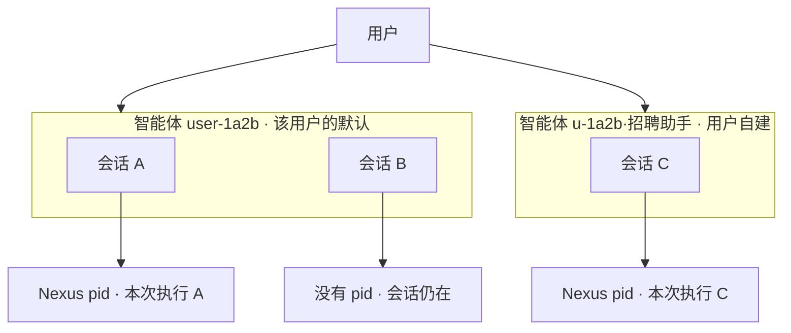

三个标识符，三种寿命，任何一个都不能替代另一个：

| | 是什么 | 活多久 | 落在哪 |
|---|---|---|---|
| **agent-name** | 持久主体：配置、提示词、技能、记忆；可被寻址的那个身份 | 比进程久，永不随进程拆除 | `/agents/{name}/` |
| **session-id** | 一条对话线程，`--resume` 的键 | 跨多次运行 | 归属某个 agent |
| **pid** | 一次运行的句柄 | 最短，随时可抛弃 | `/proc/{pid}/` |

**每个会话都归属一个 agent，没有例外。** 用户没有明确选智能体时，会话归到**该用户的默认 agent**，而不是留空或挂一个占位串。这样「归属」与「记忆桶」是同一个粒度。已有 memory_mode 与目录映射的实现细节见任务 U1 的核验记录。

**个人 Agent 与任务模板是独立选择。** 个人 Agent 承担持久身份、配置、技能与记忆；「招聘专家」这类模板提供会话任务指令。当前草稿可以同时选择自有具名 Agent 和可见任务模板，服务端分别保存 Agent 引用与模板引用。使用模板不会把共享模板当成个人记忆桶，也不会仅因打开草稿而新建一份 Agent 身份。真实模型回复已验证模板角色指令生效。

需要独立长期上下文时，用户显式新建个人 Agent；需要换任务角色时，选择任务模板。草稿打开时不创建 Session 或 Pod；首次发送才提交真实 Session 并按该 Agent 的固定 allocation 唤醒运行环境。恢复已有 Session 使用原绑定和原快照，模板修改不会隐式重写既有会话的冻结上下文。

**agent-name 绑用户 id，不绑用户名。** `/agents/{name}/` 是真实路径段：用户名可以改、可以撞名、可以含分隔符。名字取 `user-<userId>` 这类稳定且路径安全的形式，显示名另存——改一次昵称不该让历史会话失去归属。

**引擎不是智能体。** scode、codex、以及 ACP 探测到的那些二进制是**驱动会话的引擎**；选引擎与选智能体是两件事，前者决定谁来跑，后者决定这是谁的会话。把引擎名当作会话名显示过（界面上出现过 `Remote Agent`），那不是命名，那是没有名字——内部标识符不该出现在用户面前。

**会话的名字在它产生的那一刻落库。** 名字是关于这条会话的持久事实，由第一条用户消息推导，写在消息被接受的那条路径上；不能靠「谁碰巧打开过它」顺带补上，否则没人打开过的会话就永远没有名字。

---

### 3.3 这三层在界面上长什么样

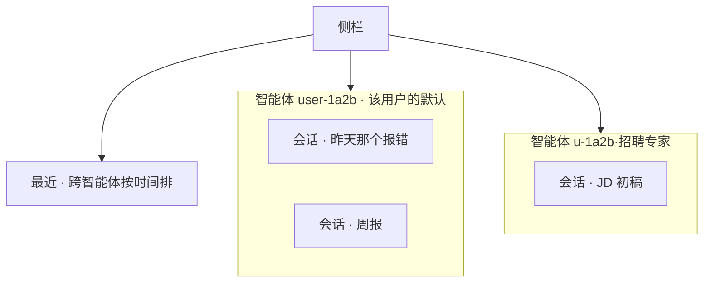

**主操作是「新会话」，不是「新建智能体」。** 用户绝大多数时候要的是开一段对话，而不是创建一个长期主体。运行时按用户复用 pod，并由 co-host daemon 承载多个会话；界面用词按 agent、会话与运行这三层语义表达。

**全局新任务使用用户默认 Agent，Agent 内的新会话保留当前 Agent。** 选择任务模板保留所选个人 Agent，两者分别显示；点击侧栏 Agent 进入其 latest Session，标题下拉选择该 Agent 的历史 Session。打开草稿不提前落库，首次发送才创建会话。上述 WebUI 路由、真实模板回复、刷新原 ID 和 latest 行为已有独立验收；原生桌面发布另按其安装产物验证。

**侧栏按智能体分组，另留一个跨组的「最近」。** 只按智能体分组会让「找上周那条会话」先变成「想起它属于谁」——那是回退，「最近」把按时间找的路留住。

**「新建智能体」是二级动作**，用在需要一条新的记忆边界时。

智能体这一层值得在界面上占一格，判据不是它在存储里存在，而是**用户感知得到**：记忆按（用户 × 智能体）存，换一个智能体，它记得的东西就不一样。反过来说，如果某一层对用户只是个分组标签、没有独立的配置与长期上下文，它就不该出现在界面上，更不该占据主操作。

**按项目分组是另一维，不是这一维的替代。** 把会话按 project / repo 归拢是个合理需求，但记忆是按智能体存的、不是按项目；用项目取代智能体来分组，分组边界会再次和记忆边界错开。要这一维，就在智能体之外另加一层。

---

### 3.4 一个 Moss Agent，多条可续接的会话

**Agent 是“谁”，Session 是“哪段对话”。** 同一人在一个企业只有一个专属 Moss Agent，但可以在浏览器、桌面、不同飞书群及私聊拥有多条会话；重新发消息会续接已定位的会话，不为每条消息创建 clean Agent。

IM 的持久定位键为 `(企业 ID, Moss Agent ID, 机器人连接 ID, 群/私聊 ID)`；若启用话题，再把平台稳定 thread ID 纳入键。同群的不同人各自定位到自己的 Agent/Session，不共享私有上下文。默认只把当前已授权发送人的消息作为输入；群内回复对全群可见，跨人或私有数据的披露仍受执行权限和显式输出范围约束。

- 首次消息原子建立映射，重复投递按来源消息 ID 去重；重启和断线后读取同一映射。
- Web/桌面按 Session ID 打开同一持久会话，沿用原生 transcript 与绑定，不复制出第二份权威历史。并发输入遵守现有单 writer/排队契约。
- `/new` 或明确“新会话”才创建该 Agent 的新 Session，并更新当前入口指针；旧会话仍可在历史中恢复。恢复到旧 Session 不改变 Agent 归属。
- 模板切换只影响新会话的任务快照；已存在会话按冻结上下文恢复。委派给其他 Agent 不覆盖当前入口映射。
- 客户端断开、daemon 重启或 Pod 重建优先按持久绑定恢复；已 terminate 的会话保持关闭，未知执行结果不自动重放。

**实现与生产边界：** #443 已为按成员模式统一持久指针、消息去重、当前身份/owner 校验与恢复；新旧模式复用输入和回复传输，并修正三个排队消息可能并发的锁安装顺序。接收实例停止、租约过期或被接管后，旧实例的排队输入被拒绝。生产仍是旧 IM 路径：主要按连接、聊天和固定 owner 持久查询，内存键又带发送人；旧 `/agent` 切换会终止当前执行，不能把它当作新模式的续接验收。新模式已通过 PR 的完整 CI 并合入；仍须正式发布、受控切换及真实群聊/计费验收。

**跨入口身份展示复用同一实现。** Moss 在创建会话时生成受保护的工作台身份信息，保留真实来源（如 `lark`）、实际 owner 和发起人。SudoWork Web 服务与桌面导入/恢复共用投影函数，把该信息交给既有管理 Agent 工作台；身份展示不授予会话访问权。已有 WebSocket 地址的桌面恢复也必须同步身份，避免把 Moss 引用当模板或丢失 owner。两种宿主的兼容产物均部署后，才能启用新的按成员 IM 模式。


<a id="deployment"></a>
## 4 · 部署与升级

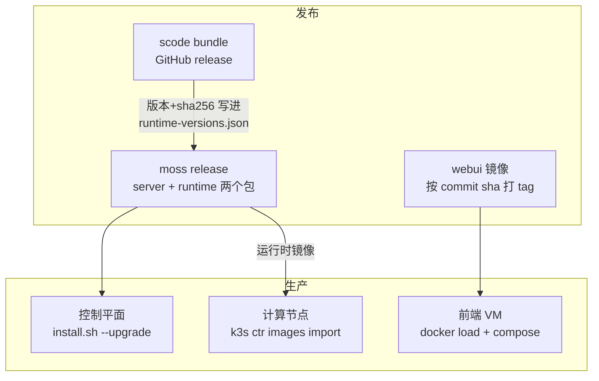

**一个安装器承担三种角色。** `install.sh` 是统一入口：`--upgrade` 原地升级控制平面，`--role compute` 装 k3s + gvisor 并导入运行时镜像，`--role webui` 部署前端镜像，`--download` 打离线包，`--offline` 在无外网环境安装。它是 POSIX sh、零运行时依赖——客户裸机与 air-gap 是硬约束，这决定了形态。

**升级可回滚。** 控制平面解包后切 `current` 符号链接并记录 `.current.rollback`；前端 VM 的 compose 指向按 commit sha 打的镜像 tag，回滚就是指回上一个。

**运行产物按清单钉住。** Moss 现有 `runtime-versions.json` 保存版本与 bundle SHA256；构建按它校验并把 cohost/scode 放入计算镜像。当前本地导入镜像的部署使用 `imagePullPolicy: Never`，升级须核对计算节点已导入新镜像及实际 Pod digest。控制器随包版本、选中的运行清单与现存 Pod 的实测版本分别记录。

**统一发布清单是两端共用的目标。** 清单记录引擎提交、cohost/Nexus 版本、ABI、镜像 digest 与制品校验和；Moss Agent 与普通用户消费同一份已验证运行清单。新会话按持久 Agent/allocation 归属使用已验证版本；旧会话通过排空或恢复升级，保留 Session ID、历史、文件和记忆，并检测实际版本漂移。桌面本地执行保留宿主适配，随包版本的推广与云 Pod 升级分别验收；同一代码源不能证明两个已安装产物此刻相同。

**10/26 发布检查点。** `server-v0.1.79` 指向已合并并通过适用 CI 的默认 Agent 修复，正式发布工作流全部成功，GitHub 已于 10/26 04:12 发布。成员使用权与飞书路由 #441/#443 也已全绿正常合并；正式候选 `server-v0.1.80` 指向 `651c78783b20f53fc87a76831416285d3f9f996d`，与受检 #443 的文件树完全相同，[正式发布流程](https://github.com/sudoprivacy/moss/actions/runs/40266287448)的 8 项任务全部成功，已于 10/26 16:16 完成控制器 0.1.80 部署。官方校验和、源码祖先、71 项隔离包验收、保护配置及旧 QA 历史前后校验通过。首轮脚本把正常 `process_shutdown` 后的 `ended / desired=active` 当作会话丢失，未切换版本并恢复旧服务；核对持久行、attempt、原文件及全部三轮历史后才继续。其随包清单为 Nexus cluster `0.8.23`、cohost/scode `0.2.36`；`server-v0.1.78` 源码中的包清单也是这些版本。此前核验的生效运行清单则为 `server-v0.1.74`、Nexus `0.8.22`、cohost/scode `0.2.34`。10/26 12:11 已完成控制器 0.1.79 切换，保护配置与原生效运行清单保持不变；不能由控制器或包清单推断实际 Pod 已升级，也不覆盖相邻维护工作线的运行清单。

**版本要可追溯。** 每个产物的 tag 对应一个 commit，任何时候都能回答"生产在跑哪份源码"。

**升级保留部署方的运维配置。** systemd 先应用 `Environment=`，再应用 `EnvironmentFile=`；同名变量以 env 文件为准。运维覆盖项在选定来源维护，验证有效值读取 `/proc/<pid>/environ`。`MOSS_NEXUS_ZONE_ID` 属于 embedded 模式。已有安装器行为、override 路径和排障记录见任务 D5。


---

<a id="channels"></a>
## 5 · 接入通道

**Web 与桌面**是两个入口，共用一套 moss 接口与一份渲染层（`packages/renderer`）：renderer 与后端的边界收敛到一个 transport 接缝——桌面绑 Electron IPC，Web 绑 moss adapter，同一份 bridge 契约。

**登录**同时提供手机号验证码与账号密码两种方式，由同一个登录面承载。

**IM 通道**（Telegram / 飞书 / 钉钉 / 企业微信）归一化到统一消息协议；Moss 管理入口的飞书身份绑定统一见 §2.5，会话定位见 §3.4。未映射者不能启动 Moss Agent。其他独立公共聊天入口如有匿名能力，须显式配置独立权限与计费，不复用企业管理身份。

---

### 5.1 owner Key、组织余额与支付

**权限、Key 与费用跟随实际执行 owner。** 每个成员使用自己的 SudoRouter API Key；新组织成员共享该组织 SudoRouter 账户余额，保留成员 Key 的用量归属。管理员代开或机器人转发不改用管理员/连接 owner 的 Key；禁用、缺失或无额度时明确拒绝，不回退到部署级 Key。

Moss Agent 和普通个人 Agent 复用现有凭据解析与计费路径。会话审计同时记录操作者、Agent owner、模型/provider 与账本归属；日志只保存必要标识和指纹，不写 Key 原文。旧组织的独立 Router 账户与新组织共享余额是不同迁移阶段，验收分别标记。

**支付事实与验收边界：** 当前找到的是富友生产商户；沙箱查询曾返回 `5019：无此交易权限`。10/26 本轮 `testybc` 微信 ¥7.30 → $1 新支付已走通：第一笔在补授权期间过期，读取确认未付后取消；付款人再次确认“现在可以”才创建新单。新单生成约 19 秒后变为已付/已到账，组织余额 $2.92951 → $3.92951，Router 9950 精确增加 500,000 quota，数据库只有一笔成功充值操作且无人工补款/核销；验收未调用主动查单或 sync。随后使用正常客户端配置接口返回的实际成员 Key（Token 380）完成一次真实模型回复，组织余额、组织用量、成员用量与日志均相差 7 quota（$0.000014），消费后余额 $3.929496。第一次即刻读余额尚未反映结算，保留失败记录后仅只读复核原请求，没有重发模型输入。Caddy 未开启本次入口的可读请求日志，因此没有独立原始 HTTP 200 回执；回调完成的判断依据是新单异步入账、唯一操作记录与未调用查询/人工入账。用户已确认退款按线下流程；保留原订单、实付金额、组织已入账与已消费金额，财务实际退付及余额核销需单独记录，本轮尚未执行退款。历史订单与管理员测试额度不替代本次新支付证据。


<a id="edge"></a>
## 6 · 跨组织与盒子交付

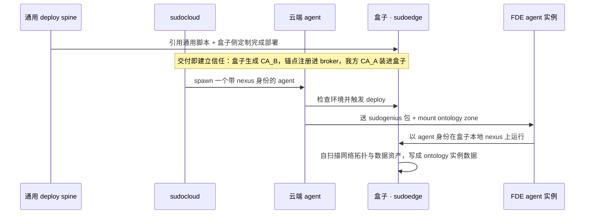

**交付的第一件事是建立信任。** 跨边界动作要求可验证的对端，所以部署脚本里含身份仪式：盒子生成自己的 CA_B，锚点注册进我们的 broker（活的 RPC，无需停机），我方 CA_A 装进盒子。

**agent 带着身份出发。** 身份由 agent cert 或 key 及相应运行环境承载。在线签发使用 `transport.proto` 的 `MintAgent / MintKey` RPC；离线 `auth mint` 纳入独占 data-dir 的维护窗口。agent cert 表达身份，zone 授权由 `service / user` key 及权限策略承载。`NEXUS_*` 注入、per-session Secret 与 CLI 的已有实现见任务 I1/I3 的核验记录。

**一台主机只跑一个 auth-on nexus。** 同时服务 moss 的 secrets 与跨组织平面：moss 以 `MOSS_NEXUS_MODE=external` 经 mTLS 连它，自带的 `nexusd serve-local` 不再起。存活的那个必须是**部署方自己持有的二进制**，不能是随发布件被静默替换的那份——它持有 CA_A 与外域锚点，信任根不该由发布流水线决定。⚠️ 其 vault 插件按环境变量 **`NEXUS_DATA_DIR`** 定位 vault，**不认 `--data-dir` flag**：没设时它会在工作目录下自建一个空 vault，于是 secrets 读不到、注入空配置、模型调用回 401，而且**全链路零报错**。

**给 agent 的是环境，不是提示词。** 送包 + 挂 ontology zone，让 agent 在真实数据面上工作，而不是把 ontology 拷进 prompt。

**跨组织搬迁：云侧交接，盒子侧起进程。**

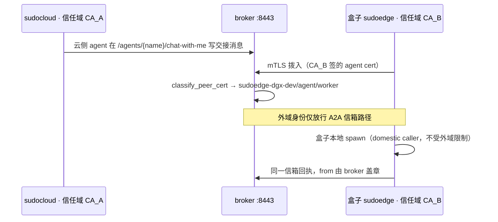

**外域身份是被围起来的，这决定了搬迁的形态。** 带 `trust_domain` 的调用方只能触达 A2A 信箱路径——那是**被复制的跨机信箱**，不是 node-local 的 `/proc/{pid}/chat-with-me`；会话的 reader register 可读不可写（挪别人的读位置会静默跳过其收件，发送方还被告知已送达，所以写侧关闭）；其余路径一律拒绝。因此跨组织搬迁**不是**云端伸手到对面 spawn，而是：云侧把交接状态写进信箱，盒子侧作为本域调用方在本地起进程，两边只在信箱上对齐。

**信任是两个锚点，方向相反。** forward anchor 把盒子的 CA_B 注册进 broker，broker 才能验盒子 agent 的客户端证书并给它盖上 `{trust_domain}/agent/{name}`；reverse anchor 把我方 CA_A 装进盒子，盒子才能验 broker 的服务端证书。盒子始终不加入 overlay，它向服务面拨出，信任全部由这条 mTLS 承担。

**判断连通性要看握手，不看 HTTP 码。** broker 的 8443 是 gRPC/mTLS 数据面，用普通 HTTPS GET 去探它，即使双向握手完全成功也拿不到 HTTP 状态码。


---

### 6.1 出境内容治理

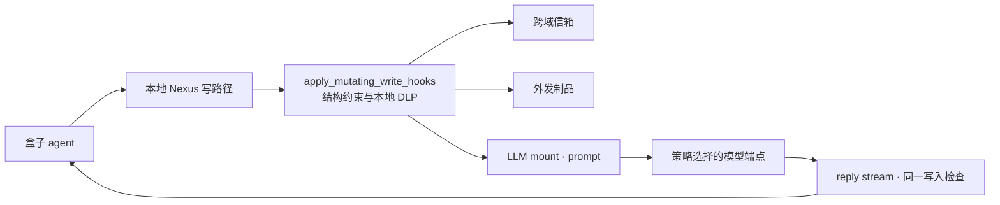

结构隔离限定可携带的数据范围，出口扫描负责内容检查。盒子本地的写入 hook 覆盖 DT_FILE、DT_STREAM 与 DT_PIPE，使用可本地部署的 DLP 执行允许、拒绝或替换内容；拒绝以错误返回并终止该次写入。

模型请求与返回也经过 Nexus：调用方以独立 stem 写 `.prompt`，读取对应 `.reply` 流；并发调用使用不同 stem，同 stem 重写表示重新请求。模型驱动随 `driver-ai` 构建进入产物，网络目标由部署策略决定。接触隐私原始数据的会话使用盒子本地模型。


**共享安全组件与验收边界（2026-10-09）：** 三种部署形态共用组件机制，共享装配归 `sudostack/security/`，行为归 Nexus、sudocode、Moss。下表的“已验证”只适用于注明路径；设计与已合入代码不自动等于生产生效。

| 层面 | 当前机制与证据 | 下一验收 |
|---|---|---|
| 身份与跨域信任（L1） | Nexus 节点/客户端使用 mTLS；foreign CA 与反向服务端信任锚、认证身份盖章和外域仅可访问信箱的围栏已有历史真实 broker 验证。Moss 到盒子执行 Nexus 使用独立身份。浏览器通过本机 HTTP 与 SSH 隧道接入。 | cohost 云端迁移后重复逐跳身份、过期、吊销和越界回归；不得将浏览器 HTTP 记成 mTLS。 |
| 工作区与隔离（L2） | Moss 校验会话 owner、原生 session、managed PID 与 agent；文件操作使用 owner 凭据，拒绝跨会话仓库定位和子路径逃逸。云端历史记录使用 gVisor；盒子未安装 gVisor。ReBAC 与插件身份透传代码按实际部署启用。 | 最新真实文件读写和重启恢复；云 pod NetworkPolicy（G1）及业务数据读治理（G4）。 |
| 模型与内容出口（L3） | 内容闸只覆盖经过本机 kernel 且列为出口的挂载。模型按 `NEXUS_EGRESS_GATE_MODEL_MOUNTS`、跨域信箱按 `NEXUS_EGRESS_GATE_A2A_MOUNTS` 选择；本地会话消息与 `/model` 不脱敏。检测规则与回环 Presidio 组合，按允许/拒绝/脱敏返回；JSON 结构保持，识别器失联拒绝外发，配置错误拒绝启动。真实模型 40 项和受控上游 deny/outage 已通过。 | 注入独立云模型挂载后验证真实生产外发；跨域信箱必须先改为经本地 kernel 中转。 |
| Router 与凭据 | 默认 online；已配置的云渠道默认 enabled/external，本地固定 local。独立 Router token，关闭跨组重试。本地失败不会改走云端。primary Nexus vault 保存系统机密；盒子 Router 状态使用内存盘。 | 云密钥加密引导、运行时只交给受闸挂载，重启后解密重注入；当前未配置云 key，不能记为完成。 |
| 审计与制品 | 闸日志只记路径、身份、类别和数量，40 项验收检查日志不含命中原文；信箱 `from` 盖章随 raft 持久化。 | ShareOne 制品出口、业务数据返回脱敏与审计各自验收。 |
| 形态差异 | Cloud 为托管多租户控制面；Private 在客户网络自营同一套服务；Edge 提供本地 GPU、独立信任域和一键纯本地。出口是否跨域由部署策略决定。 | 盒上 ShareOne 随盒部署、A2A 下发运维任务与 artifact 治理仍属后续工作。 |

**当前约束：** 接触客户原始数据的任务固定使用本地模型；纯本地模式同时阻断主机与 Docker 公网出口，保留 LAN 与本地推理。云端会话控制、跨域 A2A、ShareOne 制品和模型调用是分别需要验收的出口，不能用单项模型扫描覆盖所有通道。

---

### 6.2 盒子使用方式与联网配置

| 使用方式 | 用户体验与执行位置 |
|---|---|
| 盒子单机 | 盒子 agent 使用本地 GPU 完成任务，读取本地工作区并生成结果。 |
| 盒子＋笔记本 | 笔记本提供交互入口，任务在盒子执行；笔记本 agent 与盒子 agent 的 A2A 协作作为另一项能力分别验收。 |
| 盒子＋Sudo Cloud | 先提供可用的云端会话与模型能力，并显示实际执行位置；本地 agent 与云端 agent 的 A2A 分工在基础会话验收后推进。 |

**盒子提供浏览器入口。** 已部署盒子上的 SudoWork WebUI，笔记本通过局域网 SSH 隧道打开浏览器；盒子无需运行 Electron。本地 Moss 已通过 cohost 内的 ManagedAgentService 承载真实会话；是否为盒子增加 gVisor 依据实际多用户隔离需求和 ARM64 验证决定。WebUI 是交互面，cohost 是执行面，两者同时部署。盒子按组织运行 cohost，CLI scode 用于调试和独立终端入口。选择 cohost 的主要依据是与云端统一生命周期、Nexus 文件/信箱/模型调用和治理接缝；多会话节省进程开销是附加收益，实际内存收益需要测量。单个用户也可能同时运行多个任务，无需为了采用 cohost 先引入多智能体产品功能。

**盒子上的 Moss 负责本地应用服务。** 保留轻量本地 Moss，复用现有 WebUI 的人类登录、会话/历史、工作区、模型目录和 HTTP/WS API，使离线时这些功能仍可用。采用它的依据是应用服务与 Cloud/Private 同构，而非盒子 agent 数量。cohost 可独立运行；若移除 Moss，需要先实现覆盖上述契约的 WebUI 适配层。Sudo Private 指客户内网自营的同一套 Atlas，Sudo Cloud 由我们托管，SudoEdge 是盒子部署形态；纯桌面 Sudo Local 另用本地宿主。共享说明归 `sudostack/docs/deployment-profiles.md`，设备配置与现场验收归 `sudoedge/docs/SETUP.md`。

**谁启动谁：** systemd/容器编排启动 cohost daemon；cohost 内的 ManagedAgentService 启动 scode 会话任务。云端会话控制为 `Moss → 用户 allocation cohost 的 ManagedAgentService → scode task`；cluster 提供签发、secrets 与跨域服务；盒子目标是 `WebUI → 本地 Moss → 本地 cohost 的 ManagedAgentService → scode task`，单机不额外堆一个只负责转发的 cluster daemon。两端 agent 身份使用 Nexus 凭据。此前现场核验的“两套账号”是本地 Moss 与云端 Moss 各自的人类管理员登录；不代表本地 agent 需要两个账号，当前也尚未统一为一次登录。

**默认联网。** 本地 GPU 与已配置的 Moss 云端会话同时可用；已配置的外部模型也可由用户或 agent 显式选择。执行位置（盒子或云端）与模型位置（本地 GPU 或外部模型）分别表达。Router 的外部模型 channel 控制直接模型调用，Moss 连接控制云端会话，两者分别接入联网配置。

**一键切换纯本地模式。** 保留本地推理和笔记本的局域网接入，停止云端会话访问、跨域 A2A、云端制品发布与外部模型调用；切回联网模式恢复已配置能力。模式跨重启保持。接触隐私原始数据的会话按 §6.1 固定使用本地模型；出口治理按同节实施。

---

<a id="ontology"></a>
## 7 · Ontology（业务层）

图是 Agent 的业务工作台，原始库只读、ops 是唯一写路径；spec 定义、来源互证、读取治理与外部回执归本主题。详细规则和原图集中如下。

<details>
<summary>展开业务本体设计、全部细节与图表</summary>

图是 agent 的工作台：业务问题从图上答，业务动作从图上发。**原始数据库一律只读。**

### 7.1 人与 agent 各自在做什么

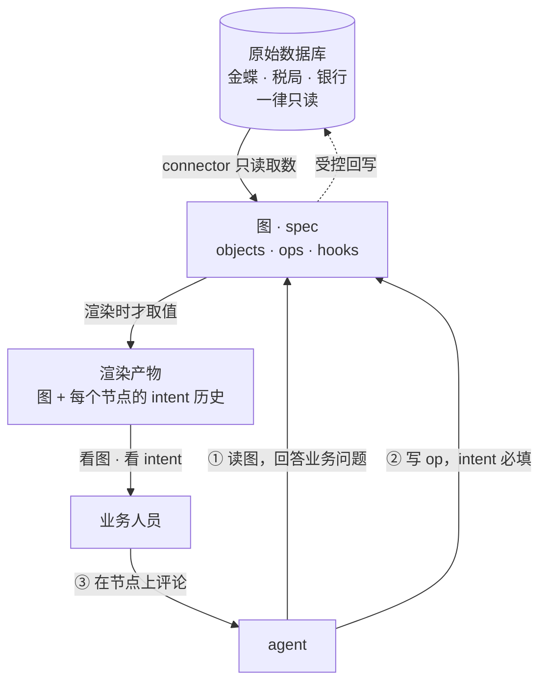

- agent 干得不好 → **先改图**，改时带 intent；人既能看图、也能看 intent，两条独立的 review 通道
- 本体内的业务操作范围由“原始库只读 + ops 唯一写路径”限定；数据访问治理见 §7.9，业务权限的实施范围见任务 G5 的核验记录。

### 7.2 SSOT 的硬规则

- 关联必须是**生成关系**，不是同步关系 —— 同步必漂，生成不可能漂
- 不存在"另一个核对脚本"：校验就是跑同一份 spec
- **差额不得无声吸收** —— 平衡项必须登记为具名 Hook，写明卡在哪份材料、谁负责
- **值不进 spec**：spec 里只有 connector 命令，数字在渲染时才取；取数时刻与校验属于**渲染产物**
- 版本史 = **remote-url 绑 git**；不另建页面版本史，也不另建修改记录表
- 属性必须声明 `owner`：`source`（上游事实）/ `ontology`（这里做的决定），**不存在两者都是**

### 7.3 图的结构：用 class 表达

沿用编程语言里的既有概念（继承 · 抽象类 · 实例）—— **LLM 熟悉度第一，业务人员可识别第二**。

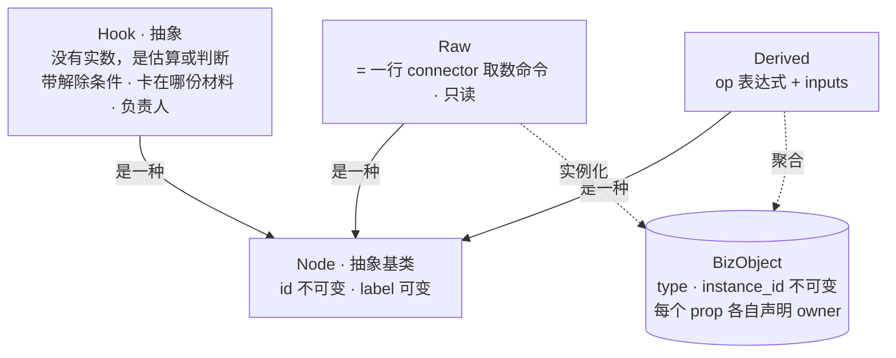

- **`Hook` 是抽象类**：代表"这里还没有实数，当前是估算或判断"，必须带解除条件；材料补齐后落地成 `Raw` 或 `Derived`
- 业务对象是一等公民，图上的标量节点是对它们的**聚合**；证据挂对象属性，不挂图的注释

**spec 里的键对应到这张图**（`type` 和 `node` 是两种东西，不是一种东西的两个名字）：

| spec 键 | 是什么 | 编程类比 | 画布上 |
|---|---|---|---|
| `types` | 对象类型，一张表的表头 | **class** | 一个分组 |
| `instances` | 该类型的行 | **object** | 组内成员；折叠后是桶 |
| `nodes` · `kind: derived` | **一个标量** —— 对表求出来的一个数 | 既不是 class 也不是 object，最接近"命名单元格"或 dbt 的 metric | 一个节点 |
| `nodes` · `kind: hook` | 缺口 | — | 一个节点 |
| `raw` | 取数点，一条命令 | — | 一个节点 |

一句话判据：**`from <X>` 里的 X 永远是 type，永远不可能是 node** —— node 没有行。

### 7.4 写回：原始库只读，ops 是唯一写路径

两道闸按顺序过，**彼此正交**：owner 决定"这个字段能不能被写"，可逆性决定"谁能落"。

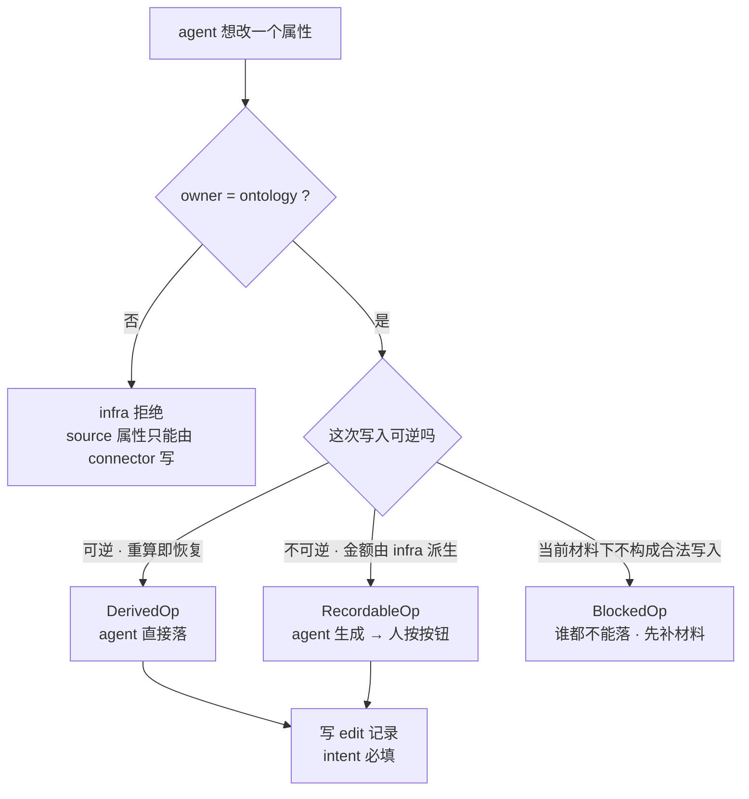

- `BlockedOp` 不是"需要审批"，是**当前材料下根本不构成一次合法写入**，要说明"怎么才能入账"
- 没被 op 覆盖的那段路，就是 LLM 会绕过去的那段 —— 人工映射必须补成 op

### 7.5 存储与历史

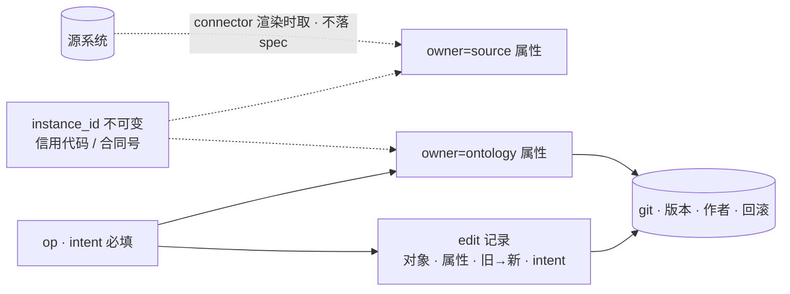

- 历史**按对象聚合渲染**（点节点看它的时间线），不是全局 commit 列表

### 7.6 交互面

- **图应用**使用 Cytoscape + ELK，承担缩放 / 平移 / 展开 / 折叠 / 定位，**跑在我们自己的页面里**；保留可选择的 DOM 文字层，通过应用锚点协议向 ShareOne 报告 node id 与位置。大表按“类型 → 分页记录 → 属性与关系”浏览，不把全表同时放进画布。
- mermaid 无原生缩放（默认把整张 SVG 压进容器宽度，节点越多字越小），故退为静态场景的回落
- 折叠 / 分组 / top-N 归 **compiler**；图应用只消费视图模型、只发事件，**不持有业务逻辑**
- **in-place comment 必选**，锚定 = **node id**；ShareOne 应用锚点协议已提供 report / hittest / reveal 接口，图应用负责同步画布几何和可见状态。

### 7.7 两根量化轴

| 轴 | 测什么 |
|---|---|
| 正确性 | 图与底层数据是否一致 |
| 可用性 | **agent 只看图**、不看文档与源码，能不能答对 |

- 可用性是**体检不是门禁**：分数下降要解释，不是红灯挡提交 —— 这是它与代码 CI 的关键区别
- 每题要求 agent 交出**命令轨迹**；失败时看轨迹停在哪，那条边或那个命令就是要改的地方（轨迹回溯，不是梯度）
- **评测不自动改本体** —— 改本体是带 intent 的写入，要走正常 op 路径并被人看到；自动改会让评测自我实现
- 分数由机器产出并存档，主张引用 run id，不引用散文
- **两阶段都经过会拒绝错误的 compiler**：阶段一 agent 扫描原始库，建立并核对数据投影；阶段二业务人员评论，agent 调整业务口径与规则。来源覆盖、身份唯一、列名与关系等可证明的错误由 infra 拒绝，并返回原因和修复方向。
- **盲测从 raw DB 出题**，不从作者已经建好的图挑题；原始库与标准答案留在裁判端，答题 agent 只接触公开问题和获授权的图接口。`--measure` 的计算自检另列，不能充当盲测成绩。缺答、图中无法表达的题也保留在分母。

### 7.8 描述层格式

- **YAML 作主 + JSON Schema 约束**：LLM 写 YAML 的出错率低于 JSON（无需配平括号逗号），注释能承载"为什么"；YAML 的类型推断与缩进陷阱由 schema 挡住
- **op 是 SQL 的一个受限子集** —— compiler 解析，不 `eval`。不自造语言：表达式是业务复核的人真正要核的那一部分，语法必须是人和模型都已经会的，而 SQL 是唯一有这个性质的数据语言（模型见过的量也最大，而作者本身就是 agent）

```sql
select sum(金额_不含税) from 委外合同 where 认定 = '资本化' and 状态 = '已确认'
select count(*) from 委外合同
(select sum(金额) from 账面委外) - 委外合计        -- 嵌套 = 标量子查询，必须带括号
```

- **减掉的部分**，每一条都是因为留着会让一个数字有两种读法：JOIN 与 FROM 子查询（类型之间的关系是图上的**链接**，见 §7.13，不塞进某个节点的表达式）· `GROUP BY`（分组是视图决策，归 compiler）· `ORDER BY` / `LIMIT`（合计不能依赖行序）· `DISTINCT` · `CASE` · `SUM / COUNT / AVG / MIN / MAX` 以外的函数。每条**按名拒绝并说明能力去哪了** —— 只拒绝不指路，读起来就像缺功能
- **保留 SQL 语义**：`SUM` 跳过 null、`COUNT(<prop>)` 只数非 null。由此产生的"合计被漏记的数悄悄低估"不靠改算术来治（那会让每个读者意外），而是上一层的 `absent: gap`
- **只反其道一次**：`x = null` 在 SQL 里永远不成立，读起来像"没有这种行"，实际意思是"这个问题问错了"。判成 false 会把错误藏在一个看似合理的数字后面，所以直接拒绝并指向 `is null`
- 借 Hamilton / dbt 的惯例（节点名即标识、显式声明依赖），**不引它们的依赖**
- **SQLGlot 负责 SQL 语法**，`compiler/sql_parser.py` 用白名单接受可验证的 AST，`compiler/expr.py` 执行其语义。表达式、计算属性、检查、来源筛选和图查询都经过检查；空表也先校验名字。未支持的语法按名拒绝并说明修复方向，不靠 agent 记住 README。
- 沿声明好的 ref 路径可以跨对象聚合，例如 `产品号.品类`；目标身份必须唯一，从而每条事实最多贡献一次。任意 `JOIN ... ON ...` 仍不开放。币种本身不代表可相加，折叠展示不得自行给价格、余额等生成合计。
- 界面多语言由 infra 模板和词典自动提供，默认按浏览器语言选择；新增界面 key 缺翻译时拒绝构建。业务术语保留本体作者的原文。

### 7.9 读治理：读必须经过 nexus

**外部受管数据源的读取经 Nexus。** 本节描述数据源的治理目标及门禁，具体通过范围见 G4。当前 Bash 对本地项目目录直接使用 Pod 文件系统，不能据此宣称每次本地 I/O 都触发 Nexus 权限检查和内容审计；已经授权取得的本地副本也不会自动获得逐读审计。

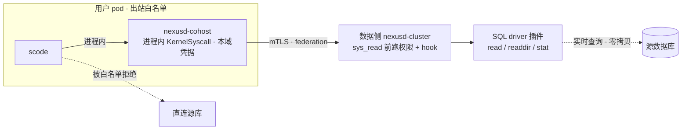

- **强制力来自出站白名单，不是沙箱** —— gvisor 关的是系统调用不是网络（见 §8）；SQL driver 只保证"经过 nexus 的那条路存在"，白名单保证"别的路不存在"
- **挂载方式**：SQL driver 写成 cdylib，生产二进制用现成的 `--mount-driver` 挂上；`sys_read` 在碰后端前就跑权限与 hook，**不改 kernel**
- **零拷贝**：数据留在源库，nexus 只转发

**scode 接 nexus 的放置：同一套机制，作用域单位随信任域走（见 §8）：**

| | 云上 · 多租户 | 盒子 · 单租户 |
|---|---|---|
| 放置 | 每用户一到多个 allocation Pod，每 Pod 一个 daemon、多 Agent／Session | 每盒子一个 daemon，会话 co-host |
| 接法 | 同进程 `KernelSyscall` | 同进程 `KernelSyscall` |
| 信任域 | 用户 | 组织 |

> co-host 的端点不可改指，但它与 nexus **共用网络命名空间与地址空间** —— daemon 连得到的东西，同进程的 agent 也连得到。所以业务库不落在本地 daemon 上：它留在源端，本地只持有一张证书，每个请求由对端按那张证书评估（见 §8 的两条前提）。

**三个前置**（缺一则"读被治理"只是纪律，不是属性）：

1. permission provider 按调用者、资源与操作执行权限检查
2. `sys_read / sys_readdir / sys_stat` 携带一致的 `OperationContext`，覆盖内容、枚举和元数据
3. post-read seam 支持返回内容审计与脱敏改写

已有实现的具体缺口见任务 G4 的核验记录。

**search / embedding 不进这条路径**：插件以 root 跑且 ABI 不带调用者身份（`zone_id` 是它唯一的权限边界）——直读被拒的 agent 能从搜索摘要拿到同样内容；且我们的查询是"按类型过滤 + 沿链接 + 聚合"，索引帮不上。

### 7.10 第一个试点：审计项目

**North star**：用本体替换审计项目现有的全部实现，然后让**正在干活的那个审计 agent** 基于它继续做业务迭代 —— 审计本身就是不断完善业务的过程，与使用本体的常态同构。所以这不是 demo，是**可用性轴的真实测量**。

**切换判据**（两条都过才切，切完旧实现直接删）：

- **400/400 逐位相同** —— 不是"都通过"，是每个数字一模一样
- **可用性不劣于现状** —— 同一个 agent、同样任务，新旧各跑一遍比答对率与 token

**阶段**：开发期影子跑（从同一份 raw 出发、输出逐位 diff，现有流程一天不停）→ 生产切过去试用 → 旧实现取缔。

**首次建模验证**（agent 拿原始材料第一次能写出多准的 spec）单列，且**必须换一个没参与过设计的 agent 来做** —— 参与过设计的等于拿着答案出题。

### 7.11 两套口径：调整分录是算出来的

审计天然有两套数：**账上怎么记的**，和**材料支持得住的怎么记**。常见做法是两份文档 + 一张手写的调整分录表 —— 然后它必漂：一边的数字动了，分录还是原来那句话，对账表变成一张"能配平的小说"。

**决定：一套 spec、两套口径（`bases`），只有真正不同的表达式写两遍；分录由 compiler 从差额算出来，不手写。**

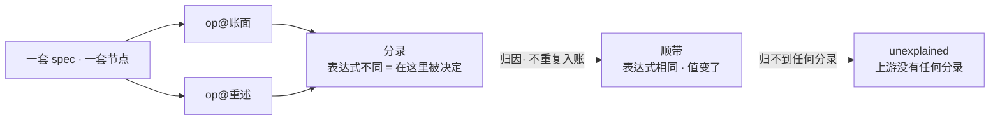

| | 是什么 | 为什么要分开 |
|---|---|---|
| **分录 entry** | 节点的**表达式**在两个口径下不同 | 重述是在这里被决定的，所以账也记在这里 |
| **顺带 carried** | 表达式相同、值却跟着动了 | 这是结果不是决定；也入账就会把图的**每一层**都记成一笔独立调整 |
| **unexplained** | 差异上游找不到任何分录 | 这正是整套设计要防的那一种失败 —— 报错并挂 CI |

- 节点写 `op@<口径>` **只在两边真不同时**；其余节点单一来源，不可能漂
- `because` 必须引用一个 **raw 或 hook**，不能是自由文本 —— 自由文本不是出处
- 四条拒绝：无 `because` · `because` 非 raw|hook · `entry` 只有一边（半张分录不平） · **某口径下沉默**（真为零就写 `op@账面: "0"`；"账上没有"和"还没算"长得一样、意思相反 —— 这是 `absent: gap|zero` 上移一层）
- 声明了 `bases` 却不指定口径就编译 → **直接拒绝**。"这是哪套数"不是调用方可以不答的问题
- **口径 × 期间 × 视图三轴正交组合**，不是每个组合一份文档

合计只算真正过账的部分，备查性质的重分类单列。原委外资本化台账的逐项数值与解释保留在任务 G5 的核验记录。

这一条直接替掉审计底稿里那句 `手工映射·待结构改造`。

### 7.13 链接与互证：审计的两个基本动作

前面几节把**一个类型内部**说清楚了。审计真正在做的两件事都跨类型，所以都得补上。

**链接** —— `ref` 现在可以指向另一个类型（以前只能指向 hook）。这笔付款对哪个供应商、这个主体在哪张合并表里、这份合同归哪条判定。不新增顶层概念，就是 `to:` 多接受一种值。

- ref 存的是目标的 id，所以 `where 供应商 = '供应商07'` 是**普通等值**，不需要 JOIN —— 这才是 §7.8 能把 JOIN 减掉的原因，不是硬撑
- 三条拒绝：ref 没有 `to` · `to` 既不是类型也不是 hook · **可空链接没有 `absent`**（"还没匹配上"和"确认没有对手方"是两个相反的结论，在数据里长得一样）
- 视图给**两个缩放级别**：类型级边永远在，带 `linked / unlinked` 计数（复核第一句话就是"这两类怎么关联的、有多少没匹配上"）；实例级边只在分组没折叠时发 —— 556 条边铺在一张已经把行折叠掉的画布上，是长列表换了张皮

**互证** —— 一个系统说的数是"信了"，两个互不通气的系统说同一个数才是"证得住"。这就是审计证据本身，而 owner 规则原来只允许一个 `from`，等于把审计最重要的那句话变成写不出来。

```yaml
金额:
  owner: source
  from: [R-KINGDEE, R-LEDGER]          # 列表 = 需要互证
  corroboration: { at_least: 2, prefer: R-KINGDEE }
```

行上按来源各写一遍 `金额@R-KINGDEE` / `金额@R-LEDGER` —— 和 `op@<口径>` 同一个形状，同一个理由：**不同的部分按变体写，差异由 compiler 判定，不由作者断言**。

| 结果 | compiler 怎么办 |
|---|---|
| 一致 | 取该值，检查通过 |
| 不一致 | **失败**，除非该行挂了 hook **并且** `prefer` 说了以谁为准 |
| 开口的来源不够 | 按 `at_least` 失败 |

- **`prefer` 单独不够用**：写一次偏好就能把以后所有分歧都埋在它后面 —— 和「plug 没有 `residual_to`」是同一种无声吸收。必须同时挂 hook
- 同时再写一个裸 `金额` 会被拒绝：那是**第三个没有出处的数字**，正是互证要防的东西
- provenance 按来源逐个查：第二个来源如果从没在 `provides` 里认领过这个字段，那不叫互证，那叫一个来源加一条许愿

来源间的差异落在发生差异的那一行，并通过 hook 显式呈现；具体对照数字和检查结果见任务 G5 的核验记录。

### 7.12 评估范围与外部回执

- **对照臂形态**：B 臂（给 agent 原始库读写 + shell）是**量尺的对照组**，不是要部署的形态；A − B 即 harness 的价值
- **回写外部系统的往返**：审计会真的去金蝶调账，所以"只读"只约束 **connector**，不约束业务闭环。业务往返通过**回执**表达 —— 分录由本体推导 → 人在金蝶过账 → 下一次拉取确认它一分不差地落了地 → hook 关闭。我们的代码不写外部库有三个理由（写完再读会让互证塌掉，两个"独立"来源不再独立 · 过账是客户会计的职权行为 · **这个往返本身就是控制**）；“发出指令并确认落地”的实施核验见任务 G5

---

</details>

## 8 · 设计取舍

**数据面不旁路 moss。** 旁路意味着暴露 pod、破坏隔离、也破坏 transcript 的单一真相。

**用户 pod 的网络边界由策略给，不由沙箱给。** gvisor 关的是系统调用，不是网络——pod 内可以直连节点网段，包括控制平面自身的内网地址。边界因此要在网络层单独声明：按用户 pod 的标签加一条出站白名单，放行集群 DNS、控制平面的服务端口与出公网 443，其余拒绝。判断它是否真的生效要看连接行为本身：被策略丢弃的 SYN 表现为连接耗时为零的失败，而放行后同一目标会走到 TLS 阶段。

**控制平面不进 gvisor。** gvisor 是用来关不受信代码的（scode 必须关），moss 自己不跑用户代码，沙箱没有安全收益却有实成本；更要紧的是循环依赖——moss 管着那个 k3s，如果它自己也跑在里面，集群故障时就无法自救。

**发布标准是低 glibc floor。** 老企业 Linux 是常态，scode 已是 musl 静态、零 glibc 依赖。

**sudocloud 与私有化同源。** 两者二进制近乎一致，云上这套是私有化交付的预演。

**cohost 按执行隔离范围放置。** 盒子按组织运行 daemon；云端按 owner 分隔，一个 owner 可以有多个 allocation，各自拥有独立 Pod、PVC 和 daemon，并承载多个 Agent／Session。Moss 按持久 Agent 存储归属选 allocation，K3s 放置 Pod；自动扩容 Compute VM 与 Agent 跨 Pod 迁移仍待实现。这里的用户执行隔离范围与图中的 CA_A/CA_B 证书信任域分开表达；共用 CA 不授予跨 owner 权限。

**co-host 取消的是 agent 与 kernel 之间的边界**，所以它成立有两条前提，缺一条它就从「更近的放置」变成「没有边界」：

1. **信任域内的 daemon 不得持有任何比该信任域更宽的东西。** 业务库留在源端（§7.9「数据留在源库」），本地 daemon 手上只有一张证书，请求由对端按那张证书评估。于是同进程的 agent 即便完全控制了这个进程，它能出示的也只有自己那张——签发在信任域之外且受白名单门控，它伪造不出别人。反过来，一旦图省事在本地直接挂一个库连接、一个服务账号或一个跨用户的共享缓存，这条前提就破了，而且没有任何东西会报警。
2. **凭据必须短时且可吊销。** 同进程的 agent 读得到自己的私钥，可以把它带出信任域使用。它伪造不了别人，但「自己那张」的有效期就是暴露窗口，所以会话凭据按会话签发、以秒计、可按证书吊销。

**同一用户的 Agent 上下文隔离，不等于彼此对抗的进程沙箱。** 同一 Pod 内的执行上下文共用用户信任域，按 Agent 与 Session 路径解析记忆和项目文件。不同 allocation 使用独立物理 PVC，不会自动获得彼此的远程文件挂载。外部触发、分享会话等更窄授权必须由接入和底层权限共同执行，界面筛选不能承担这项边界。

**代价是故障域。** 同进程意味着一个会话把进程带走，该信任域内其余会话一起没；爆炸半径因此正好等于信任域本身，这也是把作用域单位钉在信任域上的另一个理由。


---

<a id="delivery"></a>
## 9 · 当前交付与验收

**2026-10-26 检查点。** 本节是当前事项的统一入口；历史记录里的“当前”“待发布”仅指原核验时点。相邻工作线的维护进度保留最后核验日期，不由本次设计更新覆盖。

| 工作 | 已确认事实 | 剩余动作与通过标准 |
|---|---|---|
| 每人专属 Moss Agent | [Moss #441](https://github.com/sudoprivacy/moss/pull/441) 已实现稳定身份、独立 home 引用、使用权服务、Web/API 授予/撤销，并在创建、恢复和既有 WS 输入前复核；角色变化后旧会话不能沿用旧权限。相关 37 项、最新 HTTP/运行权限 11 项、Web API 2 项、浏览器交互 6 项回归通过；Web 类型检查通过，服务端类型门禁 104/104。完整服务器套件通过；Node 1,361 通过、9 项 Windows/配置失败与未修改 dev 完全一致、15 跳过 | 提交 `d9d23d55288c89b02484ca2c71f38db1a6b9e0f4` 已通过全部适用 CI 并正常合并，纳入已部署的 0.1.80；Ethan 管理员默认使用权与独立身份已在生产回读。飞书按成员链路见下一行；生产须验两人同群记忆/权限/Key 隔离、撤销拒绝及 Web/IM 续接。默认范围已由用户确认“管理员＋指定成员”，Web/API 必须同时可配置 |
| 飞书按实际成员接入 | [Moss #443](https://github.com/sudoprivacy/moss/pull/443)，提交 `cc7698ed2dd081c4d9ab47578c9ac4089f40ebd7`：私聊证明、本人才可绑定、管理员独立连接配置、持久 Session 指针、/new 与 /resume、去重及接收实例租约复核已实现；稳定 open_id 与失败回执处理见 §2.5、§3.4。SQL/执行器 8 项、HTTP/路由/身份展示 14 项、渠道生命周期/默认 Agent 20 项、Web API 4 项、真实前端路由浏览器 6 项回归通过。完整服务器套件通过；Node 1,370 通过、9 项与 dev 相同的既有失败、16 跳过；类型门禁 104/104 | PR 的 10 项适用检查与 4 条完整工作流均成功，标签专用发布任务按规则跳过；10/26 11:50 正常合并为 `651c78783b20f53fc87a76831416285d3f9f996d`。0.1.80 正式发布 8 项成功、71 项包验收与生产控制器切换已完成。真实 PostgreSQL 双连接并发用例已注册 CI，本地无数据库而跳过。生产日常组织连接已启用按成员模式；Ethan 本人私聊证明、三次群回复、同一持久会话及实际 owner 扣费通过；第三次在新 attempt 恢复六条完整历史。独立普通 QA 的 Web/API 授予撤销等八项生产检查已通过；第二位真实人类的同群隔离、IM 撤销及修复后的 /new、显式 /resume 等仍待现场验收；旧 bot owner 账单不替代本人成员的证据 |
| 新飞书应用 | `Moss` 已注册、发布并启用；消息/群 @/私聊与资源等 7 项权限生效，长连接事件已订阅；已进入宋一民、白桂东、bot QA 群，宋一民配对完成 | 此前真实 @ 创建会话失败，经 0.1.79 修复后，已在同一 QA 群通过 3 次真实 Agent 回复、连续对话与控制器重启后的记忆续接；同一 Session ID、owner 与已有历史保持。这 3 次是旧连接 owner 的历史验收；随后个人模式已另验 Ethan 的 3 次群回复、同一持久会话及账单，见 §9.0 |
| IM 默认 Agent 修复 | [Moss #439](https://github.com/sudoprivacy/moss/pull/439) 已于 10/26 01:04 正常合并；合并提交 `cb476b0c9eafac3d9904552230a947ef30937686` 与通过全部适用 CI 的 head 文件树完全相同。9 项检查成功；仅 PR 不适用的发布任务跳过，3 条完整工作流均成功。3 项新回归与 12 项关联回归、lint 与类型门禁 104/104 已通过 | 正式 `server-v0.1.79` 的 [8 项发布任务](https://github.com/sudoprivacy/moss/actions/runs/40214869661)全部成功，GitHub 已发布，并于 10/26 12:11 完成生产控制器切换。官方包 SHA、源码祖先关系、27 项隔离 HTTP 检查、受控重启与真实群聊续接通过。首轮会话一致性检查触发回滚，随后核实旧/新版本相同的启动策略会将 9 条无 runner 的失败遗留会话自然结束；审计事件、owner、attempt 与已有历史核对后才再次切换。修复也包含在后续 0.1.80 候选中；新版按人账单已单独核验 Ethan 的实际 Key；消息去重等剩余生产边界见 §9.0。完整本地测试的 9 项 Windows/配置既有失败仍保留，不将合并当作上线验收 |
| SudoWork 桌面与 WebUI | 共享 renderer、个人 Agent × 模板组合、顶部去重与侧栏入口已交付；正式 0.2.37 发布及原生 0.2.36→0.2.37 更新、工具、历史、实际 owner 扣费已验收 | 共享界面的主回归可复用；Electron 安装/IPC/更新与 Web server/登录/WS 仍各做宿主 smoke。不能用一种宿主验收替代另一种 |
| Moss 会话共用工作台兼容 | [SudoWork #1302](https://github.com/sudoprivacy/sudowork/pull/1302)，最终提交 `222dae5cd7996a9ebf222b68e19c7715510fc247`：Web 服务和桌面共用身份投影，保留飞书原 source/owner；桌面两个恢复入口同步身份，并保留现有运行状态和活动时间。相关桌面/共用工作台 44 项、Web 109 项通过；共享包构建、桌面/renderer 与 Web 类型检查通过。最终完整套件 3,402 项通过、28 跳过，370 个文件通过、7 跳过。新工作树缺浏览器子模块/SQLite 原生库的首轮环境失败已补齐，14 项复验通过，原日志保留 | 38 项适用 PR 检查全部成功，3 条基分支检查按规则跳过；已正常合并为 `5465d327ebb7bff7f5bb2e71fc1e3f2df2a33f70`。双架构官方镜像任务全部成功，WebUI 已于 10/26 15:40 部署；数据库备份、迁移、旧静态资产、既有 Ethan 登录与个人 Moss 的 4 条 IM 消息均已复核；后续第三次恢复回复后，6 条消息也已在共享工作台刷新核验。0.2.39 的版本准备 [#1303](https://github.com/sudoprivacy/sudowork/pull/1303) 已提交，3 个 manifest/lock 字段同步，完整 3,390 项测试通过、28 跳过，冻结锁文件安装通过；版本 PR 自身不发布，最终候选须同时包含 #1302。版本 PR 的 40 项适用检查成功、1 项基分支检查按规则跳过；已正常合并为 `87315497a2d562fc122fe6f45e9e152115d400ca`。官方 Nightly 质量/三平台构建/汇总成功，发布任务排队；官方 Windows 原包的十八项云端/本地/工具/历史/计费验收已通过。正式推广回归、人工审核、稳定发布和实际应用内升级仍待完成。WebUI 已满足新 IM 的兼容前置；本人账号已由用户确认并完成绑定。operator 身份不作为目录模板，不改变会话访问边界 |
| Moss 运行环境与计费 | 共用 cohost/gVisor，实际 QA 和旧 bot owner 的工作台真实回复与独立 Key 扣费已复验；10/26 12:16 核验控制器 0.1.79；新机器人旧模式会话 3 次真实请求全部记入 test_2 的 SudoRouter 用户 9920、Token ID 336（test_2-token），合计 11,153 quota，与该用户余额和用量差额完全一致。用户 ID 9920 与 Token ID 336 分别记录，避免混称 | 本次按人链路已另验 Ethan（Router 1086 / Token 420）：3 次真实群回复；前两次在同一 attempt，第二轮精确增加 55 quota，第三次新 attempt 恢复同一 Session 并精确增加 444 quota。旧 bot owner 9920 的工作台证据不替代说话人的账单。实际 Ethan Pod 已读回 gVisor、scode/cohost 0.2.34、Nexus 0.8.22、生效清单 server-v0.1.74 和匹配本人 Key 指纹；限定 owner 的合格镜像升级仍待验，不能由控制器号推断 |
| 新支付/回调/组织余额 | 富友生产商户、`testybc` 微信 ¥7.30 / $1.00 新支付、异步入账与实际成员 Key 消费已通过。10/26 12:55 新单 `MORG663fbb1e4fd446ffa93b63f2` 在生成约 19 秒后已付/已到账；Router 9950 增加 500,000 quota，组织余额 $2.92951 → $3.92951，唯一成功充值操作且无人工补款。随后正常客户端配置取得实际成员 Token 380，gpt-4.1-mini 一次真实回复成功；组织余额/用量、成员用量和消费日志精确对应 7 quota（$0.000014），余额 $3.929496。首次即刻读尚未结算的记录保留，之后仅只读复核原请求，无模型重发 | 首次图片上传 HTTP 400 / 99991679 与沙箱 5019 拒绝记录保留；本人显式授权 im:resource 后真实上传 code 0，28 项授权的新 token 已保存、旧 token 加密备份。首笔过期单读取未付后取消，收到群里及用户“现在可以”后才建第二单，新码与已付通知均发出并读回。验收未调用查单 sync 或人工补额度；原始入口 HTTP 日志未开启，判断回调的业务证据边界见 §5.1。退款范围已由用户确认按线下流程，保留订单、实付、入账和已消费记录；实际退款及财务核销未执行，不能列作已通过 |
| Router 管理员会话 | 此前会话上限问题已通过正常管理员登录确认恢复；本轮账单只读查询可用 | 新 Moss Agent 账单验收时重新登录并只退出本次会话，不无故撤销别人的会话 |
| 规划文档 SSOT 与版式 | [Sudostack #100](https://github.com/sudoprivacy/sudostack/pull/100) 保留原 23 个节点/27 条边，补为 27/33；全部 17 张图和历史记录保留，首图宽高比约 1.04，可缩放、平移及分区定位。压缩层间距后全图适配比例由 16% 提高到 21%，节点文字和边原文不变；自动布局仍有留白，已另备保留信息的 ShareOne 布局 FR。12 项 ADR 专项与 139 项完整测试通过；首轮 CI 的审核工作流字节锁失败已修正，文档检查移到独立工作流，原审核规则与哈希保持 | #104 的 12 项检查及 7 条工作流全部成功并正常合并；原 ShareOne 分享已固定到 `2afcb7040291d29224dcd98a1efc15508089654e`，回读 SHA256 与源文件一致，公网桌面/手机、明暗主题、17 张图、27 节点/33 边、旧锚点及折叠历史均通过。回读 ECONNRESET 和一次超时保留，随后同入口只读恢复成功，未重复写入。ShareOne 通用布局优化单独协作，不能以隐藏文字、连线或层级达到紧凑效果 |
| Cloud 维护（10/24 20:34 最后核验） | 资源容量、bootstrap 更新、旧环境发现、升级及模型状态修复见下方完整记录 | 这条工作线的正式依赖、排空、备份、扩容和恢复仍按其维护准入验收；本次不操作或覆盖并行维护 |

### 9.0 已验证结果与剩余验收 · 2026-10-26 23:08（UTC+8）

- **本人身份与归属：** 用户明确选择日常 Ethan 账号及其个人 Moss。正常短信登录后通过原刷新接口续期；用同一个宋一民飞书用户 token 读取 Moss 私聊中的一次性码，再由本人登录兑换。绑定不使用管理员/API Key 代领。日常组织为 `57373883-d5d6-445c-bfc0-fd0da72d6594`，不是原 QA 组织；一个组织内每个获授权人各有专属 Moss，不能把本人的通过写成第二名成员也已通过。
- **真实消息与工作台：** 宋一民、白桂东、bot QA 群中的两次请求由同一专属 Moss 会话 `195f857f-2d50-45f1-98f5-5935a6904b98`、同一 attempt 回复。第二次未重述标记，仍正确记住第一轮；API 回读原两条历史未变，WebUI 共用工作台实际截图显示四条消息，Agent 为 Moss、owner 为 Ethan。首轮自动检查漏读 Markdown 的 Shadow DOM，保留失败回执；补查 Shadow DOM 和实际截图后确认历史已显示，不据此编造产品修复。
- **独立 Key 与费用：** 实际网关用户 1086、Token 420，名称 `sudowork-recovery-20261019-pc3`。第二轮前后的 Token 用量精确增加 55 quota，只有一个新增请求日志且 owner/token 匹配；第一轮时间窗内对应日志为 389 quota。首次调用前的即时余额采集因响应契约误判未完成，因此不把第一轮称为已取得调用前后余额差额。当前是个人网关账户；该组织尚未启用共享模型余额，不能自动归为组织充值链路。用户旧后台密码仍返回“密码错误或账户被禁用”，vault 已标记；模型 Key 可用不等于后台密码有效。
- **原连接及运行清单：** 仅停止旧 QA owner 的同应用接收端，未转移旧历史。新个人连接的 tenant/app/org/owner 固定，旧 openclaw 应用连接未改。临时 QA 配置 Key 和本次运维会话已撤销/退出。控制器 0.1.80 的随包版本与原生效 compute 清单分别记录，不覆盖并行维护 pin；实际 Pod 版本和 digest 仍由对应运行环境验收确认。
- **个人会话空闲恢复：** 第三条不同的只读 QA 请求在原运行时不可用后恢复了同一持久 Session，新 attempt 为 `707f3894-f966-4d16-b10b-62957804a4af`；原四条消息逐字保持，新增后共六条消息、三次回复。Gateway 1086 / Token 420 精确增加 444 quota，只有一个匹配请求，Web 工作台刷新仍显示完整历史。此前 `@Moss /new` 在旧版误入模型通道并超时，其投递结果保留 unknown，未自动重放；这次安全的不同输入恢复不代替命令修复的上线验收。
- **成员权限生产边界：** 独立普通 QA 账号通过正常密码登录，完成默认无 Moss 权限、自授予 403、非法布尔参数 400、管理员授予专属身份、跨 owner 的 context/resume 403、同一 JWT 撤销即时生效、重新授予身份不变、跨组织管理 404 等八项检查。QA 账号已恢复禁用、专属授权已撤销，没有冒充第二位飞书人类完成绑定。
- **Moss 短信与会话修复：** [#448](https://github.com/sudoprivacy/moss/pull/448) 和 [#449](https://github.com/sudoprivacy/moss/pull/449) 均为九项检查成功、标签专用发布跳过，三条适用工作流完整成功后正常合并；合并提交分别为 `d3a3378b0e9600e7bc11574713ef8c29e3cf6992`、`f39c04b9d37ba1aed20254716509526f6236bbf9`。前者补正常手机号登录、验证码冷却和不带旧凭据/不重放认证；后者修复结构化 @ 前缀后的 /new、每轮输入前更新内部短期通道凭据，以及未知结果不建议重试。四个新增回归在原基线失败、修复后通过，真实 PostgreSQL 检查也在 PR CI 通过。正式 `server-v0.1.81` 已固定后一个合并提交并启动[完整发布流水线](https://github.com/sudoprivacy/moss/actions/runs/40341536055)，当前排队，尚未部署；不能把 PR 通过写成生产已修复。71 项隔离包验收、配置/历史/绑定/投递的前后校验和回滚条件已准备。
- **桌面 0.2.39 原包验收：** #1303 的四十项适用检查成功并正常合并为 `87315497a2d562fc122fe6f45e9e152115d400ca`；[官方 Nightly](https://github.com/sudoprivacy/sudowork/actions/runs/40312601596)的完整质量检查、Mac ARM64/Intel、Windows x64 构建和汇总成功，发布任务仍排队。Windows 官方 artifact 摘要、安装器与 portable 均核验；实际新安装和同一原程序的十八项验收通过：正常登录、Agent × 模板独立选择、云端和本地真实读写/权限、用户输入持久化、刷新恢复不重放、实际 owner 9932 扣费、对照账号无变化、只读刷新不新增用量。本地实际 scode 0.2.36 与随包二进制一致。旧脚本标签“我的 Agent”与新版“我的智能体”不符的失败保留；修正脚本后从同一安装/进程继续，未重放模型输入。QA 状态、原安装注册、快捷方式和协议均已精确恢复。正式推广回归、现有人工审核、稳定发布和真实 0.2.38 → 0.2.39 更新仍待完成，0.2.38 原安装器已下载并通过官方摘要校验。
- **实际 compute 版本：** 已读取 Ethan 当前 gVisor Pod：scode/cohost 0.2.34、引擎 `5befb9d`、Nexus 0.8.22、ABI 7、生效清单 server-v0.1.74；实际配置的模型 Key 指纹与本人 Token 420 一致。控制器随包 0.2.36、桌面本地 0.2.36 和现有云 Pod 0.2.34 分别陈述；仍需完成限定 owner 的合格运行镜像升级和历史/文件/计费复验，不覆盖并行维护 pin。
- **原分享与外部事项：** #104 的十二项检查和七条当前 head 工作流全部成功并正常合并；原 ShareOne 分享仍为 `3v34NpWDDcLTgBqo`，已发布合并源 `2afcb7040291d29224dcd98a1efc15508089654e`，源字节与公开回读相同。公开桌面/手机、明暗主题均渲染全部十七张图，第一图二十七节点/三十三边，宽高比 0.992，十六段折叠历史与旧锚点保留。线下退款已在授权的重构群请求财务确认，截至 10/26 22:34 没有新回复，实际退款及余额核销未完成。第二位真实成员的本人绑定/同群隔离已请求协调；之后仍须验成员模式 /new、/resume、空闲通道、重启、重复事件和生产手机登录。

### 9.1 验收顺序

1. 默认 Agent 修复的 CI、正常合并与正式发布；保留既有会话和配置的受控部署。
2. 按人身份与使用权、唯一 Agent 和持久 Session，补正反自动回归；所有适用 CI 全绿后合入。
3. 在指定 QA 群验收真实回复、两人隔离、多轮/重启/Web 续接、重复消息一次执行、撤销拒绝和实际 owner 账单；保留原失败与退款/支付外部条件。
4. 对照已验收产物更新本节；详细日志、哈希、时间、失败与回滚集中到附录。付款条件到位后单独完成真实支付链。

### 9.2 当前维护检查点（保留其他工作线原文）

<details>
<summary>2026-10-24：容量、依赖、维护准入的完整核验记录</summary>

<section id="cloud-status-20261024" data-shareone-anchor-id="cloud/status-20261024">

## Cloud 恢复与维护：代码修复、发布与生产分别验收 · 2026-10-24 20:34

| 工作 | 本次已核实 | 后续验收 |
|---|---|---|
| 生产容量 | 只读核对仍为 2 核 4 GB；17 个用户运行 Pod 中 16 个 Ready，另一个因 OutOfcpu 失败。已批准排空、备份后升至 8 核 16 GB | 本次尚未停机或扩容。维护前重新核对任务、身份、卷与备份；维护后验证真实恢复 |
| 过期启动凭据 | [Nexus #467](https://github.com/nexi-lab/nexus-vfs/pull/467) 全部检查通过后合入，正式 v0.8.24 已发布。完整验证的过期 bootstrap 身份可启动凭据更新；过期权限仍被 TLS 和请求授权拒绝 | [SudoCode #1043](https://github.com/sudoprivacy/sudocode/pull/1043) 将 cohost/CLI 0.2.37 配对到该版本，完整 CI 与正式发布仍待完成；生产镜像尚未切换 |
| 原生租约回归 | 真实、校验过的 Nexus 0.8.24 Windows daemon 上，mTLS 收发、失败提交后从持久位置恢复、租约过期与分区恢复三个用例通过。受控关卡强制新授予和投递早于旧客户端观察到释放完成 | 保持原 TTL、续期边界与阶段预算。新提交须通过全部消费端 CI；该测试修复未改变生产租约或 kernel syscall ABI |
| 旧运行环境发现 | 公共包 [Sudostack #90](https://github.com/sudoprivacy/sudostack/pull/90) 六条工作流全部通过后合入；已推送 user-runtime-v0.1.8 标签，正式发布检查进行中 | 核对官方包及校验和后再更新 Moss 的依赖与锁文件；现有失败或分区 Pod 的恢复继续单独处理 |
| 受控升级与模型目录 | [Moss #429](https://github.com/sudoprivacy/moss/pull/429) 全部工作流及架构构建通过后合入。升级解析 owner 的静态凭据，模型可用性检查保留在实际会话/推理入口 | 正式发布和部署尚未完成。停用或缺失的显式 provider 仍拒绝，不能借基础设施升级扩大模型权限 |
| 模型切换状态 | [Moss #432](https://github.com/sudoprivacy/moss/pull/432) 使用同一待回复请求表记录活动，修复无效控制永久 busy、并发关联和过早 idle。七项新增回归通过，完整本地检查没有新增失败 | CI 仍在进行。30 秒截止仅报告结果未确认，原任务和连接继续；迟到确认只应用一次，不重放请求。尚未据此认定桌面 Opus/Grok 报告已经修复 |
| 维护准入 | Moss 本地实现独立暂停持有者、控制器 epoch、已接收工作收敛和实际 runner 输入关卡；覆盖真实 HTTP/WebSocket 与 daemon 的回归 | 该实现仍未提交，待正式 0.1.8 依赖及最终检查。controller-input 准入只证明该控制器输入已排空；停机还需核对原生执行、审批、后台工具和实际写入者，并完成一致性备份 |
| 飞书通道 | [Moss #428](https://github.com/sudoprivacy/moss/pull/428) 完整 CI 通过后合入；真实安装 SDK 与本地物理连接已验收，生命周期能正确等待就绪并关闭连接 | 生产入站消息、Agent 执行和同群回复仍待实际应用权限及真实链路验收。本次复查 automation bot 所在 53 群完整，无新增反馈 |
| 新微信充值 | testybc 管理员登录和充值权限已核对；获授权的对接消息已发送并读回确认，最小一笔为 $1 / ¥7.30 | 等尹斌臣确认方便扫码后再创建唯一一笔 QA 订单，随后核对真实回调、组织共享余额与实际成员 Key 用量。本次尚未创建订单 |

**Pod、Agent 与会话的归属保持一个来源。** `@sudo/user-runtime` 的 `AgentRuntimeHomes` 由持久的 owner/Agent 归属选择 allocation，Moss 在创建、发现、文件和恢复路径复用它；K3s 负责放置 Pod。原 0.1.69 验收中，同一真实用户的 17 个 Agent 使用两个独立 Pod/PVC，同 Agent 的后续 Session 保持原归属，两侧路径隔离和外部 owner 拒绝均通过。新版的冷恢复还需重新验收；同 Agent 跨 Pod 并发写、Agent Move 和按负载自动增减计算节点继续单独追踪。

**按依赖顺序推进。** 先完成正式依赖、CI 和发布部署，再排空、备份、扩容并验证 Session ID、历史、文件、Agent 记忆与 latest 恢复。SudoPrivate 继续复用 Cloud/Private/Edge 的公共能力，公共运行、身份、存储、资源与部署能力归 Sudostack；本轮先完成 SudoCloud 验收。

</section>

</details>


## 相关文档

本页只写 Sudo Cloud 自身的架构与设计。相邻范围在各自的文档里：

| 文档 | 覆盖 |
|---|---|
| [当前交付与验收](#delivery) | 当前待办与证据；旧任务定位与完整记录见附录 |
| [系统架构说明书](https://s.shareone.vip/s/sudo-product-architecture) | 产品全景与两轴口径（平台 × 托管形态） |
| [agent-context-storage-matrix](https://s.shareone.vip/s/agent-context-storage-matrix) | agent 上下文与存储的契约矩阵 |

跨组织信任面与 IM 通道的协议细节属于 sudoedge 与 nexus 两条线，不在本页展开；ontology 的选型对比同样不在本页，本页只记已定的决策。

---

<a id="tasks"></a>

<a id="history"></a>
## 10 · 历史证据与环境定位

以下保留原始事实、细节、链接及失败记录。历史状态不会覆盖 §9；已被后续修复的旧结论也不删除。完整展开后仍可查全部信息。

<details>
<summary>10/10 盒子现场摘要（当时版本与边界）</summary>

**历史现场摘要（2026-10-10，当前 Cloud 状态以本页开头核验为准）：** DGX 的真实浏览器路径已运行 `笔记本浏览器 → SSH 隧道 → 盒子 WebUI → 本地 Moss → cohost 内 ManagedAgentService → 进程内 scode → Nexus /model → 本地 new-api → GPUStack/vLLM → Qwen`。执行 cohost 已核验为 sudocode #916 的官方 ARM64 产物，内置 Nexus v0.8.3 与内容闸；Moss #352、Sudowork #1222 已在全部 CI 通过后合并并部署。真实相对路径 Write／Read／Edit／Read、取消后的下一轮、闲置刷新与实时工具成功／失败结果显示已验收；首次自然语言文件任务仍暴露模型选错文件名与空内容的问题。此前盒子整机重启的本地凭据、模型挂载、历史和持久文件恢复证据保留；旧 LOCK_UNCERTAIN 与运行中崩溃恢复仍待验收。中文公司名阈值缺陷和分析器启动死锁已在 sudostack #33/#34 修复、全绿合并并部署。云端最新只读核验仍配置 k8s 外部 scode，云端 cohost 迁移、云凭据恢复和真实 A2A 均未完成验收。

</details>

<details class="history-record">
<summary>Moss 0.1.76：终止会话工作区边界验收完成 · 2026-10-20 11:23</summary>

## Moss 0.1.76：终止会话工作区边界验收完成 · 2026-10-20 11:23

- **修复已合并、正式发布并上线：**[Moss #414](https://github.com/sudoprivacy/moss/pull/414) 在最新 dev 上通过完整本地回归（1,777 项通过、9 项配置跳过）、变更文件 lint 和服务器类型检查门禁；类型错误仍为既有基线 104，不记为零错误。远端 PR 必需检查全部通过后正常合并，[正式发布 CI](https://github.com/sudoprivacy/moss/actions/runs/39357290842) 全部通过。正式版本 `server-v0.1.76` 的完整包、校验和、源码提交 `cefeb2590a3f1772fcb49cc7572394fe80f6a732` 与发布清单均已核验，隔离启动及真实 HTTP 边界测试通过后完成生产控制器切换。
- **生产正反用例通过：**原 QA 会话的历史内容哈希与消息数保持一致；已经终止的会话执行文件列表、读文件、写文件均返回 HTTP 409，六次线上反向检查最慢 0.979 秒，未创建恢复执行，也未改变持久化终止状态。另创建一个新的归属 QA owner 的 cohost 会话，真实写入、读取并列出文件成功；终止同一新会话后，三种文件操作同样快速返回 409。这轮工作区与历史复验未发送模型输入，实际 owner 与对照账户的模型请求数、用量和余额均保持不变；QA 会话均已终止，用户恢复原禁用状态。
- **生产 Moss bot 的当前 Key 再验收：**在校准后的运行环境中新建一条私有管理工作台会话，通过真实前端发送一条明确标为 QA 的提示并收到实际回复，刷新后历史保留。bot owner 的独立 Key 用量与实际账单日志增加，归属核对一致；管理员 Key 用量保持不变。本次私有工作台会话已终止，不作为飞书入站回复的通过记录。
- **与并发恢复修复共同生效：**此前生产 `0.1.72` 的只读打开曾使已终止会话进入 creating；另一工作线的 #410 / `0.1.73` 已保护持久化终止意图，但本次对 `0.1.73` 的单次真实文件列表读取仍等到 25 秒超时。#414 在共享工作区入口先检查终止意图，再决定是否建立恢复通道，补齐了快速失败边界。原失败、清理与无额外扣费记录均保留。
- **控制器维护与回滚记录：**上线前通过实际 activity 接口确认另一用户的持久会话空闲，未调用终止接口；另一个 cron 会话已经启动失败且没有 runner。首次切换时，该失败 cron 在系统正常收敛后由 active 转为 ended，触发严格保留性检查，应用自动回退到 0.1.74，数据库没有回退。保留原失败日志并按新的实际状态重新预检后，第二次切换成功；已有空闲会话的 owner、active 恢复意图及完整消息哈希前后相同。所有配置、运行清单、备份与应用回滚检查均保留。
- **控制器与实际 compute 版本分别核验：**本次应用切换保留生产全部配置、服务 drop-in、用户数据和另一工作线已更新的生效运行清单 `server-v0.1.74`，不回退先前 `0.1.67` / 引擎 `0.2.33` 的配置。期间发现 QA 与生产 Moss bot 的旧 Pod 仍报告版本漂移；应用上线后，通过已有 owner 受控升级接口完成这两个身份的实际运行环境校准，SDK 验证新镜像、执行文件、归属与保留卷。随后实际 Pod 镜像 digest 与清单一致，均不再漂移，对应 scode/cohost `0.2.34`、Nexus `0.8.22` 与 ABI `7`；已终止历史保持关闭、消息哈希与 owner Key 指纹保留，升级本身没有新增模型请求或扣费。其他 owner 不在本次定向升级范围。桌面 `0.2.37` 的本地随包引擎仍按已验收的 `0.2.33` 版本记录；其正式发布与真实 `0.2.36 → 0.2.37` 原生升级验收结果保留。
- **CI 失败和去重记录保留：**原 PR 的 amd64 管理页浏览器出现 `ERR_NETWORK_CHANGED`，懒加载脚本失败；原截图、网络事件和失败日志保留。之后纳入上游发布清单修复 #412 和浏览器 SDK 固定版本 #413，补跑完整本地回归与远端 CI，通过后再合并；未删除管理页断言或放宽测试超时。合并同时触发同一提交的 dev 与正式标签验证，正式 Ubuntu 检查排队时，仅取消了本工作线自己的重复 dev 任务 `39357278437`；保留正式标签任务 `39357290842` 的全部检查，其他工作线任务保持原样。
- **支付群已回复当前流程：**“sudowork系列产品重构”群确认目前只有生产商户，并指出 `testybc` 曾测试线上富友充值。已只读核对其微信 ¥7.30 → $1.00 订单为已付款、已到账，另有支付宝取消订单；这是历史生产记录，不等同于本次新支付/回调验收通过。群内进一步说明：每个新组织对应一个 SudoRouter 账户，成员共享组织余额、每人分配独立 API Key；仅组织管理员可在 SudoWork 桌面设置的组织充值中心充值。旧个人订单来自 sudowork-server 迁移，本次接手用的旧 QA、Moss bot/root 仍属于旧组织，先前独立账户扣费结果不冒充为新共享组织计费流程的验收。回复者理解退款应线下人工处理；正式退款产品范围、后续真实支付验收的对接人、环境与步骤仍待明确。沙箱单次查询的 `5019：无此交易权限` 拒绝记录保留。原 password-agent 条目已补中文搜索别名、原回复和后续问题引用，原凭据与附件保留。
- **生产飞书入站仍待应用拥有者：**获授权的宋一民、白桂东、bot QA 群中已发出生产 Moss 应用权限、事件订阅、可用范围及入群的确认请求。既有控制台 `/exception/403` 与 bot 成员权限拒绝保留，尚未以另一应用身份重试；此前私有工作台的真实回复和 owner 扣费通过，不替代飞书入站 → Agent → 群回复验收。可读取的 51 群检索与另两群拒绝记录保留。
- **原图信息与评论完整保留：**沿用接近正方形的布局，第一图原有节点、连线、分组和 PVC 信息全部保留；此前按日期记录的正文、其他图表、评论与访问设置保持原样。历史中的“排队 / 待发布 / 未完成升级”描述仍作为历史记录，以最新日期的实际验收为准。

</details>

<details class="history-record">
<summary>桌面 0.2.37：正式发布与原生升级验收完成 · 2026-10-19 23:11</summary>

## 桌面 0.2.37：正式发布与原生升级验收完成 · 2026-10-19 23:11

- **正式发布完成：**[推广任务](https://github.com/sudoprivacy/sudowork/actions/runs/39171217405)与[正式发布任务](https://github.com/sudoprivacy/sudowork/actions/runs/39251376958)已成功；Windows、Mac ARM、Mac Intel 构建及 WebUI 两种架构发布构建均成功。此前获授权的 GitHub 官方管理员审核已由服务端确认，保护规则与指定审批人保持原样。已核验 [v0.2.37 正式版本](https://github.com/sudoprivacy/sudowork/releases/tag/v0.2.37) 的 GitHub/COS 文件、三个架构更新 feed、完整 Windows 安装包哈希及随包 scode `0.2.33`；对应源码提交 `dba5b7314b813441db9381054e656d824b59018f`、源码树 `7f41400974ea1cea3dda0264802f5394bdbc27d6`，共享 renderer 包含已合并的 #1268 修复。
- **真实应用内升级完成：**在原始、未修改的 `0.2.36` 程序中，通过“检查更新 → 下载并安装 → 立即安装”调用原生更新器；下载缓存与正式发布 Windows 安装包完全一致。原生安装向导识别并复用原安装目录，正常退出 `0`；安装结果与正式包完全一致，保留的用户文件校验通过。更新器与单实例锁保持启用。安装后以原 QA 用户目录启动 `0.2.37`，自动恢复同一登录、原本地会话与原云端会话。
- **升级后实际验收通过：**旧回复内容完整保留并实际渲染；云端历史同步按已有实现重建镜像消息 ID，因此按内容哈希、类型与角色各一次核对历史，而不把镜像 ID 当业务身份。原会话继续执行真实 `write_file → read_file → 回复`；新用户提示只持久化、接受一次，刷新后保留且不重放。升级后的只读历史恢复、刷新均没有新增模型请求或扣费；执行工具后的模型费用只记入实际 owner 的独立 SudoRouter 账户，对照账户不变。QA 会话已终止、测试用户已恢复原禁用状态，应用正常退出，宿主协议和快捷方式恢复至验收前快照；无其他安装被替换。
- **异常和验收范围保留：**升级前后台窗口未及时绘制的两次失败、安装退出后的 CDP 连接收尾异常均保留记录；原安装流程只触发一次。升级后的首次工具任务遭遇 `socket hang up`，只读查询也发生响应截断；核对服务端未收到任务、工具未执行且账单完全未变后，进行了仅一次受控重试并通过。并未因网络错误自动重放已接受的模型请求。原程序背景帧截图及 DOM 检查已完成；此前 Win32 前台激活失败记录仍保留，不将背景检查写成整段流程的人工前台操作通过。
- **支付与生产飞书仍待外部条件：**可读取的 51 个 bot 群历史与附件已完整检索，另两群的 `230002` 成员权限拒绝保留；未声称 53 群全部可读。已按用户要求在“sudowork系列产品重构”群集中询问尹斌臣、武鹏测试商户、聚合查询/支付/退款权限、回调注册和可用验收订单，发送后原文回读一致。现存配置对测试接口的单次虚构订单查询返回 `5019：无此交易权限`；尚未创建支付、退款或入账。另已在获授权的宋一民、白桂东、bot QA 群，请生产 Moss 应用拥有者处理既有 `/exception/403` 管理权限、已发布消息权限、事件订阅、可用范围及入群；真实飞书入站回复仍待确认，先前私有工作台验收不等同于该链路。两条问题已发出，等待回复。
- **文档与图保持完整：**保留全部 23 个节点、27 条连线、17 张 Mermaid 图、allocation 独立 PVC、此前所有按时间记录的正文与评论设置；第一图沿用已验收的接近正方形布局。更早的“排队 / 待发布 / 待升级”描述作为历史记录保留，以本条最新事实为准。

</details>

<details class="history-record">
<summary>Cloud 运行环境更新与中断恢复 · 2026-10-19 20:34 北京时间</summary>

## Cloud 运行环境更新与中断恢复 · 2026-10-19 20:34 北京时间

**本节是当前线上检查点；后面的桌面与历史记录保留其原版本和时间。SudoCloud 仍未全部完成，先完成 Cloud，再推进 SudoPrivate。**

| 范围 | 当前结论 | 证据边界 |
| --- | --- | --- |
| 控制面 | Moss `server-v0.1.72` 已部署且健康；#402 的运行环境更新与结构化终态、#407 的持久历史投影和停止执行过滤均已合入。全部适用 PR 检查及正式发布 8 项任务通过；Nexus Node Client 为 `@nexus-ai-fs/vfs-client 0.7.4` | 计算运行时仍为 `0.1.67-amd64`，cohost／CLI `0.2.33`、引擎 `33ffea1`、Nexus `0.8.17`、ABI 7；外部签发服务也已直接核实为 `0.8.17`。发布清单中的 `0.2.34`／`0.8.22` 配套需要独立升级，不能由控制器版本推断其已上线。部署保留业务配置、现有 Pod 和 PVC 身份 |
| WebUI | 官方双架构镜像 `289665b9` 已部署，#1272 的终态读取先于 Moss 新投影上线。保留此前 #1270 的模型目录就绪检查及后续静态资源修复 | 原 PostgreSQL、2,590 个既有静态资源，以及 Nginx gateway 的镜像、证书和配置保留；更新后重新解析上游并验证公网 HTTPS。最终源码 3,279 项测试通过、27 项既有条件跳过；52 项 WebUI 合同测试及 WebUI、Desktop、renderer 类型检查通过。正式 CI 全绿后合入 |
| 创建后启动失败与显式更新 | 在 `0.1.70` 的真实 B 账号浏览器中，创建失败保留原 Session ID；用户点击更新后仍在原 Session，更新前未发送的输入没有进入历史。随后新输入得到真实回复并持久化 | 更新不自动重发旧输入；运行中的 Bash 请求更新返回 409，执行未被取消。此处明确记录原验收版本 |
| 非计划 Pod 丢失 | 沿用原故障：真实 Bash 获准一次后，旧容器已退出。新版本刷新原 Session 后，同一个中断事实只显示一次，加载状态结束 | 同一 Moss／native Session、历史字节前缀、冻结 prompt 和 Agent 记忆保持；一次性计数仍为 1，完成文件不存在，没有重放原命令 |
| 显式继续与底层隔离 | 只发送一条新的无工具输入，真实模型正确回忆提示中未给出的 Agent 随机口令。B 的有效委托身份在自身 runtime 可用，在 A 上读取文件、查询和取消运行会话均被原生服务拒绝 | 原生未知结果只落一条，A 的状态和文件不受越权探测影响。Moss 与界面筛选不能替代 Nexus 授权；跨组织／跨 zone 完整治理仍另行验收 |
| Agent 与任务模板 | 在更新前的 WebUI `8ea67032`／Moss `0.1.70` 中，真实浏览器可独立选择已有个人 Agent 和招聘专家模板，选择模板后 Agent 身份保持；未发送前，Agent 与 Session 列表没有变化 | 深色界面在 1280×900 与 390×844 下均已截图检查、无横向溢出。本项是草稿选择验收；发送执行和记忆继承沿用分别记录的真实模型证据，Desktop 固定候选仍独立验收 |
| 桌面及其他工作线 | 保留 `dba5b731` 候选的三平台回归和 18 项原生验收。按 20:01 检查点，管理员已放行正式推广，原流水线正在等待 runner；正式产物及真实应用内升级继续独立验收 | 下方保留该工作线的完整审核记录、支付与飞书的外部条件，以及按时间记录的历史结果 |

计费最新核对（20:43 北京时间）：本轮 GPT-6 Luna 恢复回复已在用户用量中记录输入 23,863、输出 91 tokens、扣费 3 积分；当日总请求数为 6。此前五条零用量、零费用记录仍保留，历史差异的根因尚未查明，不能把最新一次成功推断为历史问题已修复。未推算拆分、人工补记费用或重试此前被拒绝的诊断请求。Sonnet 与其他 owner 的已通过计费证据分别保留。Agent Move、同 Agent 跨 Pod 并发写栅栏、Compute VM 自动扩容、企业完整 zone 治理，以及飞书和支付的外部门禁继续独立跟踪。10 月 19 日团队报告的 Zone v1 联调中，Nexus-VFS #364 已合入，但 Nexus #4846、Moss #311、Sudostack #30、SudoCode #871 在本轮只读核对时仍开放；联调结果与当前生产部署分别验收。

源码与发布：[Moss #407](https://github.com/sudoprivacy/moss/pull/407)、[Moss 正式发布](https://github.com/sudoprivacy/moss/actions/runs/39243978166)、[SudoWork #1272](https://github.com/sudoprivacy/sudowork/pull/1272)、[WebUI 官方镜像](https://github.com/sudoprivacy/sudowork/actions/runs/39245373065)。

</details>

<details class="history-record">
<summary>桌面发布：管理员审核已放行 · 2026-10-19 20:01</summary>

## 桌面发布：管理员审核已放行 · 2026-10-19 20:01

- **审核已完成：**已通过 ai-dev-browser 的标准 extension 连接恢复原 Chrome 配置，激活专用自动化标签页，并确认页面实际可见、登录账号为仓库管理员 `elfenlieds7`。刷新固定源码、完整本地回归、三个平台正式推广构建和 18 项原生验收的发布前核对后，按此前授权在 GitHub 官方管理员审核对话框提交一次。服务端审核历史确认 `candidate-approval` 的状态为 `skipped`，并完整记录本次 QA 说明；这里表示已使用 GitHub 提供的管理员放行，质量检查均已实际通过，原保护规则与指定审批人保持原样。
- **当前等待 runner：**[正式推广任务](https://github.com/sudoprivacy/sudowork/actions/runs/39171217405)已离开人工审核等待状态；作业页原文为 `Waiting for a runner to pick up this job...` 及 `All GitHub-hosted runners with label [ubuntu-latest] are busy`。当前尚未创建正式标签，未重复提交审核或重跑已通过的构建；继续跟踪原流水线的实际执行结果。
- **仍需实际完成：**正式流水线全绿后，核验 GitHub/COS 原包、三平台更新 feed 和 scode 引擎，再在保留原始程序包的 QA 安装中执行 `0.2.36 → 0.2.37` 真实应用内下载、原生安装、同一账号/会话/历史恢复、真实文件工具、只读刷新无额外扣费及实际 owner 独立计费。0.2.36 原程序与安装注册、四个独立测试端口、QA owner 的独立 SudoRouter 凭据与额度已检查就绪；暂未启动此次真实升级。正常 Router 管理员登录可用，本轮只读检查创建的会话已退出。
- **此前结果保留：**Moss/WebUI 的工作台与 owner 计费验收、候选桌面的 18 项原生验收、支付 `5019：无此交易权限`、飞书 53 个 bot 群中 51 个完整可读及另外两群的 `230002` 拒绝均保留在下文按时间记录。支付/退款/回调和生产飞书入站回复仍有原先的外部条件，未写成完成。全部 23 个节点、27 条连线、17 张 Mermaid 图、allocation 独立 PVC、历史文章和评论设置保留。

</details>

<details class="history-record">
<summary>支付与飞书现况复核 · 2026-10-19 19:12</summary>

## 支付与飞书现况复核 · 2026-10-19 19:12

- **飞书入站验收的目的：**验证“真实飞书群消息 → Moss Agent → 同群回复”的渠道链路；Moss / WebUI 工作台已有独立的 Agent、工具、历史和实际 owner 计费验收。现有 `feishu-automation` 的 `EthanAI-connector` 应用为 `cli_a9cffec630b9dbd1`，生产 Moss 配置的应用为 `cli_a9216be9ebf85bc7`；查群成功不等于另一个应用的接收事件、权限及入群已验证。生产应用管理页此前显示 `/exception/403` 与 `Sorry, you don't have access to this page`，仍待应用拥有者通过官方流程处理，未以其他身份重试该管理权限。
- **本轮群历史覆盖：**列出 automation bot 所在全部 53 个群，完整读取其中可访问的 51 个群，共 7,670 条消息，索引 263 个文件附件，并补查充值、退款、对账、回调及原消息上下文。`特助测试群` 与 `sudorouter` 的历史被现有授权用户身份读取时，均返回 `230002: Bot/User can NOT be out of the chat.`；这两个群尚未读完，未换身份重试。宋一民、白桂东与 bot 的指定 QA 群也已读取；本轮未外发消息。
- **CC 之前的支付请求已找回：**`sudowork系列产品重构` 群 2026-09-10 12:45 UTC 的原消息要求对接代码/文档、商户后台回调地址注册及“确认测试商户可用”；12:58 UTC 尹斌臣接手支付。武鹏同日提供的 `.env` 为生产配置，`FUIOU_TEST_MODE=false`。password-agent 原条目的七项富友配置仍与该原附件逐项一致；可读历史和附件中尚未找到后续测试商户可用的确认。
- **新增真实只读查询结果：**使用 vault 中现有配置，仅向 `https://hlwnets-test.fuioupay.com/aggpos/orderQuery.fuiou` 查询一个本轮新建的虚构 QA 订单号；没有创建支付订单。富友返回 HTTP 200、业务码 **5019**、原始 UTF-8 原因 **无此交易权限**。该查询未通过，不能把测试地址或测试开关当成沙箱已经可用。需支付/商户负责人或富友确认正确的聚合支付测试商户及接口权限，并确认回调地址注册；支付、退款、回调完整验收仍待完成。原拒绝记录保留，未换端点或身份重试，也未修改生产配置或余额。
- **凭据可检索：**原有 vault 条目 `Fuiou production merchant - recovered 2026-09-10` 已追加消息来源、支付负责人和本次查询结果，可用“尹斌臣”“富友测试商户”“5019”“无此交易权限”“Fuiou sandbox”检索；原密码、密钥及历史说明保留。凭据值不出现在本页。
- **桌面发布状态：**`dba5b731` Nightly 整条流水线已成功，Windows / Mac ARM64 / Mac Intel 六个候选资产齐全；Windows 安装器及 portable 的官方摘要与通过 18 项原生验收的原包一致。正式推广仍待 `candidate-approval` 人工审核。此前管理员发布授权继续有效；原自动化页面曾因 `hidden` 拒绝输入，审核未提交，本轮浏览器扩展连接已断开，需重连可见页面或在官方页面完成人工审核。正式版资产、更新 feed 和实际 `0.2.36 → 0.2.37` 应用内升级仍待后续验证。
- **布局与信息保留：**保留全部 23 个节点、27 条连线、allocation 独立 PVC、分组与信任边界、全部历史文章和 17 张 Mermaid 图；本轮只补入实际阻碍及核实结果，近方形布局、缩放和适应窗口入口保留。

</details>

<details class="history-record">
<summary>桌面对齐候选：三平台与原生验收通过 · 2026-10-19 07:41</summary>

## 桌面对齐候选：三平台与原生验收通过 · 2026-10-19 07:41

- **固定源码与完整 CI：**桌面候选 `dba5b731`、受检 PR #1268 与合并源码 `86de9a5e` 的完整源码树均为 `7f414009`，共享 renderer 树均为 `12845e7a`。本地完整 354 个文件 / 3,270 项测试通过，27 项按原配置跳过，严格类型和共享包构建通过。[正式推广回归](https://github.com/sudoprivacy/sudowork/actions/runs/39171217405)要求的 Windows、Mac ARM64、Mac Intel 打包及完整质量检查已全部通过，进入人工审核。已从 [Nightly](https://github.com/sudoprivacy/sudowork/actions/runs/39171186375)核验 Windows 原始产物及完整质量检查；额外 Nightly Mac 构建继续跟踪。实际仓库门禁依赖完整正式推广回归和固定源码 tag，服务器保护规则保持原样。
- **新候选原生验收：**下载 GitHub 官方 Windows 原始产物并按官方 SHA256 完整核验，使用未修改的原始安装包、独立 QA 目录、全新的应用数据完成干净安装和首次 scode `0.2.33` 解压。正常 UI 登录、个人 Agent 与私有模板独立组合、实际云端回复、真实文件写入/读取、用户输入落盘、刷新恢复与输入不重放、本地实际执行和刷新后的文件工具、实际 owner 独立扣费全部通过，共 18 项。原始安装器 SHA256 为 `71c7a32a68982ef92d09a63f172701b766fba524b289f37c422cb5afd2869e90`，实际安装的 app.asar 与同源官方 portable 包一致，未修改应用包或预置安装根目录。
- **清理与保留：**新候选独立 QA 会话已终止，QA 状态已恢复；应用正常退出，宿主协议和快捷方式精确恢复，原 0.2.36 QA 安装注册及用户文件保留。旧候选 `2e01f4c0` 的原生证据与新候选证据分别保留，下文各检查点按其时间和版本理解。
- **仍待正式发布和实际升级：**现有 `candidate-approval` 人工审核门禁仍在等待，之前的管理员发布授权继续有效，已通过自有标签确认管理员登录态，并打开官方审核对话框。填写说明时，ai-dev-browser 返回 `The automation page is still hidden after activation; this input was not sent`；网页持续报告 `hidden`，说明文字未输入、审核尚未提交。已按工具提示尝试标准激活和窗口还原，需先让同一 Chrome 页面可见，或由用户在官方页面完成人工审核。随后仍须核验正式 GitHub/COS 资产和三平台更新 feed，并真实执行 `0.2.36 → 0.2.37` 应用内下载/安装、同一原会话恢复、后续工具与实际 owner 计费验收。
- **线上与外部范围：**本轮线上验收所用 Moss `0.1.69` / WebUI `86de9a5e` 已通过真实模板、文件、只读 shell、刷新和 owner 计费；管理员与生产 bot owner 的独立 Key/计费已另行实际验证。vault 中 Moss owner 归属说明可用 `Moss cohost`、`SudoRouter API Key`、`独立计费`、`生产机器人`、`test_2-token` 等关键词检索，原密码、凭据和附件保留。富友聚合 RSA 沙箱商户仍未确认。生产飞书应用 `cli_a9216be9ebf85bc7` 的管理页将当前账号引导到 `/exception/403`，原文为 `Sorry, you don't have access to this page`；当前有效权限与指定 QA 群成员资格仍待应用拥有者按官方流程处理和确认。私有工作台回复验收独立记录，飞书真实入站/回复及支付/退款/回调仍待完成。
- **信息与布局：**保留此前全部 23 个节点、27 条连线、每 allocation 独立 PVC、原文与历史记录、评论设置、managed-session 门禁矩阵和全部后续图表，仅更新桌面交付状态。近方形自动布局、缩放、适应窗口和 100% 阅读入口保留。

</details>

<details class="history-record">
<summary>当前交付与验收核对 · 2026-10-19 06:12</summary>

## 当前交付与验收核对 · 2026-10-19 06:12

- **线上版本及真实验收：**Moss `0.1.69`，WebUI `86de9a5e`（#1268 已正常合并并部署）。已在此组合上重新完成个人 Agent 与私有任务模板独立选择和持久化、真实模板回复、`write_file` / `read_file` 与只读 `bash pwd`、owner API 和 WebUI BFF 文件回读、刷新恢复及输入不重放。独立 QA owner 的 SudoRouter 请求数由 58 增至 65，未使用的 QA 管理账户保持不变。会话已终止，QA 状态已恢复，专用页面已退出并关闭。
- **桌面源码与浏览器对齐：**#1266 的 37 项通过、2 项按配置跳过，已正常合并；#1268 的 35 项通过、2 项按配置跳过，也已正常合并。为包含已上线的恢复与运行环境更新提示，桌面 0.2.37 固定采用 `86de9a5e` 的完整树 `7f414009`，renderer 树为 `12845e7a`，与上述线上 WebUI 相同。该源码已完成共享包构建、严格类型及本地全量测试，使用相同树准备发布候选 `dba5b731`。后续线上再更新不会自动改变这个已固定的候选。
- **原生验收证据的版本范围：**此前候选 `2e01f4c0` 的原始 Windows 安装器已完成干净安装、首次引擎解压、正常登录、个人身份与模板组合、云端与本地真实回复、文件工具、用户消息落盘、刷新恢复及实际 owner 独立扣费，共 18 项检查通过。原始 scode `0.2.33` 与随包摘要一致；QA、宿主协议/快捷方式及原 0.2.36 QA 安装注册均已恢复。此证据对应旧候选；新对齐候选仍需独立产物和原生复验，不能沿用旧安装包的通过结论。
- **发布状态：**[新候选三平台构建](https://github.com/sudoprivacy/sudowork/actions/runs/39171186375)包含完整质量检查，未向其他群发送验收通知。旧推广任务 `39160745502` 已因版本对齐替换，旧 nightly 产物和全部验收记录保留。正式发布仍保留 GitHub 人工审核门禁；已有管理员授权继续有效，但尚缺可操作的已登录管理员窗口，未尝试或伪造审核。正式 GitHub/COS 产物、更新 feed 和真实 `0.2.36 → 0.2.37` 应用内升级、原会话恢复及工具/计费验收仍须完成。
- **运行架构与独立计费：**沿用最新核对的每用户可有 1..N 个 allocation Pod、每 Pod 一个 cohost daemon、每 allocation 独立 PVC，保留 Agent 记忆、会话历史及项目文件两条 I/O 路径。当前有效计算清单 `server-v0.1.67` 与控制面 `0.1.69` 均使用引擎 `0.2.33`，不把不同发布层级混为漂移。管理员、生产 bot owner、普通 QA owner 分别使用独立 SudoRouter 账户 `1` / `9920` / `9932`；管理入口代 owner 发起会话的归属和独立扣费已实际通过。私有工作台回复不代表飞书真实入站已验收。
- **外部事项：**SudoRouter 管理员正常登录已恢复，会话上限未改，未复用其他 CLI 的令牌。富友原 vault 条目已保留凭据和附件并增加“富友 / Fuiou / 富友沙箱 / 聚合支付 / RSA”可搜索说明；目前只确认生产凭据，公开 PC 网银测试商户与现有聚合支付 RSA 产品不匹配，沙箱支付/退款/回调仍待相符商户及密钥。生产飞书应用权限和指定 QA 群成员资格仍待确认，本轮未发送飞书消息。
- **图文完整性：**以最新主分支 #77 为基底保留全部 23 个节点、27 条连线、Pod/PVC 新信息、原文、历史检查点、managed-session 门禁矩阵、评论设置和全部后续图表。仅调整布局 rank spacing 并更新当前状态，实测布局约 `1.31:1`，提供适应窗口、缩放、100% 阅读与展开。自动布局 FR 继续保留于 [ShareOne 布局需求](https://github.com/sudoprivacy/sudostack/blob/main/docs/shareone-diagram-layout-fr.md)。下文历史状态按各自记录时间保留。

</details>

<details class="history-record">
<summary>Cloud 真实运行与恢复核验 · 2026-10-19</summary>

## Cloud 真实运行与恢复核验 · 2026-10-19

**SudoCloud 尚未完成，继续先完成 Cloud；SudoPrivate 暂不推进。** Cloud、Private、Edge 的公共运行、存储、资源、权限和部署能力归入 Sudostack。Desktop 与 WebUI 复用共享 renderer，宿主和传输集成仍分别验收。

| 范围 | 已部署、已验收 | 本轮仍在做 |
| --- | --- | --- |
| 控制器与镜像 | Moss `server-v0.1.72` 已在全部 CI 和正式发布通过后部署；用户镜像仍为 `0.1.67-amd64`，cohost／CLI `0.2.33`、Nexus `0.8.17`、ABI 7 | #402 和 #407 已合入；原 Session 身份、显式受控升级和持久中断历史已按本节最新检查点验收；企业范围继续独立跟踪 |
| WebUI | #1268 已上线；#1270 的模型目录修复和静态资源改进保留。当前官方双架构镜像 `289665b9`，#1272 已合入并先于新 Moss 部署，原 PostgreSQL 与既有静态资源保留 | 刷新后的结构化中断提示、原 Session 和显式新输入已通过；Desktop 固定候选及实际应用内升级按独立记录验收 |
| Agent 与模板 UX | 全局新任务打开默认个人 Agent 草稿；Agent 内新会话保留身份。草稿不预建 Agent、Session 或 Pod。个人 Agent 与任务模板独立选择；真实模板角色回复、刷新原 ID 和再次进入 latest 均通过 | Desktop 0.2.37 安装器及发布进度见后面的独立记录；WebUI 通过不代替原生桌面验收 |
| 执行中 Pod 丢失 | 同一原故障在新版恢复原 Moss／native Session、历史前缀、冻结 prompt、文件与 Agent 记忆；一次性计数仍为 1，完成文件不存在，原命令未重放 | 刷新后同一持久中断事实只显示一次；随后显式新输入取得真实回复并回忆随机口令。执行结果未知，用户应先检查副作用再决定后续操作 |
| 记忆契约与 Agent 隔离 | 同 Agent 的新 Session 从预置 MEMORY.md 读出提示中未出现的随机口令，随后 Pod 丢失仍保留完全相同的 prompt snapshot 并再次正确回忆。另一个 Agent 的真实回复使用其自己的旧记忆；快照、完整历史和记忆文件均不含目标口令 | 原最早测试在 Session 建立之后才写入记忆，该 Session 继续沿用旧快照，符合现有引擎契约。不能把该测试前提错误当成 SudoCode 丢失记忆；跨组织／跨 zone 仍独立验收 |
| 不同真实账号 | 独立密码账号 E 在 Pod 缺席、PVC 保留时，通过草稿首次单次发送冷启动，14.965 秒收到真实 GPT-6 Luna 回复；刷新保留原 ID，侧栏进入 latest，访问 A 的会话为 403，其他用户 Pod UID 不变 | 先前已主动结束的 E 历史 Session 继续保持 terminated；本次没有把它伪装成可恢复的活动会话 |
| 原生底层授权 | B 的有效委托身份可以访问自身运行环境，但对 A 的文件读取、getSession 和 cancel 三项均被原生服务拒绝；A 的执行和文件保持不变。Moss 协调与界面筛选不能替代 Nexus 执行授权 | 同用户不同 Agent 是上下文分离，不是互相对抗的操作系统沙箱；企业完整 zone 隔离继续单独验收 |
| 同用户多个 Pod | 真实用户 C 的 17 个 Agent 分布于两个独立 Pod／PVC，首次溢出失败的原 Session 在修复后恢复；两个 Pod 各自检查 19 个路径，归属目录存在、另一 allocation 目录不存在；同 Agent 两个 Session 共享 Agent home、工作区分开。外部用户访问拒绝 | 验收完成后，两边原生 activeExecutions=0；20 个测试 Session 正常终止，只回收两个 UID 固定的自有 Pod，PVC、绑定和 Agent 状态保留。Agent Move、同 Agent 跨 Pod 并发写、Compute VM 自动扩容尚未实现 |
| 技能、工作区与 Bash | 正式 0.2.33 的真实模型加载完整技能，直接执行安装脚本并保留 0700；文件工具与 Bash 双向读写同一物理项目目录。当前实际工作区采用 Nexus 本地引用存储，生产未挂载 FUSE | Bash 直接使用 Pod 的原生文件系统，受 Pod 沙箱约束，不能宣称每次 I/O 均有 Nexus 授权和审计。gVisor 的匿名及普通 PVC 文件 mmap 已成功；此前 ENOSYS 属于独立 FUSE 试验路径 |
| 短期凭据与配置升级 | owner 绑定的 300 秒服务端凭据已在真实 mTLS 连接中自动轮换且 Pod UID 不变；普通唤醒、续期和升级共用 UID／owner 校验的投影更新路径 | Sudostack #75 全部 10 项 CI 通过后合入；正式 `user-runtime-v0.1.7` 的 3 项发布任务全部成功，官方包校验及 Moss 安装文件逐一比对通过。真实 Kubernetes 只读验收验证两类结构化拒绝且零写入、Pod／Secret 不变。Moss #402 与共享前端 #1268 已接通显式受控升级；原 Session、忙碌拒绝和未发送输入不重放已在真实浏览器验收 |

### 持久数据与调度的单一来源

- `/sessions/<native-session-id>/transcript.jsonl` 是原生日志的持久来源；`/agents/<agent>/sessions/<session-id>` 是 DT_LINK 枚举索引，不重复存一份 transcript。Agent 记忆位于 `/agents/<agent>/memory/MEMORY.md`，实际项目为 `/agents/<agent>/workspaces/<Moss-session-id>`。
- 动态记忆在创建新 Session 时进入其 prompt snapshot；普通 resume／compact 保持该 Session 的快照。测试“重启后保留记忆”必须使用在 Session 建立前已经存在的事实，不能悄悄刷新会话上下文来使测试通过。
- Moss 持久保存 owner／Agent／allocation 归属。当前新 Agent 每个 allocation 按容量打包，超过 16 个后使用下一份独立 Pod／PVC；K3s 负责已创建 Pod 的调度，不替 Moss 决定 Agent 归属。Pod IP、PID、连接和即时 busy／idle 状态不写成持久身份。
- 共享 PVC 的普通文件锁不能作为跨 gVisor Pod 的写入栅栏；当前不让同一个 Agent 在多个 Pod 上并发写同一份本地状态。迁移、复制和跨 zone 能力另行实现与验收。

### 尚未关闭的 Cloud 验收项

本轮显式更新、终态历史与恢复修复已完成全部适用 CI、正式发布及部署；运行环境更新的真实验收版本为 0.1.70，刷新中断历史及原会话继续的最新验收版本为 0.1.72。模型真实计费分别记录：Sonnet 4.6 成员计费通过；本轮 GPT-6 Luna 恢复回复在用户侧记录输入 23,863、输出 91 tokens、扣费 3 积分。此前五条零用量记录仍保留，历史差异根因未确认；没有推算拆分或补记估算费用。飞书生产应用权限、支付沙箱及其他场景门禁仍按后面的原任务清单追踪。

---

</details>

<details class="history-record">
<summary>线上 0.1.69 / 044cfe6e 复验与桌面 0.2.37 收尾 · 2026-10-19 02:46</summary>

## 线上 0.1.69 / 044cfe6e 复验与桌面 0.2.37 收尾 · 2026-10-19 02:46

- **当前生产：**Moss `0.1.69`（健康与就绪检查通过），WebUI `044cfe6e`。已先核对其他执行链的新部署，复验在当前版本完成，保留既有生产更新。两端共享 renderer 树均为 `a9445712`；线上 WebUI/BFF/shared packages 与桌面修复提交 `117c791b` 无差异，桌面剩余差异集中在宿主实现、安装器和工具链。
- **浏览器真实验收全部通过：**用独立 QA owner 经页面同时选择具名个人 Agent 和私有任务模板；服务端分别保存身份与模板，模板实际影响 scode 回复。真实 `write_file` / `read_file` 与只读 `bash pwd` 成功，工作区文件通过用户 API 和公开 WebUI BFF 双向回读。页面刷新恢复模板和工具历史，三条用户输入各只出现一次。SudoRouter 只扣实际 owner 的账户，未使用的 QA 管理账户保持不变。QA 账户恢复原状态，测试会话已清理，私有可复用模板保留。
- **Moss 自身没有统一共享模型 Key：**当前管理员、生产飞书机器人 owner、普通 QA owner 分别关联 SudoRouter 账户 `1` / `9920` / `9932`，三把 Key 的指纹不同且均有效，未在本文或日志中公开 Key。Moss 管理入口 → 共享对话工作台已在 `0.1.69` 分别实测管理员与机器人 owner 的回复、刷新及独立扣费；管理者发起的机器人会话保持机器人 owner，管理员模型 Key 无消费增量。管理员总账户存在其他并发流量时单独记录，不把该流量归到这次机器人会话。这项验收为私有工作台对话，飞书真实入站与自动回复仍需生产应用权限及指定群成员资格。
- **共享运行清单：**Moss 控制面 `0.1.69` 随包清单为 scode/cohost `0.2.33`（引擎 `33ffea1`）、Nexus `0.8.17`、ABI `7`，cohost 摘要 `ff8ed0a0…c8979`。现场同时读取有效配置与三个 owner 的 Pod：计算运行平面固定采用已验证的 `server-v0.1.67` 清单，实际镜像摘要 `d147d823…a7957`，三个 Pod 均为 `gvisor / Running`，有效清单检查均为 `isDrifted=false`；其引擎同为 `0.2.33`。控制面版本、随包候选清单与当前生效计算清单分别记录，完整镜像及 archive digest 保留。已有会话通过排空或恢复升级，另一执行链的 `0.2.34-rc.1` 候选仍待验证。
- **桌面新发现及修复：**原始官方 `0.2.36` 安装、真实云端回复、引擎首次解压与 owner 扣费通过；正常退出后数据库发现用户输入未落盘，而助手回复已落盘。`#1266 / 117c791b` 将用户输入接入与流式回复相同的持久化通路，并加入服务端不回显用户输入的回归。该最终源码完整通过 **353 个文件 / 3,262 项测试**，27 项按原配置跳过；桌面与 renderer 类型、改动文件 lint 和格式检查通过。
- **发布尚在收尾：**远端 PR 检查在 `2026-10-18T18:46:43.325846+00:00` 为 **24 / 39 通过，零失败**，其余排队或运行中。严格等待全部适用检查通过后正常合并，再以同一测试树构建 `0.2.37`。正式发布、原始安装器干净安装、真实 `0.2.36 → 0.2.37` 更新、原会话恢复及云端/本地执行验收尚未完成；现有 `0.2.36` 标签和资产保留，发布审核门禁保留。
- **外部事项：**SudoRouter 管理员会话问题已解决，未放宽会话上限。富友只找到生产商户凭据，尚无可确认的沙箱商户；支付、退款及回调完整验收待沙箱。飞书生产机器人应用的权限与指定 QA 群成员资格待应用管理员确认，未将私有工作台回复写成飞书入站验收完成。
- **信息与布局保留：**本节追加新证据，更正第一张图的当前版本和验收状态；22 个节点、25 条连线、原文与历史检查点、managed-session 门禁矩阵、评论设置与紧凑布局全部保留。ShareOne 自动布局 FR 继续保留，不以减少信息换取外观。

</details>

<details class="history-record">
<summary>发布状态更正与 0.2.37 修复 · 2026-10-19 00:36</summary>

## 发布状态更正与 0.2.37 修复 · 2026-10-19 00:36

- **发布状态更正：**[正式版 0.2.36](https://github.com/sudoprivacy/sudowork/releases/tag/v0.2.36) 已由另一条执行链于 **2026-10-18 14:11:45 UTC / 北京时间 22:11:45** 发布，Windows x64、Mac arm64、Mac x64 资产均已存在。标签实际指向 `4bbec646`（桌面请求失败修复 #1264），其源码已包含在本会话当前开发基线中。上个检查点“尚未发布 0.2.36 正式版”的表述落后于真实发布状态，**以本节及第一张图为准**；保留原记录和本次更正，避免丢失核对过程。
- 本会话尚未发布的首次引擎探测、私有模板和安装器修复将使用 **0.2.37**。现有 `v0.2.36` 标签和全部发布资产保持原状。旧 `4ebac042` 候选已撤回；后来 `2c1fd8ee` 候选的推广 `39143834086` 被校验拒绝，确切返回为 `ERROR: Stable tag already exists`，未进入人工审核或生产切换。
- 安装器修复及最新会话恢复基线曾完整通过 **352 个文件 / 3,260 项测试**，另 27 项按原配置跳过；类型、lint、格式检查通过。随后 Windows PR CI 在 **SQLite ABI 重编译准备步骤**失败，测试步骤尚未运行：本次锁文件更新带入 `@electron/rebuild 4.2.1`，其参数解析拒绝了脚本使用的 `--electron-version`。相关失败任务和日志保留，未把旧候选继续推广。
- 正在修复两条原生编译路径：共用一份 CLI 参数生成函数，使用正式支持的 `--version` 显式传递 Electron 版本，并固定 `@electron/rebuild 4.0.3`，与选定的 builder 工具链一致。新增回归会启动真实 CLI，在**没有 Electron 依赖的空模块目录**中检查显式版本解析；旧参数可复现失败，修复后通过。新 **0.2.37 完整回归**正在进行，原断言和超时保留，尚未将其写成最终全绿。
- 最新升级基线切换到已发布的原始 `0.2.36` 安装器；先前使用原始 `0.2.35` 建立的 QA 安装目录、用户文件保留标记、两次干净安装崩溃证据和宿主快照均保留。会验证新版干净安装、实际升级、原会话恢复、文件工具和实际 owner 扣费，并在最终候选全绿后走既有发布审核门禁。
- 旧 `0.2.35` ASAR 的只读分析曾被工具完整性校验拒绝（`artifact_integrity_mismatch`）：SQLite 原生文件的声明哈希与实际文件不一致。已独立核对到**官方安装器原始 payload 就包含同样差异**，安装后的该文件与原始字节一致；旧版静态全图分析尚未完成，拒绝记录保留，未放宽该校验策略。独立内存边界复现仍因先前工具安全审查拒绝而未执行；常规 NSIS 路径回归已通过。
- 本节只追加状态、更正第一图中的桌面版本，保留全部 22 个节点、25 条连线、原文、历史检查点、managed-session 门禁矩阵与紧凑布局。Moss / WebUI 既有线上验收、富友沙箱和飞书生产应用权限等原待办继续保留。

</details>

<details class="history-record">
<summary>安装器修复与回归 · 2026-10-18 23:36</summary>

## 安装器修复与回归 · 2026-10-18 23:36

- 桌面 `4ebac042` 的完整质量检查及 Windows x64、Mac arm64、Mac x64 构建全部通过。原始 Windows 产物经 Actions 归属、分段长度和整体 SHA-256 校验，未修改应用包；原生首次启动无需手动重试，密码登录、个人 Agent 与私有模板独立绑定、模板指定的真实回复均已实测。`write_file` / `read_file` 的工具结果和 owner 工作区实际文件也已独立读回；原生刷新恢复、最终 owner 扣费与发布完成仍待最终产物复验。
- 在正式升级验收中，官方稳定版 `0.2.35` 安装器两次使用正常命令均在安装前崩溃（`0xc0000005`）。原始 minidump、安装器及 System.dll 哈希、Windows CDB 寄存器 / 栈和 REA 反汇编证据已保留：固定长度的路径字符串复制越过源内存页。这与 [electron-builder #9769](https://github.com/electron-userland/electron-builder/pull/9769) 的已知缺陷一致。
- 修复使用固定版本 `electron-builder` / `builder-util` **26.12.0**，其已发布 NSIS 模板包含有界路径复制。实际默认安装路径及升级目录的 **5 项 NSIS 回归已通过**，并加入 Windows 正式构建检查；未替换插件 DLL，也未更改 Windows 安全设置。旧版基线使用原始安装器和自有 QA 目录建立，应用文件未经修改，已放入升级后应保留的用户文件标记；该基线设置不作为旧版干净安装通过的证据。新版干净安装和旧版升级会分别复验。
- [SudoWork #1266](https://github.com/sudoprivacy/sudowork/pull/1266) 的已推送代码 `0f0b8a8d` 已有 **35 项适用 CI 通过、1 项按规则跳过**。随后继续纳入最新 `dev` 的会话恢复和平台探测修复；本地重基后的启动 / 模板提交为 `c02ff4fd`，安装器改动正在完整回归，尚未作为最终候选发布。
- 上一轮 Windows 本机全量为 **3,241 项通过、7 项计时超限、27 项按配置跳过**，另有一个测试 worker 启动超时。建模完整流程和目录修复的单项复查分别在 **7.7 秒 / 2.3 秒**内通过；原失败日志保留。最新基线正在使用原有断言及超时重跑，不能将单项通过写成全量通过。
- 因最终版本还需包含安装器修复及最新会话恢复代码，`4ebac042` 的 nightly 保留为草稿，其推广任务 **39127885504 已取消**。尚未发布桌面 `0.2.36` 正式版；既有 `candidate-approval` 人工门禁保持。独立内存边界复现子任务被工具安全审查拒绝，未执行，也未更换工具重试；上述常规安装路径回归和应用验收独立进行。
- 本次追加状态保留全部历史说明、并行合入的 managed-session 门禁矩阵、22 个节点、25 条连线、信任域和紧凑布局。富友沙箱及生产飞书应用权限仍保留为外部待办；SudoRouter 管理员会话限制已解决。Moss / WebUI 的既有线上验收结论不等同于桌面正式发布完成。

</details>

<details class="history-record">
<summary>桌面候选更新 · 2026-10-18 20:36</summary>

## 桌面候选更新 · 2026-10-18 20:36

- 线上状态再次只读核对：Moss `0.1.68`（`087de256`）的健康 / 就绪接口均为 200；仓库中新合入的文件管理等代码尚不等于线上切换。WebUI 的组合选择、模板真实回复、文件读写、`bash pwd`、刷新恢复及实际 owner 独立扣费验收已通过。
- 原生桌面验收发现并修复两处实际缺陷：[SudoWork #1266](https://github.com/sudoprivacy/sudowork/pull/1266)。一处是解压后首次版本探测失败会被当作引擎不完整，现增加有边界的重试；另一处是已安装的私有任务模板会先落入无关的目录查询并得到 HTTP 500，现先经当前用户的已安装模板接口核对规范引用和启用状态。原生个人 Agent 的真实云回复、文件授权与实际文件读回已有证据；首次启动、独立模板和刷新恢复仍以新正式打包产物的完整复验为准。
- 旧提交 `965153f8` 的 nightly 已转为草稿，旧推广任务 `39116796220` 已取消，保留源码、产物和失败证据。下方 19:05 的三平台全绿记录属于该阶段候选，不能作为当前可正式发布版本的结论。
- 新候选提交 `4ebac042`、源码树 `09e8496c`，包含上述两项修复；引擎仍为经验证的 scode `0.2.33`。功能 PR 与候选提交前各自完整回归均为 **350 个文件 / 3,249 项通过**，另 27 项按配置跳过。相关 TypeScript、lint 和格式检查通过。
- 新 [nightly 构建](https://github.com/sudoprivacy/sudowork/actions/runs/39127863676) 与 [正式候选推广](https://github.com/sudoprivacy/sudowork/actions/runs/39127885504) 已启动，保留完整质量检查和 Windows x64、Mac arm64、Mac x64 三平台构建。原生验收和既有 `candidate-approval` 人工门禁完成前，暂不标记桌面正式发布完成。
- 本次以并行合入的 SudoStack #71 为基线，保留其 managed-session 门禁证据与检测矩阵，以及全部原文、历史记录、22 个节点、25 条边、信任域和既有紧凑布局设置。富友匹配协议的沙箱凭据及生产飞书应用权限仍按外部待办保留；SudoRouter 管理员会话上限已解决。

</details>

<details class="history-record">
<summary>当前验收结果 · 2026-10-18 19:05</summary>

## 当前验收结果 · 2026-10-18 19:05

- 武鹏在“sudowork系列产品重构”群的原消息已核对：模板入口需要选定个人 Agent，以共享该 Agent 的记忆。这里的 Agent 指个人身份，不是执行引擎；当前会话使用 Sudo Code。个人身份、memory 和 owner 不与任务模板绑定，模板在每次新会话单独选择。
- SudoWork #1262 与实际点击回归修复 #1263 均已全绿合并；当前线上 WebUI 源码 `07d4e153`，镜像 `b67b8f01`。外层 label 引起的下拉菜单二次切换已修复。共享 renderer 的完整回归为 349 个文件、3,240 项通过，桌面 / renderer 类型检查及相关文件 lint、格式检查通过。
- WebUI 已实际验证：个人 Agent 与任务模板分别选择和保存；模板规则影响真实 scode 回复；经逐次授权执行 `write_file` / `read_file`，实际 owner 工作区文件及公网 WebUI 文件接口均可读回；恢复与刷新保留模板回复和工具历史。QA owner 的 SudoRouter 账户 `9932` 实际扣费，未使用的管理账户 `9930` 保持不变。首轮模型没有执行所请求的 `pwd`；补充的 shell 专项已实际调用 `bash` 执行 `pwd`，返回当前 owner 的工作区路径。刷新后最新助手回复可见，接口中的模板、文件工具与 shell 完整历史仍在；shell 调用也只扣实际 owner 费用。会话使用虚拟列表，因此历史完整性由接口核对，页面另查当前助手回复，避免误把屏幕外消息当成丢失。
- 新镜像部署保留了此前全部 1,305 个静态资源，增加 183 个；旧文件哈希保持不变，新旧公网入口资源、数据库迁移和健康检查通过。此前回滚及候选撤销的经过在下方阶段记录中保留。
- Moss `0.1.68`、实际运行 scode/cohost `0.2.33`（`33ffea1`）、Nexus `0.8.17` / ABI `7` 已保持一致。管理员账户 `1`、生产机器人实际 owner 账户 `9920 / test_2-token`、QA 账户 `9932` 的 Pod Key 均已分别核对；管理员与机器人 owner 的真实回复、历史恢复和各自扣费也已通过。管理员使用其他 Agent 时沿用实际 owner 的权限与账单。
- 修复后的桌面 `0.2.36` 候选提交 `965153f8`、源码树 `8d4a49bf` 与已验收界面一致；nightly 与正式候选的 Windows x64、Mac arm64、Mac x64 构建及完整质量检查均通过。nightly 已发布，正式候选停在既有 `candidate-approval` 审核门禁；原生桌面安装包现场验收仍在进行，尚未记作正式发布完成。
- 原生桌面和浏览器共用 renderer、组合选择器、会话头部及历史切换组件，公共交互回归可以复用。Electron 安装 / 更新、IPC、本地执行与浏览器服务接口仍需各自的宿主验收；共享 Chromium 本身不会消除这些差异。
- SudoRouter 管理员正常登录已恢复，未撤销旧会话；本轮复查可访问的 349 个飞书群自 10 月 10 日以来全部 80 条新消息及相关附件元数据，未发现新增富友沙箱。vault 的可搜索条目仍是生产商户，未执行真实支付、退款或充值。生产飞书机器人应用的群权限 / 可用性仍待管理员确认，私有工作台通过不能替代飞书入站验收。
- 第一张图继续保留全部 22 个节点、25 条边和部署 / 信任域，保持接近正方形与缩放、适应窗口功能。自动布局改进 FR：`docs/shareone-diagram-layout-fr.md`；下方原始方案、历史验证及全部评论保留。

</details>

<details class="history-record">
<summary>本轮线上核验 · 2026-10-16</summary>

## 本轮线上核验 · 2026-10-16

以下是实际部署与故障测试的快照。**SudoCloud 尚未完成，SudoPrivate 暂不推进。** 总图中的多 Pod 调度、远程挂载和跨域服务仍需分别验收，不能从单用户 Pod 的恢复结果推导出来。

| 项目 | 已核实的结果 | 尚未完成 |
| --- | --- | --- |
| WebUI | [SudoWork #1242](https://github.com/sudoprivacy/sudowork/pull/1242) 已合入；最新主机核验已运行后续镜像 `dd3a6c7f`，其所标提交包含该改动；容器健康，Compose 与实际镜像一致；真实浏览器取消后可继续对话 | Desktop Opus 5.5 的原报告人已于 10 月 12 日确认恢复；原故障的具体版本与根因尚未追溯，不能归功于本轮修复 |
| 用户 Pod 恢复组件 | [Sudostack #46](https://github.com/sudoprivacy/sudostack/pull/46) 与 [SudoCode #950](https://github.com/sudoprivacy/sudocode/pull/950) 均在 CI 全通过后合入；`@sudo/user-runtime 0.1.3`、cohost `0.2.32`、Nexus `0.8.15` 已进入生产用户镜像 `0.1.60` | 同一用户多个 Pod 的调度与写入 fencing 尚未验收 |
| 控制器 | [Moss #389](https://github.com/sudoprivacy/moss/pull/389)、[#390](https://github.com/sudoprivacy/moss/pull/390)、[#391](https://github.com/sudoprivacy/moss/pull/391) 均在适用 CI 全通过后合入；`0.1.63` 的发布与恢复验收已完成；最新只读核验的生产控制器已由后续部署切为 `0.1.64`，保留原用户 Pod。该版本尚未包含 #393；后续代码还须保留 [#394](https://github.com/sudoprivacy/moss/pull/394) 的安装器放置配置修复 | 原生用户运行时保持已验收的 `0.1.60`，控制器与用户运行时版本分别记录 |
| 非计划 Pod 丢失 | 在 `0.1.63` 删除自有测试账号 A 的 Pod；普通 resume 在替代 Pod Ready 后返回，耗时 83.5 秒；原 Session ID、PVC、文件保留，账号 B 未变化；随后只读观察 121 秒，同一次恢复执行持续运行；真实浏览器在原会话收到预期新回复 | 本次故障发生在空闲会话；执行中的工具与外部副作用恢复仍需独立验收 |
| 正常空闲停止 | 已核对实际 runner 来自 `0.1.63`，保留生产 10 分钟超时；浏览器暂停后只读观察，执行记录正确变为 stopped、错误为空，Session 为 ended 且仍可恢复；原生执行已退出，历史/文件/记忆保留；未提前调用 resume，直接由浏览器恢复原会话并收到回复，Pod/PVC 未变 | 等待取消确认与正常停止结果已纳入回归；长期运行与工具中断场景继续验收 |
| 会话与记忆 | `0.1.63` 的 Pod 丢失及正常空闲停止后，均核对 5 个原生会话、7 份持久快照，原历史、文件和 Agent 记忆保留。此前 `0.1.62` 还验收了新建空会话回忆同 Agent 记忆、另一 Agent 返回 UNKNOWN | 中途崩溃时的工具执行语义、跨 Pod 写入仍需单独验收 |
| 新用户首次冷启动 | 新普通账号通过浏览器密码登录；全局新任务选中自己的默认 Agent，打开草稿不创建空 Session；首次发送按需创建独立用户 Pod，只创建一个 Session，17.9 秒收到真实回复；已核对实际执行使用所选模型，刷新保留原会话与回复 | 本次验收覆盖 WebUI；Desktop 使用共享 renderer，正式桌面产物仍需对应场景验收 |
| 账号隔离 | 真实账号委托凭据读取另一账号文件、读取会话和取消执行，均由原生服务拒绝；新普通账号访问其他账号会话，在 Moss API 与 WebUI 均返回 403；新用户启动未改变其他账号的 Pod/PVC | 已验证用户运行时与应用会话边界；企业资源跨 zone 路径仍需独立验收 |
| 短期运行时凭据 | 对两个真实用户 Service 发起 mTLS 连接，验证实际提供的服务端证书均在原证书到期前自动更换，Pod UID 未变化；每张凭据绑定 owner、有效期 300 秒 | 90 秒签发周期不等于投影到 Pod 的完整交付时限；需继续监测投影延迟与到期前余量 |
| 技能与工作区 | 已确认技能路径仍指向 Moss VM；目录技能写入还会因原生文件接口不支持权限设置而失败；Bash 与文件工具尚未共用完整文件视图 | 必须统一实际项目目录、权限和技能数据来源，保留可执行资产语义 |

### FUSE 工作区试验的实测约束

以下表格只描述实验性的 Nexus FUSE 挂载，生产当前没有此挂载。在生产同款 gVisor `release-20260817.0` 内，以独立临时 daemon、签名插件和账号限定的短期凭据测试。原用户 daemon 与 Pod 安全配置均未改动，临时资源已清理。修复命名空间访问兼容性后，Nexus API 与 Bash 的双向内容读写通过；这不足以证明完整 POSIX 工作区可用。

| 操作 | 实测结果 | 对产品的影响 |
| --- | --- | --- |
| 从第 0 字节局部写入 | `abcdef` 写一个 `X` 后变成 `X`，预期应为 `Xbcdef` | 会截断文件尾部 |
| 执行权限与直接启动脚本 | chmod 返回 EPERM，直接执行返回 EACCES | 技能中的可执行资产不能正确工作 |
| mmap | 返回 ENOSYS | 依赖文件映射的开发工具与二进制执行路径需要额外验证 |
| 元数据一致性 | API 改写后曾读到过期文件大小 | 仅内容相同不能证明两个入口使用一致的文件契约 |

gVisor 的 FUSE 实现[对应版本源码](https://github.com/google/gvisor/blob/release-20260817.0/pkg/sentry/fsimpl/fuse/regular_file.go) 中，`ConfigureMMap` 也直接返回 ENOSYS。不能通过忽略权限错误、复制一份工作区或只测试简单读写来宣布此问题已解决。

**工作区现状与修复方向（2026-10-16 生产核验）：** 已核对部署二进制、源码标签、实际 Pod 和原生文件操作。当前 Bash 已经在 Pod 内创建本地 `sh` 子进程，文件 I/O 由原生文件系统与 gVisor 处理，不逐次经过 Nexus；也不是每条命令都调用 Kubernetes／Docker exec API。文件工具仍通过 Nexus。不能把“所有 Bash I/O 经过 Nexus”当成现有安全契约或此次修复的前置决定。

| 核验项 | 已确认的生产现状 | 本轮处理 |
| --- | --- | --- |
| 一个 Pod 多实例 | 同一个用户 Pod、一个 `nexusd-cohost` 进程，同时承载两个 Agent 的三个 Session；三个执行均保持 ready | 已启用并实测。这里的多个执行实例在同一进程内，不需要多个 scode CLI 进程 |
| Bash 与文件工具 | Bash 使用按 Agent 共用的 `/data/scode/agents/<agent>/shell`；文件工具使用 `/agents/<agent>/workspaces/<session>`，引用 `/data/files` 中的文件 | 修复为同一个真实项目目录。Nexus 文件工具保留授权与钩子；Bash 沿用原有 Pod 沙箱边界。不会复制两份工作区 |
| mmap | 生产 gVisor Pod 的匿名 mmap、PVC 普通文件 mmap 均成功；当前没有 FUSE 挂载 | 先前的 ENOSYS 来自独立 Nexus FUSE 试验路径，不能泛化成 gVisor 不支持 mmap。当前工作区修复采用本地引用存储，无需引入 FUSE |
| 已有 Shell 文件 | 对线上 17 个用户 Pod 只读盘点：旧 Shell 目录没有文件或文件链接；未读取文件内容 | 本次无需搬迁旧 Shell 文件。原 Nexus 工作区与 PVC 中的数据继续保留 |
| 同用户多 Pod | 生产仍默认一个用户 Pod。独立双 Pod 实测：同一 Pod 内 `flock` / `lockf` 正确互斥；两个 gVisor Pod 挂同一 PVC 时，两种锁均可被双方同时取得。两个测试 Pod 和遗留测试 PVC 已按 UID 清理，现有用户 Pod 未变 | 公共包已支持独立 allocation 各自使用 Pod/PVC/Service。Moss 的持久 Agent 归属与多 Pod 路由仍未完成。不能把共享 PVC 加普通文件锁当作跨 Pod fencing；Native Bash 的写入不能仅靠 Nexus RPC 授权约束 |

**代码与发布状态：** 上述运行现状已验证；以下修复仍须通过最终 CI、正式发布与线上验收，不能视为已经部署：

| 代码部分 | 修复内容 | 当前证据与后续 |
| --- | --- | --- |
| Nexus 本地引用存储 | 外部修改后的真实大小、权限、mtime 与删除可见性；可执行文件引用使用只读描述符，避免 ETXTBSY；递归删除清除子孙描述符并传播后端失败 | [nexus-vfs #445](https://github.com/nexi-lab/nexus-vfs/pull/445)、[#446](https://github.com/nexi-lab/nexus-vfs/pull/446) 均在最终 19 项 CI 全通过后合入。正式 v0.8.17 全部 10 项发布任务通过，Node 客户端 0.7.3 已发布；实际 RPC 写入、chmod、原生执行及技能同步通过。本地内核与后端 540 项测试通过；生产仍是 0.8.15 |
| SudoCode 共宿主 | 从描述符绑定真实项目目录，Bash 与文件工具共用文件；每个 Session 的异步池限制为两个 worker；Windows shell 进程组隔离控制台信号，由引擎协调取消 | [SudoCode #964](https://github.com/sudoprivacy/sudocode/pull/964) 已配对正式 Nexus 0.8.17，相关本地测试 1,145 项通过、21 项既有可选测试忽略；真实 Ctrl-Break、PTY 暂停与保存恢复通过。源码构建的真实 cohost 又通过双 owner 历史、文件、记忆与审批恢复；最终跨平台 CI、正式 cohost 0.2.33 发布与生产部署仍待完成 |
| 执行中工具恢复 | 区分完成结果与未收到最终回执；保留部分输出，明确可能已有副作用；持有写租约的恢复流程落盘中断记录，不自动重放 | [Moss #393](https://github.com/sudoprivacy/moss/pull/393) 已在全部 8 项适用 CI 通过后合入；SudoCode 配对修复保留未知副作用记录。生产 0.1.64 尚未包含 #393，真实 Pod 丢失时的执行中工具验收仍待部署后完成 |
| 技能完整安装 | 在真实远程项目准备 SKILL.md、脚本和其他资源，保留可执行位；停止给模型提供 Moss VM 路径 | [Moss #395](https://github.com/sudoprivacy/moss/pull/395) 已接入正式 Nexus 客户端 0.7.3、公共 resource-files 0.1.0 和 user-runtime 0.1.5。完整测试最后一组 1,049 项通过、5 项既有跳过，构建与原类型基线检查通过；远程写入共用有界目录准备路径。仍待正式 cohost 配对、最终 CI、部署和生产验收。只读盘点：测试账号的 18 个技能共 72 个文件、106,331 字节，无文件链接 |

### 短期证书与普通唤醒的新增核验

同一生产 Pod 中，观察到服务端证书自动从一张 300 秒证书切换为下一张；轮换前后的真实 mTLS 与 owner 文件授权检查均通过，Pod UID 未变。持续的用户授权与短期凭据轮换是不同的生命周期。

普通 Agent 查询在旧证书到期后曾耗时 **66.07 秒**：Secret 已更新，但 Pod 等待 kubelet 的周期投影。原实现只在升级时主动请求刷新。已将 UID 和 owner 校验的投影通知收敛到公共凭据更新路径，让普通唤醒、配置更新、续期和升级共用；新建 Pod 的初始 Secret 仍先于 Pod 创建。真实 HTTPS 回归在旧普通恢复路径报 `CERT_HAS_EXPIRED`，修复后普通恢复与升级均通过。

[Sudostack #63](https://github.com/sudoprivacy/sudostack/pull/63) 已在全部 10 项适用 CI 通过后合入；`@sudo/user-runtime 0.1.5` 正式发布的三项任务均通过，本地 23 项测试和构建通过。**这项修复尚未生产部署，不能把源码测试当作线上唤醒耗时已经改善。**

### 同用户多个 Pod 的写入边界

一个 allocation 对应独立 Pod、PVC、Service 和凭据交付；它沿用用户委托身份。Moss 仍须保存稳定的 Agent 到 allocation 归属，使同 Agent 的所有 Session、重连和恢复指向同一份持久状态。该归属是持久事实；Pod IP、进程 ID、连接和即时运行状态不能成为这份身份记录。

本次实测排除了依赖共享 PVC 的普通文件锁来做跨 gVisor Pod fencing 的方案。当前不应启用同一个 Agent 在多个 Pod 上并发写同一份本地状态。按 Agent 分配独立存储归属，与将来同一 Agent 的跨 Pod 复制或迁移，是需要分别实现和验收的能力；K3s 只调度控制平面已创建的 Pod，不替 Moss 决定 Agent 归属。

会话日志、身份与记忆继续遵循 Nexus 持久化契约；跨 zone 与 Raft 契约必须保持。Bash 对远程 Nexus 挂载的透明访问需要独立设计和验收。Cloud、Private、Edge 的公共运行、存储、资源与部署能力归入 Sudostack，各产品保留场景差异。


---

</details>

<details class="history-record">
<summary>接手核对 · 2026-10-18（发布前留档）</summary>

## 接手核对 · 2026-10-18（发布前留档）

- 当前主机服务为 Moss `server-v0.1.67`，进程声明的不可变运行清单为 scode/cohost `0.2.33`（引擎提交 `33ffea1`）、Nexus `0.8.17`、ABI `7`。这项只读结果不替代每个既有 Pod 的实际二进制与漂移验收。
- SudoCode #946（Codex Responses 修复）与 #948（审核工作流修复）已合并；后续正式版本已经发布。本轮按最新代码收尾，不再部署旧候选。
- WebUI 与桌面共用 `packages/renderer`。Agent × 任务模板组合、顶部信息层级、侧栏切换正在补齐和回归，尚未部署或宣称生产验收通过。共享组件验收可复用；Electron 宿主、桥接、升级与浏览器鉴权仍各有集成检查。
- 模型 Key 按实际 owner 解析。本轮已只读核对超级管理员自己的 Agent 使用 SudoRouter 账户 `1` 的 `admin-token`；生产机器人 owner 与管理员代开普通用户的路径仍须分别做端到端账单核验。未公开凭据原文，也未新增额度。
- 支付沙箱、生产飞书应用权限和网关单个闲置管理员会话撤销仍待补齐；未将模拟支付或 API 拒绝算成通过。
- 总图仅调整自动布局：原有全部节点、连线、信任域、部署层级和标签信息保留。使用 Dagre 和更适合总图的层间距；保留缩放、100% 阅读、聚焦与展开。

</details>

<details class="history-record">
<summary>生产复验更新 · 2026-10-18 17:35（阶段留档）</summary>

## 生产复验更新 · 2026-10-18 17:35（阶段留档）

- Moss `server-v0.1.68`（源码 `087de256`）已正式发布并部署。应用包升级沿用已验证的不可变运行清单：运行镜像 `server-v0.1.67`、scode/cohost `0.2.33`、引擎 `33ffea1`、Nexus `0.8.17`、ABI `7`。应用版本与运行镜像版本分别记录，不将两者的标签差异误判为引擎版本漂移。
- 管理员、生产飞书机器人 owner、普通 QA owner 的三个实际 gVisor Pod 均已通过正常运行环境升级入口加载 scode `0.2.33`，实际二进制哈希与清单一致。QA 原先停留 `0.2.29` 的漂移已消除；原先失效的 QA Haiku 选择已改为当前可用的 `gpt-4.1-mini`。
- WebUI 修复 PR #1262 已在全部 CI 通过后合并（`4421c322`）并曾部署；实际点击验收发现新增选择器的外层原生 `label` 会再次激活 Arco 隐藏输入框，使下拉菜单打开后立即关闭，因此已回退到原健康镜像 `dd3a6c7f-publisher-70f20827`。共享组件修复已移除外层原生 `label`，保留无障碍名称；三个单测和实际浏览器源组件的点击、选择、清空模板均已通过，完整回归与后续 CI、重新部署验收仍在进行。新建会话分别选择个人 Agent 与任务模板，身份、memory、owner、模板引用分别保存；模板不锁定个人 Agent。当前个人 Agent 执行引擎为 Sudo Code。桌面和浏览器复用 `packages/renderer`；顶部去掉重复模板徽标并增加分隔，左栏保留智能体 / 会话两个明确入口，定时任务使用独立按钮。
- 部署完成数据库迁移和健康检查；原有 1,119 个静态资源文件全部保留且哈希不变，新增 186 个文件，新旧入口资源均通过公网读取校验，支持已打开的旧页面继续加载资源。
- 模型凭据已按真实 owner 与运行中 Pod 配置核对：管理员本人对应 SudoRouter 账户 `1`；生产 Moss 飞书机器人 owner 对应独立账户 `9920`（`test_2-token`）；普通 QA owner 对应账户 `9932`。管理员和机器人 owner 均已从 Moss 的 Agents 详情进入共享工作台，完成真实模型回复、刷新恢复历史和对应账户扣费。机器人 owner 测试期间管理员账户没有扣费。凭据原文未进入页面或测试报告，未新增额度。
- 普通 QA owner 的 Agent＋模板组合和工具完整流程正在验收；不以静态配置匹配替代真实调用验收。
- 桌面 `0.2.36` 的旧候选构建与推广任务已撤销，避免继续推广含选择器交互缺陷的源码；将以修复后新提交重走三平台构建和正式候选回归。桌面引擎仍固定 `0.2.33`。发布来源需继续满足主分支合并历史与完整源码树一致性校验，候选人工审核和原生桌面现场验收逐项执行，不将 WebUI 验收直接算作 Electron 安装、桥接或更新验收。
- SudoRouter 原先的管理员登录会话上限问题本次已通过正常登录确认恢复，没有撤销任何旧会话。支付 vault 仅查到富友生产商户，仍缺本系统匹配的支付沙箱和测试订单；生产飞书应用 `cli_a9216be9ebf85bc7` 的群成员读取权限和授权测试群成员身份仍待应用管理员确认。机器人 owner 的私有工作台调用通过，不代表飞书入站与群内回复已通过。
- 第一张图沿用近方形 Dagre 布局，全部 22 个节点、25 条边、信任域、部署层次、原文及评论继续保留。自动布局改进 FR 位于 `docs/shareone-diagram-layout-fr.md`。

</details>

<details>
<summary>旧任务 ID、环境访问与核验细节（B/R/U/G/D/I，保留原文）</summary>

## 任务清单

本节集中记录 Sudo Cloud 实现、部署与验收状态。设计要求通过章节引用；证据标明来源与时点。本节于 2026-10-01 合并整理；历史记录与后续现场核验分别注明日期和覆盖范围。下方核验记录保留合并前原文的技术细节；其中“今天”“目前”等措辞指原记录时点。

### 盒子基本功能（10 月 1 日阶段安排）

2026-10-01 对齐：先完成盒子单机、盒子＋笔记本、盒子＋云的真实任务闭环，再推进 G3 的 DLP 集成。现有 L1 身份与访问限制随链路改动做回归；L2 在后续 B5 验收，L3 随 G3 验收。基础联调使用合成数据，DLP 供应商接口不阻塞 B1–B4。

| ID | 任务及设计依据 | 下一验收 |
|---|---|---|
| B1 | 盒子单机真实任务（§6.2） | 10 月 9 日已部署完整 WebUI 服务端/前端与 Moss #347–#349：真实多轮记忆回复、工具审批、取消后继续提问、页面刷新重连通过。持久 Nexus 绝对路径的 agent Write/Read、WebUI 文件预览和上传 API 通过；仓库别名写入存在 R3 缺口。最新版整机重启后，以新 managed PID 恢复相同 native session ID；新问题依据重启前记忆回答 7397，旧文件内容逐字保留，完整 B1 仍未完成：R3 相对路径、旧测试会话 LOCK_UNCERTAIN 的安全恢复，以及运行中崩溃后的恢复还需分别验收。Moss terminate 会设置终止生命周期，不能作为透明恢复步骤；旧历史已保留。 |
| B2 | 笔记本接入盒子（§6.2） | 10 月 2 日晚修复 Windows 临时 SSH 进程退出造成的 12808 不可达。`open-webui.ps1` 安装登录自启的 `SudoEdge-WebUI-12808` 计划任务；主动结束 SSH 子进程后自动重连并通过 HTTP 检查。真实浏览器登录、工具/文件、刷新恢复已验；Windows 重启、长时间掉线与取消仍待验。 |
| B3 | 盒子访问云端会话与模型（§6.2） | 10 月 2 日晚从 password-agent 取得当前有效账号，DGX WebUI 登录云端返回 200；真实会话创建、读取 `cloud-check.txt` 并回复 `CLOUD_OK_20261002`，刷新后可见结果。当前为外部 scode 路径；R1/G2 迁移后须重复同一验收。 |
| B4 | 默认联网与一键纯本地（§6.2） | sudoedge 默认 online。本地 channel/token 固定 `local`，已配置的云 channel 默认 enabled、固定 `external`；两组独立凭据且不跨组重试。本地请求失败不会转到云模型，真实 new-api 同名模型对照已验证。统一入口 `/usr/local/bin/sudoedge`；主机/Docker 公网阻断、LAN、本地推理、IPv4/IPv6 与持久模式均已验证。10 月 9 日修复启动临时目录被清理的问题并完成 DGX 重启：本地 Router 凭据重建、模型挂载和 Windows SSH 隧道重连已通过。当前未注入云 key；云凭据冷启动恢复与 Windows 真正重启登录仍待验。 |
| B5 | 真实 agent A2A（§6.2） | 排在 B1–B4 后。以真实盒子 agent 与云端 cohost 会话验证双方身份、自动任务往返及结果继续执行；不以 Python/mailbox_cli 探针替代。 |

**接手核验（2026-10-01）：**

- 9 月 19 日的借脑证据是 DGX 上的 Python HTTP／WS 测试客户端调用 Moss，由云端 scode 调模型并返回预期文本；同轮另测了 broker 的身份盖章与越界拒绝。该记录没有覆盖盒子 scode 经本地 Nexus 与云端 co-host 的完整协作，B5 仍需验收。
- 本次只读检查：DGX 上 GPUStack、本地模型、Router、内存保护与开机重新配置服务运行中；找到 `~/sudocode/rust/target/debug/scode`，版本 `0.1.12`，未见运行中的 scode／co-host。历史本地工具调用通过记录与当前版本的重新验收分别记录。
- 云端本次核对：Moss `server-v0.1.41` 的进程为 external 模式，连接 `https://127.0.0.1:8443`；broker 为 `nexusd-cluster v0.7.19`，配置了正确的 `NEXUS_DATA_DIR`，未见 2126 监听。本次未重跑模型或跨域 E2E。
- 亿格云本地可读群记录的最后进展为 9 月 19 日安排人员对接，尚未看到后续内容识别接口文档。测试 AccessKey 已入 vault；base URL、鉴权、文本识别接口和权限仍需拿到可执行示例。G3 可评估 Presidio 等本地可部署组件，先验证样本效果，再决定是否维护 fork。

**现场部署与核验（更新至 2026-10-09）：**

- **云端生产核验（2026-10-10，只读）：** 腾讯云 sudocloud 的 Moss 服务实际为 0.1.49，连接独立 Nexus broker；实际配置仍为 `runtimeDefaults.type=k8s`、engine `scode`、namespace `moss-sessions`、runtimeClass `gvisor`，镜像 `moss-runtime:scode-webui6-c5bd3fa4`。使用受限 kubeconfig 查询该 namespace 时没有活动 pod，主机也未发现运行中的 cohost。此处证明配置仍走外部 scode；未创建云会话，也未修改生产。10 月 2 日的 Moss 0.1.46／外部 spawn 记录保留为历史；盒子 cohost 迁移已验收，云端仍需真实入口迁移证据。
- **盒子当前状态：** 执行端口 22141 的实际进程已核验为 sudocode #916 官方 ARM 制品，源码 `592c7cb8e839`、Nexus v0.8.3，二进制 SHA256 `09049e4a43a797544afa035232e82b6dbf04b547b65d3c8f8795a6d22fb61674`。已备份并移除覆盖 ExecStart 的旧配置；此前一次升级实际仍运行旧二进制。Moss #352 已部署，服务器 bundle SHA256 `f1b8b1b5fcfebf4f4c0a80fb7be9526cd220da251ca80caf8bf88b14980b9eb4`；primary Nexus 22140 继续负责 vault，执行 Nexus 使用独立 mTLS 身份。新会话仓库绑定 `/agents/{agent}/workspaces/{Moss-session-id}`，原生会话定位原子持久化；旧历史无定位时不能承诺自动迁移。WebUI #1222 的 ARM 镜像 `sudoedge-webui:handoff-73691345` 已部署，实际 image ID `sha256:5cba7445991475547907237f7edf884df46f62e88e5be72a53fe3f86c3b70683`，备份后核验健康、镜像身份和真实工具结果。此前 #1217 的发布记录保留；[Sudowork #1217](https://github.com/sudoprivacy/sudowork/pull/1217) 全部 CI 通过后已合并，merge `a0f278101566`；补齐 Windows PDF 冷启动预算、Bun 下载并发、Windows 安装预算和 Ubuntu Xvfb 准备，保留真实测试；合并提交 `a0f27810` 的 linux-amd64 WebUI 镜像已由 [CI](https://github.com/sudoprivacy/sudowork/actions/runs/37838184929) 构建并发布到 COS，镜像归档 SHA256 `9047033b3256efc41c3a8377a1c82bb83ae2a91ee041a7317d6120d0b96dff0c`，公开校验文件已取回核对；盒子未安装 gVisor。
- **本地模型：** Qwen3-30B-A3B-Thinking-2507-FP8，vLLM 0.22.1；实际 runner 参数为 65536 上下文、4096 输出上限、`hermes` 工具解析和 `qwen3` 推理解析。补齐 worker 的 GPU 设备挂载并完成模型重建，解决旧容器能服务但无法重建调度的问题。Router 发布真实上限，部署启动器为 scode 0.2.20 ACP 首次请求补入显式模型配置。
- **浏览器与文件证据：** 会话 `78eb44be-6275-47e4-abce-482c6fb2e4de` 在 DGX 本地工作区生成 CSV 和 `edge-result.txt`；用户与 agent 的工具、结果均经真实 WebUI。首次总和 50；后续追加的换行错误通过实际 CSV 解析发现。随后自然语言纠正修复了 CSV，但仍遗漏结果文件更新，故 B1 多轮任务可靠性保留未通过。最终通过浏览器发送明确的 `awk` 命令，实际文件更新为 60；独立 CSV 解析确认四行之和为 60，结果文件为 `60\n`。该工具执行验证与自然语言任务质量问题分别记录。新 Playwright 回归验证刷新后的末条回复可见且没有零高度虚拟行；Moss 历史制品记录契约回归通过。
- **云端真实客户端证据：** 会话 `0be68ba5-05ce-4028-9cc2-3cde7c73c137` 由 DGX WebUI 连接生产 Moss 建立，模型为 `claude-opus-4-6`。浏览器显示两个工具执行完成，恢复会话后看到读取出的 `CLOUD_OK_20261002`；这是现有云路径的基本任务证据，尚未覆盖 cohost 或 A2A。有效账号保存在 password-agent 的 `Sudo SaaS Demo (腾讯云 moss-server)`，此前“待用户提供账号”的阻塞已解除。
- **Live evidence:** The first-message regression is fixed and the browser now uses `runtime.type=cohost`. Session `9fd73394-f9f4-44eb-a89d-01dc73e3bfd1` returned `COHOST_MODEL_OK`, `result.status=success`, and new-api recorded the matching streamed `qwen3-30b` call. The 22141 log shows `managed_agent` and `/model` services up, proving the browser entry has moved to in-process cohost. A second session `37de752c-20fc-4646-a04b-96009b9e0e0e` omitted the runtime field and still selected cohost from `MOSS_DEFAULT_RUNTIME=cohost`, returning `DEFAULT_COHOST_OK` with a successful result.
- **云 Router 生产核验（10 月 6 日，只读）：** Azure `sudorouter_jp` 的主容器 `new-api` 实际入口 `/new-api`，运行固定镜像 `sudorouter.azurecr.io/new-api@sha256:4575bfd1df1fba52c2e9f77da57fe999613e4f249ed001ceb332432c97171e68`，启动时间为 10 月 3 日 08:50 CST；镜像与 ladder 的已成功发布记录一致。构建来自 `sudoprivacy/new-api`，构建提交 `18d85f9e`，发布记录对应合并后的源码树 `d3483eee`。DGX 为同仓库 `41868d6f`，两端部署版本不同。运行容器健康接口与 `sudorouter.ai`、`api.sudorouter.ai`、`hk.sudorouter.ai` 三个公开状态接口均返回 HTTP 200 / success。此次未重启、重部署或修改云端服务。
- **Router 部署（10 月 3 日）：** DGX 正式端口 3000 已部署 `sudoprivacy/new-api` 的 `sudo/rc24` 分支 `41868d6f`，ARM64 镜像 `sudoedge-new-api:41868d6f`，实际入口 `/new-api`；与 sudorouter.ai 使用同一源码仓库。本轮没有部署云端。旧数据库副本迁移及空数据库初始化均通过，真实 Qwen 流式回复、工具调用参数 `total: 96`、模型能力 65536/4096 均已验证。本地 GPU 模型费用比例设为零；当前实际只有本地渠道，联网开启不代表云模型凭据已配置。
- **恢复职责（10 月 9 日）：** `/model` 是 Nexus 的挂载，Router 提供模型渠道/凭据/能力目录。sudoedge 在 Nexus 启动后以 mTLS 恢复挂载，Router 重建凭据后刷新 Moss 与挂载。已完成真实整机重启，boot ID `5c027e7c-152e-4759-b8de-64f5c07c87cc`；联网持久模式、本地新凭据与模型挂载恢复通过。最新部署又完成整机重启，boot ID `2d1c9f28-7ae0-48cd-b31e-383f6d7f3b7a`；相同 native session ID 在新 managed PID 恢复，以旧记忆返回新答案 7397，18/19 字节旧文件都返回原文；云凭据尚未配置。无需在 new-api 增加 Nexus 挂载逻辑。
- **new-api 浏览器复验（10 月 3 日）：** 会话 `e8d0fede-da60-4a15-861f-79c45884e66f` 由真实 WebUI 发问，先算出 `42`，同会话追问“再加 8”得到 `50`，刷新后两轮回复均可见。部署上传曾漏保留 scode Python 启动器的可执行权限，已修正打包规则和现场权限。此处证明基本多轮和历史恢复，随后会话 `47ad86d2-97f6-4f05-a6d6-02a82d32f3e5` 又通过相同多轮/刷新检查，浏览器 WebSocket 停止请求使长回复取消，同会话新问题得到 `63`；先前 CSV 自主文件修订质量仍保留单独验收。
- **下一步：** 补齐旧 LOCK_UNCERTAIN 会话及运行中崩溃的安全恢复，必须取得旧执行器停止或写入隔离的证据，保留历史且不自动重发提示；取消已返回、心跳过期和 registry 中找不到 PID 均不足以单独证明旧任务停止。之后配置加密云凭据和独立受闸的真实云模型挂载，接入云端 cohost 统一协议，重复流式／工具／审批／取消／恢复验收，再验 Windows 实际登录启动、真实 agent A2A、制品出口与中文 DLP 样本质量。公开 DLP 语料评测归 sudostack 的通用目录，业务策略与实际模型出口测试已接入共享组合；继续用固定公开基线比较许可证明确的中文检测器，并补独立业务标注和无敏感文本样本。盒子交付继续以完整产品链路为主线。
- **部署分工与接手：** sudoedge 管盒子安装、模型参数、联网切换、启动恢复与实机 runbook；sudostack 管跨形态共享装配与内容闸分析器/验收工具；Sudowork 管 WebUI 和共享渲染。CC 的 sudostack #31、sudoedge #2、sudocode #903 已由本次接手修复并在全部检查成功后合并。设备 bringup #3、profiles #32、启动修复 #4、Router 分组 #5 和 Qwen 复现文档 #6 也已全绿合并；最新浏览器/重启/闸负控证据归 [sudoedge #7](https://github.com/sudoprivacy/sudoedge/pull/7)，已全绿合并且 main CI 通过；[Moss #350](https://github.com/sudoprivacy/moss/pull/350) 修复发布烟测固定端口与 mock 随机端口碰撞，已全绿合并且 dev CI 通过。[Moss #352](https://github.com/sudoprivacy/moss/pull/352)、[Sudowork #1222](https://github.com/sudoprivacy/sudowork/pull/1222)、[sudostack #33](https://github.com/sudoprivacy/sudostack/pull/33)／[#34](https://github.com/sudoprivacy/sudostack/pull/34) 均已在全部最新检查通过后合并；#34 的主分支安全和契约 CI 也已通过。设备验收记录已归入 [sudoedge #9](https://github.com/sudoprivacy/sudoedge/pull/9)，PR 与 main CI 均通过。运行凭据保存在 password-agent，不写进本页。
- **DLP：** 已采用 [Presidio](https://github.com/microsoft/presidio) 的本地中文 NER 分析器和 Nexus 内规则扫描，共享镜像与真实验收工具归 `sudostack/security/egress-gate`。身份证／银行卡／手机号／统一社会信用代码、凭据与人名／地点／机构分别检测，识别器故障时拒绝外发。#33 修复公司名被降分为 0.34、低于闸默认 0.5 阈值的漏检；六项真实分析器回归覆盖两个人名、两家公司、地点与普通技术文本。#34 修复 Gunicorn 25.1.0 启动死锁，三次从零启动共 18 项识别检查通过，已部署 ARM 镜像 `sudo-presidio-zh:startup-e52035e` 并对当前服务复验六项。当前 #916 cohost 的受控上游回归验证了公司名脱敏、deny／识别器失联时零违规外发和本地原文保留；上游是合成 loopback fixture，尚非生产云模型。亿格云仍缺可执行识别接口，暂未比对。2026-10-12 已在当前 DGX 分析器完整评测 PII Bench ZH 正式文本 5,000 条／聊天 3,000 条，以及 TAB dev 的 127 篇文档；共享来源固定版本／SHA256、评测适配器与基线归 [sudostack #36](https://github.com/sudoprivacy/sudostack/pull/36)，6 项最新检查全部通过后合并。人名严格跨度召回分别为 67.8%／49.5%，地址完整覆盖为 1.7%／28.6%，说明六条启动回归不能代表语料质量。这里仅测 Presidio 上下文分析器；Nexus 身份证／银行卡／手机号规则不计入，报告保留未评类别。PII Bench ZH 没有公司标注，不能据它判断公司名误报；TAB 是英文且保留多位标注者，识别与应否保护分别评估。CLUENER 已有本地适配器，OpenPII 1.5M 含中文，接入与独立业务策略样本仍待补齐。当前配置是部署环境变量与 YAML；实际登录 agent.sudoprivacy.com 的系统设置未见 DLP 策略入口，尚无已验收的 DLP 管理 API。公开公司名精确例外、受保护客户名／别名和显式机密记录已实现为 sudostack 的启动策略文件；保护优先，调用方的 NER 类型／阈值／allow-list 不能取消保护，Presidio 保持上游。共享组合、Compose 和真实线缆验收归 [sudostack #37](https://github.com/sudoprivacy/sudostack/pull/37)，6 项最新 CI 全绿后已合并（6e436af7）。DGX 隔离 cohost 已经实际通过 mTLS Nexus 写入、生产 SudoRouter → gpt-4.1-mini 云回复，local 对照走本地 new-api → GPUStack → Qwen：脱敏后云端 5 个请求，deny 仅 2 个公开／安全请求，故障 0 请求，本地原文保留；重建分析器后策略 hash／行为恢复。盒子证据归 [sudoedge #11](https://github.com/sudoprivacy/sudoedge/pull/11)，PR／main CI 均全绿后已合并。这是隔离模型写路径，常驻 WebUI 的 /cloud-model 挂载、凭据自动恢复、真实 A2A 与制品出口仍待补齐；不能把这些策略样本当成通用中文 NER 达标。公开合成语料仍不能替代中文业务验收；商业秘密、文件／OCR、延迟和策略运营继续评估。 2026-10-13 的补强验收归 [sudostack #39](https://github.com/sudoprivacy/sudostack/pull/39)：14 个合成业务正反例同时覆盖客户／联系人／合同和源码／内部技术文档；实际隔离链路已走 cohost／Nexus 闸 → new-api 独立 external 组 → 生产 SudoRouter → gpt-4.1-mini，本地 local 组走 GPUStack／Qwen。挂载凭据原样转发，错配本地凭据必须失败；脱敏／拒绝／检测器故障分别有 8／2／0 个云请求，本地原文与可见模型回复均已核验。原 256 输出测试上限导致的空回复未算通过，改按盒子 4096 预算验收。常驻浏览器云挂载和凭据冷启动恢复仍待完成。
- **2026-10-18 真实会话出口闸验收：** DGX 复用已发布 cohost 的原生 `egress_gate`，通过 mTLS 控制端 → ManagedAgentService → 进程内 scode 的 ACP 会话发问。正常／脱敏均得到可见回复，各有 1 个上游请求；敏感内容拒绝、分析器断连和非法结果均将闸错误返回调用方，上游请求为 0，五项都保留本地原始会话输入。模型端是可计数的 loopback 测试端点；常驻浏览器云凭据／挂载及错误呈现继续验收。共享脚本与固定结果见 [sudostack #68](https://github.com/sudoprivacy/sudostack/pull/68)，[检测矩阵](https://s.shareone.vip/md/egress-gate)记录各形态接入：Cloud／Edge 使用同一服务；未接 Nexus 的独立 CLI 暂不要求 DLP，接入时复用相同出口闸。

- **Qwen3.8 实机试验（10 月 9 日）：** DGX 已实际加载 NVIDIA `Qwen3.8-Flash-Next-NVFP4`，固定 revision `fc694b54fb0174e0913e6adf86691ef85a4ead47`，11 个权重分片均校验官方 SHA256。SGLang ARM64 使用 8K 上下文、并发 2 与文件 PLE offload；真实 HTTP 200 验证中文 17+25=42、同会话 7319+1=7320 和 `get_weather({city:北京})` 工具调用。权重加载约 549.5 秒，观测最低 MemAvailable 13.19 GiB。官方 BF16 约 335.3 GiB 不能直接放进这台约 121 GiB 内存的 Spark；本次通过的是 NVFP4。未做长上下文/长期负载/质量或 MTP 验收；试验容器已停止，原 Qwen3-30B 已恢复。复现见 [sudoedge/docs/QWEN38.md](https://github.com/sudoprivacy/sudoedge/blob/main/docs/QWEN38.md)。

### 运行时与状态

| ID | 任务及设计依据 | 状态与下一验收 |
|---|---|---|
| R1 | 云端用户运行环境与固定 allocation（§3、§8） | 当前 Moss 0.1.72 直接连接用户 Pod 内 native cohost 0.2.33，Nexus 0.8.17、ABI 7。每 Pod 一个 daemon，进程内承载多个 Agent／Session；17 个 Agent 在两个独立 Pod／PVC 的实际验收保留。#402／#407 已正式发布、部署并完成显式更新及原会话中断恢复验收。Agent Move 与跨 Pod 唯一写者仍未实现。 |
| R2 | 同一 daemon 的多会话与恢复（§3.0） | 当前 Cloud 已实测两个 Agent、三个 Session 并发 ready；同 Agent 两个 Session 共享 Agent home、工作区独立。同用户两个 allocation 的原生文件检查和另一 owner 拒绝已通过。真实执行中 Pod 丢失保留原 ID、历史、文件和记忆，副作用计数为 1，未知工具不重放；新版结构化中断提示已上线，刷新后同一事实只显示一次，显式新输入恢复真实回复。 |
| R3 | 文件系统、技能与物理存储边界（§3） | Cloud 正式 0.2.33／Nexus 0.8.17 的实际模型已完整加载技能并直接执行 0700 安装脚本；Bash 与文件工具双向读写同一项目目录。两个 allocation 分别对 19 个路径验证自身存在、另一份不存在。当前采用 Nexus 本地引用存储，Bash 原生 I/O 受 Pod 沙箱约束，不逐次经过 Nexus 授权／审计。旧 DGX 别名故障与盒子跨机验收保持独立记录，不能以 Cloud 通过替代。 |
| R4 | Agent 状态迁移（§3.1，持续跟踪） | 当前实现的是 Agent 固定 allocation 与缺席 Pod 的原地恢复，尚未实现 Agent Move 或同 Agent 跨 Pod 并发写。Cloud 主线完成后，再按原生租约／Raft 契约设计迁移、隔离旧写者并验收 share、mount 与恢复；不把普通 PVC 文件锁当成跨 gVisor 的写入栅栏。 |
| R5 | 原生日志与上层视图收敛（§3.0、存储矩阵） | 已核对当前 Cloud 的原生日志 `/sessions/<native-id>/transcript.jsonl`、Agent DT_LINK 枚举索引、记忆与项目路径。Moss 持有应用身份和原生绑定；UI 使用统一的实时／历史映射。真实 Pod 丢失后的历史字节前缀保持一致。结构化中断终态正在补齐发布，不能再把旧方案的“Moss 拥有 transcript”当成当前写入契约。 |

### 身份与共享 UI

| ID | 任务及设计依据 | 状态与下一验收 |
|---|---|---|
| I1 | 会话身份覆盖完整调用链（§2.3） | 2026-09-26 的生产记录显示 `MOSS_SPAWN_VIA_NEXUS=1`，短时凭据已用于真实用户 spawn，owner 由证书确定；字节隧道仍使用 Moss 身份。待核查 co-host 接入后的逐跳调用身份与吊销行为。 |
| I2 | 登录换发 Nexus User subject（§2.3） | 待实现并验证人与 agent 在统一身份面上的关联；与 I1 的会话 Agent 凭据分别验收。 |
| I3 | 在线签发管理入口（§2.3） | 原记录已有 `AllowSessionMinter / DenySessionMinter / ListSessionMinters` 等 node 证书门控 RPC，缺 CLI；同时核查在线 MintAgent / MintKey 的操作入口。 |
| U1 | 个人 Agent、Session 与任务模板（§3.2） | 默认个人 Agent、用户自建 Agent 和会话任务模板已分开。全局新任务使用默认 Agent；Agent 内新会话保留身份；打开草稿不创建 Agent／Session／Pod。真实模板组合回复、刷新原 ID、再次 Use 与侧栏进入 latest 已通过。旧无原生绑定且有历史的 Session 仍不得伪装成新会话初始化。 |
| U2 | 会话标题（§3.2） | [SudoWork #1169](https://github.com/sudoprivacy/sudowork/pull/1169) 于本次整理前核查仍 open，24 项检查成功、1 项跳过；代码包含写入时命名与旧标题回填，PR 描述需同步。 |
| U3 | 共享 renderer 与两端集成（§3.3、§5） | Desktop 与 WebUI 复用 packages/renderer 的个人 Agent、独立任务模板和会话选择。当前 WebUI 289665b9，#1272 的持久终态读取已部署；实时和刷新后的中断展示、原 ID 与显式新输入已验收。Desktop 的固定 dba5b731 候选、正式发布和实际应用内升级分别验收，不沿用 WebUI 产物结论。 |

### 网络、模型与业务治理

| ID | 任务及设计依据 | 状态与下一验收 |
|---|---|---|
| G1 | Moss 管理 pod NetworkPolicy（§8） | 原记录依赖管理员手工配置，Moss 缺策略管理权限与生命周期接入。待补 RBAC、用户 pod 标签和策略管理，以实际允许/拒绝连接验收；同时核对总图的公网 443 白名单与模型出口、数据访问治理的目标是否一致。 |
| G2 | 模型调用经过 Nexus（§6.1） | DGX 实际运行 sudocode #916／Nexus v0.8.3，进程字节已核验：scode 在 cohost 内运行，`nexus:///model` 经同仓库 new-api／GPUStack 返回真实 Qwen 回复。本地挂载与 Router 凭据此前已通过整机重启恢复；最新运行链路的相对路径文件／多轮／取消／闲置恢复和工具结果显示见 R3。旧 uncertain／运行中崩溃恢复单独验收。云模型独立挂载尚未注入凭据，云生产入口另按 R1 验收。 |
| G3 | 盒子出境内容闸（§6.1） | Nexus #379/#381/#386/#388/#395/#396 的 hook、PII／凭据规则、Presidio 与 JSON 结构安全脱敏随当前 #916／v0.8.3 cohost 运行。中文分析器及验收工具归 sudostack #31；sudoedge #2 已删除重复装配。10 月 9 日在独立 #903 制品环境以真实 new-api／Qwen 跑过 40/40 项断言（少量合成提示，尚非代表性质量语料测评）；随后用实际安装的 #916 二进制和受控 loopback HTTP 上游验证了公司名脱敏、deny／识别器失联的零违规上游调用与本地原文保留。#33 的公司名阈值修复和 #34 的分析器启动修复已全绿合并并部署，当前 loopback 服务六项识别回归通过。生产 cohost 已配置闸，实际云 mount／凭据尚未配置，生产云外发未验收。**A2A 缺口仍在：** 直接写云 broker 绕过盒子本地 kernel，需本地中转和独立跨域命名空间后验收 L3。亿格云接口未纳入。2026-10-12 的共享公开语料评测及当前 DGX 分析器基线已归 sudostack #36，8,000 条中文与 127 篇 TAB dev 完整评测；仅证明上下文分析器质量，Nexus 规则、业务敏感性和真实出口验收分别补齐。共享业务策略已对实际 cohost／Nexus 与生产云模型完成隔离验收，相关合并状态见 #37；公开中文质量仍不足，常驻产品云链路及 A2A／制品继续验收。 |
| G4 | 业务数据读治理（§7.9） | 待联调只读 SQL driver、实际启用的 permission provider、带调用者的 readdir/stat，以及返回路径审计和脱敏。Rust 已有相关权限组件；生产装配与完整覆盖需验证。查询扩展须验证同一权限契约。 |
| G5 | Ontology 交付接缝（§6、§7） | 与 sudograph 对齐数据访问、agent 包与 ontology zone 挂载、node-id 评论，以及外部过账回执。编译器与试点实现由对应仓库跟踪，本清单跟踪 Cloud 集成。 |

### 发布与运维

| ID | 任务及设计依据 | 状态与下一验收 |
|---|---|---|
| D1 | 应用、CLI 与用户运行时分别核验版本（§4） | 当前 Cloud 控制器 0.1.72、WebUI 289665b9；计算镜像保持 0.1.67-amd64，scode/cohost 同一引擎 33ffea1、版本 0.2.33，Nexus 0.8.17、ABI 7。正式产物、程序哈希、业务配置和既有资源均核对。Desktop 0.2.36 已发布；0.2.37 候选与应用内升级依独立记录。 |
| D2 | PG 与 HA 发布部署（§4） | PG 修复 `a7ba5bc` 随 Moss #279 合入，CI 包含 PG service、`MOSS_PG_TEST_URL` 守卫和打包态双实例冒烟；旧文“最新 tag 0.1.36”早于其 0.1.41 部署记录。待核查实际 release、PG 配置、实例标识、租约与 LB，完成部署验收。 |
| D3 | 真实账号的首次启动与缺席 Pod 恢复（§4） | 独立普通账号 E 使用密码登录，在 Pod 缺席、PVC 保留时单次创建 Session，14.965 秒收到真实 GPT-6 Luna 回复；刷新原 ID、latest 及他人访问 403 通过。A 的活动原 Session 在执行中 Pod 丢失后由浏览器显式输入恢复；已主动 terminate 的旧会话继续保持 terminated。新运行环境更新 UX 尚待正式部署验收，GPT 用量／扣费为零的问题继续独立修复。 |
| D4 | WebUI 纳入统一安装器（§4） | 已有按 commit sha 构建发布镜像的 CI；原部署仍手工 load 和改 compose tag。待接 `--role webui`、离线包、升级与回滚。 |
| D5 | 升级保留部署配置与持久数据（§4） | 本轮控制器只切换已核验程序，保留业务 env、配置、用户镜像、Pod/PVC 与绑定；WebUI 的三项 Compose 应用服务一起更新，PG 配置和旧静态资源字节保留。数据库先备份，程序失败回退不以恢复旧数据库覆盖期间的新写入；同源 Linux 安装器 16 项回归通过。通用安装与跨形态装配继续沿用这些约束。 |
| D6 | pod 到 Moss 的回调地址（§4） | 原注入的 `100.64.0.1` 在 pod 内超时；模型凭据由 Secret 提供时未触发回调。待替换为计算网络可达地址，验证 `MOSS_SERVER_URL` 与 `SUDOWORK_AUTH_PROXY_URL`。 |
| D7 | broker、vault 与跨组织复验（§6） | 原记录已采用单个 auth-on broker 和 external Moss。升级时核查部署方二进制、信任锚点、`NEXUS_DATA_DIR` 和 secrets 读取；以真实 mTLS RPC、信箱往返及本域启动验收。 |

### 环境核查入口

以下是历史部署定位信息。实际版本、配置与验收时间通过上述任务更新。

| 环境 | 定位 | 核查项 |
|---|---|---|
| 控制平面 | `agent.sudoprivacy.com` · `152.136.139.254` | 10 月 2 日核查 Moss `server-v0.1.42`，external Nexus/mTLS/spawn via Nexus；HA 仍需专项验收 |
| 计算节点 | `10.2.3.6` · `vm-3-6-ubuntu` | k3s、gVisor、实际运行时镜像与用户/session pod 粒度 |
| WebUI | `webui.sudoprivacy.com` · `43.138.120.200` | 10 月 2 日运行镜像 `sudowork-webui:38f32233`；应用会话验收待有效账号 |
| 身份与 secrets broker | 控制平面主机 · `:8443` | 原记录 Nexus `v0.7.12`；核查运行版本、mTLS 与 vault |
| DGX Spark 盒子 | `taolei@192.168.1.11`，SSH 身份 `~/.ssh/dgx_spark` | 盒子部署信息以该机 `~/sudo-dgx/SETUP.md` 为准；验证 broker 的 TLS 握手与实际 RPC |

计算节点通过控制平面跳转，分别给两跳显式指定 SSH 身份：

```sh
ssh -i <key> -o ProxyCommand="ssh -i <key> -W %h:%p ubuntu@<控制平面>" ubuntu@10.2.3.6
```

### 核验记录与实现细节

#### R4 · agent 生命周期接口

agent 生命周期今天只有 spawn、状态迁移、cancel 三件事。`AgentRegistry` 的 28 个公开方法里没有一个能改 `ppid`、`owner_id` 或 `zone_id`——身份字段在 spawn 那一刻写一次就定；`managed_agent` 的分发表也只有 `start_session_v1` / `cancel_v1` / `get_session_v1`。所以"迁移一个正在跑的 agent 进程"这件事不存在，也不该发明。

#### R4 · share、mount 与演示约束

**今天的硬约束是它只能离线做。** `share --mount-at` 是离线子命令，要独占数据目录的 redb 锁，必须先停 nexusd。运行期的 `apply_topology` 只把**启动时已声明**的挂载收敛到位，而声明来自 `NEXUS_FEDERATION_MOUNTS` 这类环境变量；持有待挂载表的 `pending_mounts` 没有任何运行期写入口，Call 面也只有只读的 `get_mount_points`。所以新增一条 mount 的唯一路径是改声明加重启。

生产现状与之对应：broker 没有任何 federation 声明，启动参数只有 `--cluster-init`，`/agents` 就落在 root zone 里，不是独立 zone。要演示搬迁，第一步是把 `/agents/{name}` share 出去，而那一步会停服务。

因此演示这件事有三个诚实的选项：停机做一次真实搬迁，用一个独立的 nexus 实例演示搬迁，或者只演 spawn 与跨机信箱而把搬迁留到有在线接口之后。

#### R4 · 演示验收范围

**第一步只做到 scrollback 可见即可。** 迁移提示先出现在 sudocode 的回滚区，不需要 UI 改动；锁与事件保证的是不会两边同时持有，而不是画面好看。

#### U1 · 默认 agent 与现有记忆映射

**每个会话都归属一个 agent，没有例外。** 用户没有明确选智能体时，会话归到**该用户的默认 agent**，而不是留空或挂一个占位串。这样「归属」与「记忆桶」是同一个粒度。moss 的跨会话记忆落在 `<configDir>/.moss/memory/<assistantName>/MEMORY.md`——configDir 按用户分，记忆子目录按智能体分，所以记忆的真实粒度是**（用户 × 智能体）**，与 agent 实例一一对应。而**没选智能体的会话根本没有跨会话记忆**：此时 memory_mode 是 `session`，整块共享记忆逻辑都不会执行。所以给这批会话一个默认 agent 不只是界面上归个类，它是这批用户第一次拿到跨会话记忆。

#### D5 · 安装器与 systemd 配置细节

**运维变量放 systemd override，且不要同时留在 env 文件里。** `install.sh` 在升级时用固定模板整体重写 `moss-server.env`，模板之外的变量不会被保留，且过程无提示——所以运维侧的变量应写进 `/etc/systemd/system/<unit>.d/` 的 override。⚠️ 但 override 只在该变量**不存在于 env 文件**时才生效：systemd 先应用 `Environment=`、再应用 `EnvironmentFile=`，同名变量以 env 文件为准。更隐蔽的是 `systemctl show -p Environment` 显示的是合并后的配置视图，会显示 override 的值，而进程真正拿到的是 env 文件的值——**判断是否生效要读 `/proc/<pid>/environ`**。另一条契约细节：external 模式下不可设 `MOSS_NEXUS_ZONE_ID`（它只对 moss 自管的 embedded nexus 有意义，与 external 同时出现会启动失败），而安装器模板恰好会条件写入该行。

#### I1/I3 · 凭据交付与签发接口

**agent 带着身份出发。** 身份是一张凭证（agent cert 或 key ＋ 一组环境变量），不是"谁 fork 的进程"的属性。已验证的契约是一组 `NEXUS_*` 环境变量，签出的 bundle 直接放进 per-session Secret。**签发有两条路，别混**：命令行 `auth mint` 是**离线**的——它要独占 data-dir 的 redb 锁，daemon 在跑时直接拒绝（`if the daemon is running, stop it first`）；零停机那条是 `transport.proto` 里的 `rpc MintAgent` / `MintKey`，但目前**没有任何 CLI 暴露它**。另外 `--subject-type agent` 会拒绝 `--zone`／`--admin`：agent cert 是纯身份、不携带授权，要带 zone 授权得签 `service` 或 `user` key。

#### G4 · 读治理接缝

1. 生产装上 permission provider —— 今天 `permission_provider` 默认 `None`，每次读直接放行；**已知项，后续挂简化版 Rust ReBAC**
2. 给 `sys_readdir` / `sys_stat` 加 gate —— 签名里没有 `OperationContext`，枚举与元数据无治理
3. 要**脱敏**而非全有全无，需加 post-read seam —— 今天读 hook 在取数前触发，改写结果被丢弃

#### G5 · 两套口径的实测

**实测**（委外资本化台账，16 条真实数据）：账面把判定为资本化的全部入账 **27,488,000**，重述只认材料坐实的 **20,863,000**，中间 **6,625,000** 是重分类 —— 总额不动。所以合计只算"**真正过账的那部分**"，把备查性质的差异单独列出而不并入，否则会报出一个任何科目上都看不到的净额。

#### G5 · 来源互证的实测

**用真实数据跑出来的结果**：金蝶 GL 与委外台账各自报每期合计。2023、2025 **分文不差**；26H1 一个 10,152,000 一个 10,820,000 —— 就是 plug 一直在报的那 **668,000**。现在它被写在**它发生的那一行上**，而不是到最后从残差里倒推出来。71/71 检查通过，所有数字一个没动。

#### G5 · 本体业务权限范围

- **已开始实现服务端视图权限**：sudograph gateway 对图、分页、查询、导出逐次授权；视图注册与授权源位于 agent 可编辑 YAML 之外。不同可见范围分别编译，筛选先作用于取数、计数和聚合，不能把全部数据送进浏览器再隐藏。导出单独授权，已导出的静态文件不可撤销。
- 已有本地 capability 后端与 Nexus 调用者授权适配器；拒绝、后端失败和撤销均不回退放行。**真实 Nexus SQL driver、permission provider、调用者传播和出站白名单仍须按 G4 联调**，接口测试不能证明完整链路已部署。本地 SQLite / capability 只用于编译器与边界测试，不改变 §7.9 的目标路径。

#### D3 · external 模式建会话故障

原 v0.1.39 记录：升级前当天 `/models` 401 为 0 次，升级后出现，回滚后回到 0 次；故障时 readyz 仍为 200。启动时迁移把平台凭据搬到默认组织作用域，无论是否成功写入都会标记完成，因而不可重入。org vault 条目与平台条目同大小，表明凭据已搬；读取侧用同步 `store.get`，而 external 模式的远端缓存依赖异步 `refreshKey`。回滚将 `current` 指回上一 release 并重启，数据保持原样。

#### I1 · owner 来源与会话凭据验收

原记录：会话凭据带 `nexus://agent/session-<uuid>` 和 `nexus://owner/<owner>` SAN，可按证书吊销。以会话凭据调用 start_session 并声明其他 owner 会被拒绝；body 省略 owner 时回读到该用户。使用 Moss 自己的证书且省略 owner 时回读为 `system`，由此区分证书归属与默认值。无 owner SAN 的既有调用方仍按原请求契约处理。2026-09-26 记录的 `validity_secs=300` 来自 Moss 常量；此前 `MOSS_SPAWN_VIA_NEXUS=0` 的 pin 用于绕开阻塞读 35 秒问题，原记录称修复随 Nexus v0.7.11 发布。

#### D2 · HA 与 PG 的历史定位

原记录称 HA 代码随 server-v0.1.33 合并，v0.1.34 已包含；当时 43127 只有一个监听，配置缺实例标识和租约字段，前置单个 Caddy。该记录仅定位当时部署，当前拓扑按 D2 复核。PG CI 使用 postgres:16-alpine，两个 job 注入 MOSS_PG_TEST_URL，并以 `test -n "$MOSS_PG_TEST_URL"` 防止用例静默跳过。

#### R3 · co-host 构建与产物证据

原记录的产物大小测量为 linux-x64 压缩包 nexusd-cluster 6.55 MB、nexusd-cohost 16.0 MB；测量值随版本变化。宿主对等性由 host_parity.rs、三个 OS 上的 cohost_mock_llm 与检出源码构建的 run-cohost.sh 验证；新增宿主注入差异需要对应检查。FUSE/WinFsp 与 gVisor 的适配按实际文件访问路径验证，作为部署核查项保留。

#### G4 · 查询扩展的调用者上下文

原读治理调查记录：search / embedding 插件使用 root 的 system_ctx，plugin ABI 的 sys_read 缺调用者身份，zone_id 是其边界；需避免查询摘要绕过直接读取的授权。当前组件与生产装配按 G4 重新核验。

#### G5 · 外部回执建模

原 §7.12 记录“发出指令并确认落地”尚未建模。保留分录推导、客户会计过账、再次取数核对和关闭 Hook 的完整目标；实现与试点证据由 sudograph 对应工作跟踪。

</details>

<details>
<summary>10/25 归并时更正的旧设计措辞（已由正文替代，保留追溯）</summary>

这些是重整前的原文，用于解释旧说法与当前职责的差异；其中的部署状态和权限结论不作为当前准入依据。

**云与盒子使用 cohost 作为目标运行时。** 云端按用户隔离 daemon，盒子按组织部署 daemon；同一 daemon 内承载多个 scode 会话。上图表示目标放置，已部署形态及差距见 R1、G2 和本次现场核验。cohost 二进制已发布、机器上已有该二进制、真实用户会话已由它承载，是三个分别需要证据的状态。

---

**会话契约必须完整。** 逐跳接入要保留消息发送、流式回复、工具事件、权限审批、取消和恢复，并明确 cluster 与 cohost 的 PCB 归属和会话定位。信箱消息与浏览器会话事件需要协议适配；已有外部 spawn 的 fd 隧道继续服务当前部署，迁移验收后再切换入口。

---

当前 Cloud 已在真实用户 Pod 验证本地 Nexus `/model` 挂载与独立 owner 的 SudoRouter 凭据；模型用量缺失继续单独追踪，不能用收到回复代替计费正确。

---

### 2.1 zone 就是租户

zone 是 nexus 的命名空间根（路径第一段）＋ 一个 raft 复制组 ＋ zone_perms 的附着点 ＋ 租户硬边界。组织需要的东西它全有，**不在 zone 之上再发明一个 org 概念**。

---

mount 是运行期 syscall（`sys_setattr(DT_MOUNT, …)`），可建也可拆，所以：

---

**scode 的版本由 moss 钉。** `runtime-versions.json` 写版本号与 bundle 的 sha256，运行时镜像在构建时按它从 GitHub 拉取并校验，scode 烘进镜像。计算节点的 pod 用 `imagePullPolicy: Never`，**只认本地导入的镜像**，所以升级 scode 的最后一步是在计算节点上导入新镜像。

---

**nexusd 按信任域放置。** 盒子的信任域是组织，每个盒子运行一个 daemon，在进程内承载组织内的会话。云上的信任域是用户，一个用户可以有多个 allocation；每个 allocation 对应独立 Pod、PVC 和 daemon，在进程内承载多个 Agent／Session。Moss 按持久的 Agent 存储归属选 allocation，K3s 再安排 Pod；当前没有按 CPU 自动扩容 Compute VM，也没有实现同一 Agent 的跨 Pod 迁移。

</details>
